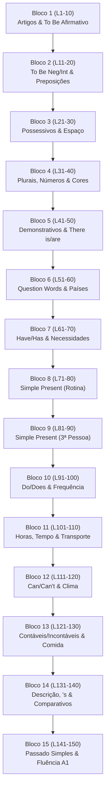

# Roteiro A1 — Lições i+1, ciclos e bancos de vocabulário

## 1. Especificação aprovada — fonte de verdade

| Tema | Regra e Diretriz |
| :--- | :--- |
| **Quantidade e organização** | O mapa-base começa com **15 blocos temáticos de cerca de 10 lições** (referência inicial: 150 lições), em geral com três ciclos de três lições e uma lição de fechamento. O número pode crescer quando a progressão i+1, a naturalidade ou a prática exigirem uma lição adicional; não se remove conteúdo útil apenas para preservar uma contagem. Cada bloco também tem uma **Lição 10x** auxiliar, que guarda 10 frases inéditas para o teste e não conta como lição de estudo nem altera a numeração. Os blocos agrupam assuntos; não são a unidade de revisão. |
| **Progressão i+1** | As frases partem de palavras e estruturas já ensinadas e acrescentam, em regra, uma unidade lexical ou estrutural nova por vez. Palavras novas podem aparecer em qualquer lição, inclusive na terceira, sempre em contexto de frase. |
| **Ciclo de três lições** | As duas primeiras lições ensinam um foco gramatical cada; a terceira não introduz nem explica gramática nova e fixa somente os dois focos das lições anteriores do mesmo ciclo. Ela pode introduzir vocabulário novo em frases. A fixação nunca revisa o bloco inteiro. |
| **Ordem de palavras e frases** | A sequência é flexível: uma ou duas palavras novas podem vir antes de uma frase que use **todas as unidades pendentes**. Assim que uma palavra isolada é apresentada, a próxima frase adequada deve implementá-la; não se deixa uma palavra para ser aplicada só várias posições depois. Uma palavra nova também pode estrear dentro de uma frase, desde que tenha o botão **“Ver palavra”**. Não se apresentam três cartões de palavras isoladas seguidos sem uma frase que as contextualize. |
| **Frases e naturalidade** | Todo conteúdo em frases deve ser curto, compreensível para o estágio do aluno e natural em situações reais. Falas de diálogo são unidades completas de frase, não palavras isoladas. |
| **Unidades lexicais compostas** | Compostos, expressões fixas e phrasal verbs são ensinados e contabilizados como uma unidade lexical, sem separar seus componentes para formar o significado. Exemplos: *bedroom* (uma palavra: quarto), *living room* (sala de estar), *good morning* (bom dia), *happy birthday* (feliz aniversário), *Merry Christmas* (Feliz Natal), *Happy New Year* (Feliz Ano Novo), *good afternoon* (boa tarde), *good evening* (boa noite ao chegar), *good night* (boa noite ao se despedir ou antes de dormir), *wake up* (acordar) e *get up* (levantar-se). Um componente também pode ser ensinado separadamente quando tiver significado próprio em outro contexto, mas isso não substitui o card da expressão inteira. |
| **Estatística do ciclo** | Ao concluir a terceira lição, mostrar **“Você aprendeu X palavras”**, contando os itens lexicais novos e distintos do ciclo, incluindo palavras introduzidas dentro de frases. Repetições não contam novamente. |
| **Estatística do bloco** | No fechamento de cada bloco, mostrar o total cumulativo de palavras e expressões conhecidas, sem duplicar itens já contabilizados, incluindo os aprendidos em bancos suplementares. |
| **Card de palavra a partir da frase** | Uma palavra ou expressão lexical nova apresentada numa frase tem um botão **“Ver palavra”** que abre seu card específico no banco de palavras. Esse card oferece **“Voltar à lição”** e retorna ao ponto da lição de origem; expressões compostas abrem como uma unidade inteira. |
| **Revisão opcional do dia** | Um botão **“Revise as frases”** oferece, opcionalmente, revisão das frases da lição atual. Inclui frases completas e falas de diálogo; não inclui palavras isoladas nem cards de gramática. |
| **Revisão obrigatória de dias anteriores** | Frases vencidas de lições anteriores são revisões obrigatórias e não incluem frases da lição atual, palavras isoladas ou cards de gramática. |
| **Limite ajustável de revisão** | O limite padrão de revisões obrigatórias é **20 frases por dia**. O aluno pode alterá-lo nas configurações e na tela de revisão. Se houver mais frases vencidas que o limite, a seleção é aleatória e ponderada: quanto mais antiga a frase, maior sua chance de entrar. O limite não se aplica à revisão opcional da lição atual. |
| **Cards de gramática** | São exibidos somente nas lições 1 e 2 de cada ciclo, depois das estatísticas; são exclusivamente para leitura e não entram em revisões de frases. |
| **Fechamento e teste do bloco** | A lição de fechamento não substitui nem altera a fixação do ciclo anterior. Depois do fechamento, o aluno faz o teste do bloco; a aprovação libera o próximo bloco. |
| **Bancos de vocabulário** | São lições suplementares, identificadas separadamente e sem frases de exemplo, com **5 a 20 palavras ou expressões** cada. Contam no vocabulário aprendido, têm cards próprios e podem ser retomadas em frases futuras. |
| **Filtro de sobrevivência e naturalidade** | Todas as frases devem passar pelo critério: *“Um nativo usaria essa frase em uma conversa ou situação cotidiana?”*. Frases artificiais e circulares são evitadas. |
| **Multiplicadores morfológicos** | A partir da introdução de cada regra (*plural +s*, *3ª pessoa -s/-es*, *passado regular -ed*), formas derivadas regulares são contabilizadas na métrica de vocabulário. |
| **Meta de vocabulário A1** | O aluno atinge **mais de 1.500 palavras e expressões** reconhecidas, ou o patamar real imediatamente inferior mais honesto, ao concluir o plano A1. O produto calcula o total real; a comunicação arredonda para baixo em blocos de 50 (ex.: 1.572 itens = “mais de 1.550 palavras e expressões”). Bancos suplementares, formas morfológicas e lições adicionais também entram na contagem. |
| **Teste de fechamento** | Cada tentativa usa 10 frases: 5 sorteadas das lições já estudadas e 5 sorteadas da Lição 10x do bloco. Cada frase pode ser usada nos quatro formatos, garantindo ao menos 5 frases elegíveis para cada formato no banco. Após a seleção, cada frase recebe um formato aleatório, com pelo menos 2 questões de cada formato; a ordem também é sorteada. É preciso acertar 8/10 para liberar o bloco seguinte. |

### Bancos de vocabulário — orientação de distribuição

Não há um banco obrigatório após cada ciclo ou bloco. A ordem deve acompanhar o contexto: apresentar algumas palavras em lições com frases, ampliar o mesmo tema em um banco suplementar e reutilizar o vocabulário em frases, diálogos ou histórias posteriores. Assim, o banco expande o repertório sem virar uma lição de frases nem interromper um ciclo.

| Grupo de palavras ou expressões | Momento pedagógico sugerido |
| :--- | :--- |
| Saudações e despedidas (*good morning, good afternoon, good evening, good night, hello, goodbye*) | No início, antes dos primeiros diálogos de apresentação. *Good evening* é uma saudação ao chegar; *good night* é usado ao se despedir ou antes de dormir. |
| Sala de aula e materiais escolares | Depois das primeiras frases sobre escola e localização; antes de contextos mais amplos de sala de aula. |
| Família e relações pessoais | Próximo das lições de pronomes e possessivos, antes de relatos sobre família. |
| Cômodos, mobília e objetos da casa | Depois de *in/on/under* e de exemplos iniciais do lar; antes de descrições mais completas da casa. |
| Cores e formas | Depois de algumas descrições com cores; antes de expandir para roupas, compras e descrições visuais. |
| Números | Dividir conforme o uso: 1–10 no começo; números de idade, datas, horas e preços quando esses contextos forem ensinados. Um banco pode cobrir 21–100 se selecionar no máximo 20 valores úteis, sem listar todas as combinações em sequência; 100–1000 pode vir quando houver contexto para quantidades ou preços. |
| Roupas e acessórios | Antes de diálogos de compras, depois de já haver contexto para cores e demonstrativos. |
| Países, nacionalidades e idiomas | Depois das primeiras perguntas sobre origem e antes de diálogos de viagem ou imigração. |
| Alimentos e bebidas | Próximo dos contextos de cafeteria, refeições e restaurante; separar em bancos menores por tipo, se necessário. |
| Animais e pets | Próximo dos contextos de família, casa, parque e preferências. |
| Profissões e locais de trabalho | Junto de apresentação pessoal e antes de diálogos sobre trabalho. |
| Lugares da cidade e serviços | Antes de contextos sobre bairro, direções, compras e viagem. |
| Transporte | Junto de deslocamentos, rotina e viagem. |
| Partes do corpo e saúde | Quando surgirem descrições físicas, sintomas ou necessidades básicas. |
| Dias, meses, estações e clima | Próximo de rotina, calendário, planos e atividades ao ar livre. |
| Esportes e hobbies | Junto de preferências, lazer e rotina. |

Esses grupos são candidatos, não uma lista que precise entrar toda de uma vez. A seleção e o momento de cada banco devem respeitar o vocabulário já conhecido e o que será usado nas lições seguintes.

---

## 2. Teste de fechamento de bloco

- **Lição 10x — banco de frases inéditas**: Cada bloco tem um banco auxiliar de 10 frases novas, por exemplo, L10x para o bloco 1, L20x para o bloco 2 e assim por diante. As frases usam somente vocabulário e gramática já ensinados; são novas pela combinação e organização das palavras. Cada frase é elegível para os quatro formatos, sem cópias separadas por modalidade. A Lição 10x não ensina conteúdo, não é exibida como uma lição regular e não entra na contagem das 150 lições.
- **Seleção das frases**: Em cada tentativa, sortear 5 frases entre as já estudadas até o fechamento daquele bloco e 5 das 10 frases guardadas na Lição 10x correspondente. Não repetir frase dentro da tentativa. As frases estudadas devem ser elegíveis para qualquer um dos quatro formatos, sem cópias separadas por modalidade.
- **Combinações do teste**: Depois de selecionar as 10 frases, sortear para cada questão um formato entre:
  1. **Listening + Writing**: o aluno ouve a frase em inglês e escreve em inglês o que ouviu.
  2. **Listening + Translation**: o aluno ouve a frase em inglês e escreve a tradução em português.
  3. **Reading + Speaking**: o aluno lê a frase em inglês e a diz em voz alta.
  4. **Reading + Translation**: o aluno lê a frase em inglês e escreve a tradução em português.
- **Distribuição e ordem**: Garantir ao menos 2 questões de cada formato. Sortear os 2 formatos das questões restantes aleatoriamente e, depois, embaralhar a ordem das 10 questões. Assim, cada tentativa cobre os quatro formatos sem fixar em quais posições aparecem.
- **Aprovação**: É necessário acertar pelo menos 8 de 10 questões (80%) para liberar o próximo bloco.
- **Nova tentativa**: Se não atingir 80%, refazer os sorteios de frases, formatos e ordem, sem dar prioridade às questões erradas ou às ainda não vistas. Uma frase ou formato pode voltar em outra tentativa.
- **Separação das lições**: O teste é diferente das lições de estudo e acontece no fechamento do bloco. Não apresenta explicações gramaticais nem vocabulário novo.
- **Validação de respostas**: Aceitar variantes válidas de tradução e escrita; a frase ditada deve ser comparada com a resposta em inglês, considerando as tolerâncias já definidas pelo sistema. No formato *Reading + Speaking*, avaliar a fala conforme o mecanismo de reconhecimento de voz/pronúncia adotado pelo aplicativo.

### Exemplo de sorteio — Bloco 2

Este é apenas um resultado possível: 5 frases já estudadas e 5 da Lição 20x, com os formatos e a ordem sorteados novamente em cada tentativa.

| Ordem | Origem | Formato sorteado | Frase |
| :---: | :---: | :--- | :--- |
| 1 | L11 | Listening + Writing | The lawyer is not busy. |
| 2 | L12 | Listening + Translation | The mother is with the teacher. |
| 3 | L12 | Reading + Translation | The sister is with the teacher. |
| 4 | L20x | Listening + Writing | Is the doctor in the quiet bedroom? |
| 5 | L20x | Reading + Speaking | Is the glass of milk for the patient? |
| 6 | L20x | Reading + Speaking | The bed is not under the window. |
| 7 | L16 | Listening + Translation | Is it a glass of milk? |
| 8 | L20x | Listening + Writing | The clean cup is for the teacher. |
| 9 | L12 | Reading + Translation | I am with my brother. |
| 10 | L20x | Reading + Speaking | The milk is not for the guest. |

---

## 3. Mapa Mestre da Sequência A1 — rascunho a reorganizar

> **Atenção:** as Lições 1–20, os bancos 10x/20x e o Banco B2.1 foram reorganizados conforme a especificação aprovada nas seções 1 e 2. As Lições 21–150 ainda são rascunhos e precisam ser reorganizadas antes de serem tratadas como sequência final ou base para implementação. Cada lição de fixação deve cobrir somente as duas lições de gramática do próprio ciclo.
>
> **Resultado da auditoria preliminar das Lições 21–150:** a checagem de sequência sinalizou 91 lições com pelo menos uma palavra nova que não aparece na frase seguinte. Além disso, 24 lições de fixação ainda contêm um card de gramática: 23, 26, 29, 33, 36, 39, 93, 96, 99, 103, 106, 109, 113, 116, 119, 123, 126, 129, 133, 136, 139, 143, 146 e 149. Esses pontos permanecem pendentes de reorganização; a checagem de vocabulário é uma triagem e deve considerar também formas flexionadas.

### Grade Geral dos Blocos

| Bloco | Lições | Tópicos Centrais | Tipo de Fechamento | Meta Vocab. Acumulada |
| :---: | :---: | :--- | :--- | :---: |
| **1** | 1 a 10 | Artigos (the, a, an com vogais), preposições básicas (in, on, under), To Be afirmativo completo | **Descrição 1** (A Escola e o Parque) | ~70 palavras |
| **2** | 11 a 20 | To Be negativo (not), preposições with/from/at/for/of/near, To Be interrogativo e cortesias | **Diálogo 1** (Check-in no Hotel) | ~140 palavras |
| **3** | 21 a 30 | Possessivos (my, your, his, her, its, our, their), família, love/loves, preposições 2 | **Relato 1** (Minha Família e Nossa Casa) | ~220 palavras |
| **4** | 31 a 40 | Plurais (+s, +es, -ies, irregulares), números (1-10), compras na feira, cores | **Descrição 2** (A Feira e a Praça Central) | ~350 palavras *(multiplicador +s)* |
| **5** | 41 a 50 | Demonstrativos (this, that, these, those), roupas, There is / There are (afirm., neg., interr.) | **Diálogo 2** (Na Loja e no Bairro) | ~450 palavras |
| **6** | 51 a 60 | Question Words (what, where, who, how, when, which), países, nacionalidades e profissões | **Diálogo 3 / Entrevista** (Imigração e Apresentação) | ~560 palavras |
| **7** | 61 a 70 | Verbo Have / Has, Need e Want, documentos de viagem, aeroporto e conveniência | **Relato 2** (No Aeroporto com a Bagagem) | ~670 palavras |
| **8** | 71 a 80 | Simple Present afirmativo (I, you, we, they), ações da manhã, alimentos e bebidas naturais | **Relato 3** (Minha Rotina Diária) | ~780 palavras |
| **9** | 81 a 90 | Simple Present (3ª pessoa: he, she, it: -s, -es, -ies, has, goes), dias da semana | **História 1** (A Rotina de Sarah) | ~900 palavras *(multiplicador 3ª p.)* |
| **10** | 91 a 100 | Negação e perguntas com Do e Does, respostas curtas, advérbios de frequência (always, never) | **Diálogo 4** (Entrevista sobre Hábitos e Esportes) | ~1.000 palavras |
| **11** | 101 a 110 | Horas e tempo (o'clock, half past), preposições de tempo (at, on, in), meios de transporte (by) | **Relato 4** (Meu Deslocamento e Itinerário) | ~1.100 palavras |
| **12** | 111 a 120 | Modal Can / Can't (habilidades e pedidos), clima e temperaturas, estações do ano | **Diálogo 5** (Planejando um Passeio ao Ar Livre) | ~1.200 palavras |
| **13** | 121 a 130 | Substantivos contáveis vs. incontáveis, how much / how many, quantificadores, restaurante | **Diálogo 6** (Jantar Completo no Restaurante) | ~1.300 palavras |
| **14** | 131 a 140 | Possessive 's, descrição de aparência e personalidade, comparativos básicos (-er than) | **História 2** (Comparações entre Amigos e Cidades) | ~1.400 palavras |
| **15** | 141 a 150 | Passado To Be (was/were), passado regular (-ed), marcadores temporais, fechamento A1 | **Grande História 3** (A Viagem dos Sonhos no A1) | **1.500+ palavras** |

---

# BLOCO 1 — Fundações: Identificação, Artigos e Verbo To Be Afirmativo
*Ciclos: (1, 2, fixação 3) · (4, 5, fixação 6) · (7, 8, fixação 9) · Fechamento: Lição 10 · Teste 1 após o fechamento.*

### Lição 1 — Artigo Definido "The" e Conjunção "And"
*Identificação com substantivos regulares e com vogal*
**Foco**: Artigo definido The (o, a, os, as) antes de consoante e vogal, e conjunção And.

1. `[Palavra]` **The** — O, a, os, as
2. `[Palavra]` **Apple** — Maçã
3. `[Frase]` **The apple.** — A maçã.
4. `[Palavra]` **Orange** — Laranja
5. `[Frase]` **The orange.** — A laranja.
6. `[Palavra]` **And** — E
7. `[Frase]` **The apple and the orange.** — A maçã e a laranja.
8. `[Palavra]` **Boy** — Menino, garoto
9. `[Frase]` **The boy.** — O menino.
10. `[Frase]` **The boy and the girl.** — O menino e a menina. `[Ver palavra: girl]`
11. `[Gramática]` **Gramática — Lição 1: O Artigo Definido "The" e a Conjunção "And"**
   > O artigo *The* serve tanto para o singular quanto para o plural, masculino e feminino (*o, a, os, as*). Antes de palavras iniciadas por som de vogal (*the apple*, *the orange*), sua pronúncia se torna sutilmente /ðiː/. A conjunção *And* une elementos na frase.
   > *Exemplos*:
   > - **The apple and the orange.**
   > - **The boy and the girl.**

### Lição 2 — Artigos Indefinidos "A" e "An"
*Diferenciação prática por som vocálico e consonantal*
**Foco**: Uso de A antes de som de consoante e An antes de som de vogal.

1. `[Palavra]` **A** — Um, uma (antes de som de consoante)
2. `[Palavra]` **Car** — Carro
3. `[Frase]` **A car.** — Um carro.
4. `[Palavra]` **An** — Um, uma (antes de som de vogal)
5. `[Palavra]` **Egg** — Ovo
6. `[Frase]` **An egg.** — Um ovo.
7. `[Palavra]` **House** — Casa
8. `[Frase]` **A house.** — Uma casa.
9. `[Palavra]` **Office** — Escritório
10. `[Frase]` **An office.** — Um escritório.
11. `[Frase]` **A house and an office.** — Uma casa e um escritório.
12. `[Gramática]` **Gramática — Lição 2: "A" vs "An"**
   > Usa-se *a* antes de sons consonantais (*a car, a house*) e *an* antes de sons vocálicos (*an egg, an office, an apple*). O critério é fonético: evita o choque entre duas vogais consecutivas.
   > *Exemplos*:
   > - **A car and an office.**
   > - **A house and an egg.**

### Lição 3 — Fixação: Artigos e Conjunção em uma Cafeteria
*Fixação de artigos e conjunção com novos itens de café da manhã*
**Foco**: Praticar *the*, *a*, *an* e *and*, conteúdos das Lições 1 e 2. Introduzir vocabulário novo em frases curtas de cafeteria, sem ensinar estruturas gramaticais novas.

1. `[Frase]` **The coffee.** — O café.
2. `[Frase]` **A coffee.** — Um café.
3. `[Frase]` **The tea.** — O chá.
4. `[Frase]` **A tea.** — Um chá.
5. `[Frase]` **An omelet.** — Um omelete.
6. `[Frase]` **The omelet.** — O omelete.
7. `[Frase]` **A sandwich.** — Um sanduíche.
8. `[Frase]` **The sandwich.** — O sanduíche.
9. `[Frase]` **A coffee and a sandwich.** — Um café e um sanduíche.
10. `[Frase]` **An omelet and a tea.** — Um omelete e um chá.

> **Fixação do ciclo:** todas as frases praticam artigos definidos/indefinidos e, nas duas últimas, a conjunção *and*. As palavras novas aparecem em contexto; não há cards de palavras isoladas nem card ou explicação de gramática nesta lição.

### Lição 4 — Verbo To Be: "I am" e "You are"
*Identidade e localização do falante e do interlocutor*
**Foco**: Formas singulares I am e You are (ser e estar).

1. `[Palavra]` **I** — Eu
2. `[Palavra]` **Am** — Sou, estou
3. `[Frase]` **I am a student.** — Eu sou estudante. `[Ver palavra: student]`
4. `[Palavra]` **You** — Você
5. `[Palavra]` **Are** — É, está
6. `[Frase]` **You are a friend.** — Você é um amigo. `[Ver palavra: friend]`
7. `[Frase]` **I am a friend.** — Eu sou um amigo.
8. `[Frase]` **You are a student.** — Você é estudante.
9. `[Frase]` **I am a student.** — Eu sou estudante.
10. `[Frase]` **You are a friend.** — Você é um amigo.
11. `[Gramática]` **Gramática — Lição 4: Verbo To Be no Singular (I e You)**
   > *I am* (contraído: *I'm*) e *you are* (contraído: *you're*) traduzem tanto "ser" quanto "estar" conforme o contexto da frase. Note que usamos artigo antes de profissões e papéis (*I am a student*).
   > *Exemplos*:
   > - **I am a student.**
   > - **You are a friend.**

### Lição 5 — Preposições de Lugar: "In", "On" e "Under"
*Localização do falante e do interlocutor com o verbo To Be já conhecido*
**Foco**: Preposições espaciais *in* (dentro), *on* (sobre/em cima) e *under* (embaixo), aplicadas com *I am* e *you are*.

1. `[Palavra]` **In** — Em, dentro de
2. `[Frase]` **I am in the house.** — Eu estou na casa.
3. `[Palavra]` **On** — Em, sobre, em cima de
4. `[Frase]` **You are on the bus.** — Você está no ônibus. `[Ver palavra: bus]`
5. `[Palavra]` **Under** — Embaixo de
6. `[Frase]` **I am under a tree.** — Eu estou debaixo de uma árvore. `[Ver palavra: tree]`
7. `[Frase]` **You are in the kitchen.** — Você está na cozinha. `[Ver palavra: kitchen]`
8. `[Frase]` **I am on the train.** — Eu estou no trem. `[Ver palavra: train]`
9. `[Frase]` **You are under a blanket.** — Você está debaixo de um cobertor. `[Ver palavra: blanket]`
10. `[Frase]` **I am in the garden.** — Eu estou no jardim. `[Ver palavra: garden]`
11. `[Gramática]` **Gramática — Lição 5: Preposições In, On e Under**
   > *In* expressa interior ou espaço fechado (*in the house*); *on* indica posição sobre uma superfície ou meio de transporte (*on the bus*); *under* indica posição inferior (*under a tree*).
   > *Exemplos*:
   > - **I am in the house.**
   > - **You are on the bus.**

### Lição 6 — Fixação: "I am", "You are" e Preposições de Lugar
*Vocabulário novo praticado com as estruturas das Lições 4 e 5*
**Foco**: Fixar somente *I am/you are* e *in/on/under*. Cada frase introduz, no máximo, uma unidade lexical nova por contexto.

1. `[Frase]` **I am in the bedroom.** — Eu estou no quarto. `[Ver palavra: bedroom]`
2. `[Frase]` **You are in the bathroom.** — Você está no banheiro. `[Ver palavra: bathroom]`
3. `[Frase]` **I am in the classroom.** — Eu estou na sala de aula. `[Ver palavra: classroom]`
4. `[Frase]` **You are on the floor.** — Você está no chão. `[Ver palavra: floor]`
5. `[Frase]` **I am under the table.** — Eu estou embaixo da mesa. `[Ver palavra: table]`
6. `[Frase]` **You are in the room.** — Você está no cômodo. `[Ver palavra: room]`
7. `[Frase]` **I am on the bus.** — Eu estou no ônibus.
8. `[Frase]` **You are under the tree.** — Você está debaixo da árvore.
9. `[Frase]` **I am in the garden.** — Eu estou no jardim.
10. `[Frase]` **You are on the train.** — Você está no trem.

> **Fixação do ciclo:** esta lição pratica apenas *I am/you are* e as preposições *in/on/under*, ensinadas nas Lições 4 e 5. Não inclui card ou explicação de gramática.

### Lição 7 — Verbo To Be: "He is", "She is" e "It is"
*Terceira pessoa do singular com pessoas, animais e objetos*
**Foco**: Concordância verbal com is e artigos diante de profissões iniciadas por vogal.

1. `[Palavra]` **He** — Ele
2. `[Palavra]` **Is** — É, está
3. `[Frase]` **He is a friend.** — Ele é um amigo.
4. `[Palavra]` **Doctor** — Médico, médica
5. `[Palavra]` **She** — Ela
6. `[Frase]` **She is a doctor.** — Ela é médica.
7. `[Palavra]` **It** — Ele, ela, isso (objetos e lugares)
8. `[Frase]` **It is an office.** — É um escritório.
9. `[Palavra]` **Actor** — Ator
10. `[Frase]` **He is an actor.** — Ele é ator.
11. `[Gramática]` **Gramática — Lição 7: To Be na 3ª Pessoa (He, She e It)**
   > *He, she, it* sempre usam a forma verbal *is* (contraídos: *he's, she's, it's*). Lembre-se de usar *an* antes de profissões e substantivos com som vocálico (*he is an actor*, *it is an office*).
   > *Exemplos*:
   > - **He is a doctor.**
   > - **He is an actor.**

### Lição 8 — Verbo To Be no Plural: "We" e "They"
*Pronomes no plural e ambientes comunitários*
**Foco**: Forma verbal *are* com os pronomes plurais *we* e *they*, usando a preposição *in* já ensinada.

1. `[Palavra]` **We** — Nós
2. `[Palavra]` **Park** — Parque
3. `[Frase]` **We are in the park.** — Nós estamos no parque.
4. `[Palavra]` **They** — Eles, elas
5. `[Palavra]` **Classroom** — Sala de aula
6. `[Frase]` **They are in the classroom.** — Eles estão na sala de aula.
7. `[Palavra]` **Library** — Biblioteca
8. `[Frase]` **We are in the library.** — Nós estamos na biblioteca.
9. `[Palavra]` **Museum** — Museu
10. `[Frase]` **They are in the museum.** — Eles estão no museu.
11. `[Gramática]` **Gramática — Lição 8: To Be no Plural (We e They)**
   > *We* e *they* usam a forma *are*. Nesta lição, *in* retoma a preposição de lugar já aprendida.
   > *Exemplos*:
   > - **We are in the park.**
   > - **They are in the museum.**

### Lição 9 — Fixação: "He is", "She is", "It is", "We are" e "They are"
*Vocabulário novo praticado com as formas ensinadas nas Lições 7 e 8*
**Foco**: Fixar somente os pronomes e as formas *is/are* das duas lições anteriores. As frases reutilizam estruturas conhecidas e acrescentam vocabulário de pessoas, animais e lugares.

1. `[Frase]` **He is a pilot.** — Ele é piloto.
2. `[Frase]` **She is a nurse.** — Ela é enfermeira.
3. `[Frase]` **It is an animal.** — É um animal.
4. `[Frase]` **He is in the museum.** — Ele está no museu.
5. `[Frase]` **She is in the classroom.** — Ela está na sala de aula.
6. `[Frase]` **It is on the desk.** — Está sobre a escrivaninha.
7. `[Frase]` **We are in the studio.** — Nós estamos no estúdio.
8. `[Frase]` **We are in the park.** — Nós estamos no parque.
9. `[Frase]` **They are in the station.** — Eles estão na estação.
10. `[Frase]` **They are in the library.** — Eles estão na biblioteca.

> **Fixação do ciclo:** esta lição pratica somente *he/she/it is* e *we/they are*, ensinados nas Lições 7 e 8. Não introduz verbos de ação, outras regras gramaticais, card ou explicação de gramática.

### Lição 10 — Descrição 1 (A Escola, o Escritório e o Parque)
*Texto de Fechamento do Bloco 1 reunindo os conceitos em narrativa*
**Foco**: Compreensão de texto em contexto comunicativo.

1. `[Frase]` **I am a student.** — Eu sou estudante.
2. `[Frase]` **I am in the classroom.** — Eu estou na sala de aula.
3. `[Frase]` **You are in the library.** — Você está na biblioteca.
4. `[Frase]` **He is a doctor.** — Ele é médico.
5. `[Frase]` **She is an actor.** — Ela é atriz.
6. `[Frase]` **It is an office.** — É um escritório.
7. `[Frase]` **We are in the park.** — Nós estamos no parque.
8. `[Frase]` **They are in the museum.** — Eles estão no museu.
9. `[Frase]` **The pilot is in the station.** — O piloto está na estação.
10. `[Frase]` **The nurse is in the bedroom.** — A enfermeira está no quarto.

### Lição 10x — Banco de Frases Inéditas do Teste do Bloco 1
*Banco auxiliar; não é uma lição de estudo e não apresenta vocabulário ou gramática novos.*

1. `[Frase inédita]` **The apple is on the table.** — A maçã está sobre a mesa.
2. `[Frase inédita]` **The orange is under the tree.** — A laranja está embaixo da árvore.
3. `[Frase inédita]` **I am in the garden.** — Eu estou no jardim.
4. `[Frase inédita]` **You are on the bus.** — Você está no ônibus.
5. `[Frase inédita]` **He is in the office.** — Ele está no escritório.
6. `[Frase inédita]` **She is in the classroom.** — Ela está na sala de aula.
7. `[Frase inédita]` **It is under the blanket.** — Está embaixo do cobertor.
8. `[Frase inédita]` **We are in the library.** — Nós estamos na biblioteca.
9. `[Frase inédita]` **They are in the park.** — Eles estão no parque.
10. `[Frase inédita]` **The doctor is in the bedroom.** — O médico está no quarto.

---

# BLOCO 2 — Verbo To Be (Negação/Interrogação), Preposições Fundamentais e Diálogos de Cortesia
*Ciclos: (11, 12, fixação 13) · (14, 15, fixação 16) · (17, 18, fixação 19) · Fechamento: Lição 20 · Teste 2 após o fechamento.*

### Lição 11 — Negação no Verbo To Be: "Not"
*Formas negativas diretas para profissões e estados*
**Foco**: Uso de not imediatamente após am, is, are.

1. `[Palavra]` **Not** — Não
2. `[Palavra]` **Sad** — Triste
3. `[Frase]` **I am not sad.** — Eu não estou triste.
4. `[Palavra]` **Teacher** — Professor, professora
5. `[Frase]` **He is not a teacher.** — Ele não é professor.
6. `[Palavra]` **Lawyer** — Advogado, advogada
7. `[Palavra]` **Busy** — Ocupado, ocupada
8. `[Frase]` **The lawyer is not busy.** — O advogado não está ocupado.
9. `[Palavra]` **Artist** — Artista
10. `[Frase]` **She is not an artist.** — Ela não é artista.
11. `[Gramática]` **Gramática — Lição 11: A Negação com "Not"**
   > Para negar com o verbo *to be*, acrescenta-se *not* logo após a forma verbal: *I am not*, *he is not*, *she is not*. O artigo *an* permanece antes de *artist* por causa do som inicial de vogal.
   > *Exemplos*:
   > - **I am not sad.**
   > - **She is not an artist.**

### Lição 12 — Preposições "With" e "From" com Pessoas da Família
*Companhia e origem de pessoas*
**Foco**: With (companhia) e from (origem).

1. `[Palavra]` **With** — Com
2. `[Frase]` **I am with my brother.** — Eu estou com meu irmão. `[Ver palavra: my, brother]`
3. `[Palavra]` **From** — De, vindo de
4. `[Frase]` **The doctor is from Brazil.** — O médico é do Brasil. `[Ver palavra: Brazil]`
5. `[Palavra]` **Father** — Pai
6. `[Frase]` **The father is with the teacher.** — O pai está com o professor.
7. `[Palavra]` **Mother** — Mãe
8. `[Frase]` **The mother is with the teacher.** — A mãe está com o professor.
9. `[Palavra]` **Sister** — Irmã
10. `[Frase]` **The sister is with the teacher.** — A irmã está com o professor.
11. `[Gramática]` **Gramática — Lição 12: Preposições With e From**
   > *With* indica companhia (*with my brother*); *from* indica origem ou procedência (*from Brazil*).
   > *Exemplos*:
   > - **I am with my brother.**
   > - **The doctor is from Brazil.**

### Lição 13 — Fixação do Ciclo: Negação com "Not" e Preposições "With"/"From"
*Vocabulário novo praticado com as estruturas das Lições 11 e 12*
**Foco**: Fixar somente *not*, *with* e *from*, sem introduzir ou explicar gramática nova.

1. `[Frase]` **I am not with the teacher.** — Eu não estou com o professor.
2. `[Frase]` **The doctor is not from Brazil.** — O médico não é do Brasil.
3. `[Frase]` **The father is not with the mother.** — O pai não está com a mãe.
4. `[Frase]` **The lawyer is not from Brazil.** — O advogado não é do Brasil.
5. `[Frase]` **The sister is with the teacher.** — A irmã está com o professor.
6. `[Frase]` **The lawyer is not busy.** — O advogado não está ocupado.
7. `[Frase]` **The neighbor is not with the teacher.** — O vizinho não está com o professor. `[Ver palavra: neighbor]`
8. `[Frase]` **The guest is from Brazil.** — O convidado é do Brasil. `[Ver palavra: guest]`
9. `[Frase]` **The patient is not with the doctor.** — O paciente não está com o médico. `[Ver palavra: patient]`
10. `[Frase]` **The visitor is from Brazil.** — O visitante é do Brasil. `[Ver palavra: visitor]`

> **Fixação do ciclo:** todas as frases praticam somente a negação com *not* e os usos de *with/from* ensinados nas Lições 11 e 12. Não há cards isolados de palavras nem card ou explicação de gramática.
>
> **Estatística do ciclo:** ao terminar esta lição, mostrar “Você aprendeu X palavras”, contando os itens lexicais novos e distintos das Lições 11–13.
>
> **Conteúdo adiado:** *at* e *near* não pertencem a esta fixação; devem ser alocados a uma futura lição de gramática.

### Lição 14 — Preposições "For" e "Of" com Alimentos e Bebidas
*Finalidade, destinação e conteúdo de recipientes*
**Foco**: For (destinação) e Of (conteúdo/pertencimento).

1. `[Palavra]` **For** — Para, por
2. `[Palavra]` **Tea** — Chá
3. `[Frase]` **Tea for the teacher, please.** — Chá para o professor, por favor.
4. `[Palavra]` **Of** — De, do, da
5. `[Palavra]` **Cup** — Xícara
6. `[Frase]` **A cup of tea, please.** — Uma xícara de chá, por favor.
7. `[Palavra]` **Milk** — Leite
8. `[Frase]` **A cup of milk, please.** — Uma xícara de leite, por favor.
9. `[Palavra]` **Glass** — Copo
10. `[Frase]` **A glass of milk, please.** — Um copo de leite, por favor.
11. `[Gramática]` **Gramática — Lição 14: Preposições For e Of**
   > *For* indica finalidade ou destinatário (*for the teacher*). *Of* conecta recipientes e seus conteúdos (*a cup of tea*, *a glass of milk*).
   > *Exemplos*:
   > - **A cup of coffee for the teacher.**
   > - **A glass of milk, please.**

### Lição 15 — Interrogação Simples no Verbo To Be
*Perguntas por inversão: "Are you...?" e "Is he...?"*
**Foco**: Inversão do verbo To Be para formar perguntas diretas.

1. `[Palavra]` **Question** — Pergunta
2. `[Frase]` **Is it a question?** — Isso é uma pergunta?
3. `[Palavra]` **Ready** — Pronto, pronta
4. `[Frase]` **Are you ready?** — Você está pronto?
5. `[Palavra]` **Hungry** — Com fome
6. `[Frase]` **Are you hungry?** — Você está com fome?
7. `[Palavra]` **Thirsty** — Com sede
8. `[Frase]` **Are you thirsty?** — Você está com sede?
9. `[Palavra]` **Sure** — Certo, certa, com certeza
10. `[Frase]` **Are you sure?** — Você tem certeza?
11. `[Gramática]` **Gramática — Lição 15: Interrogação no Verbo To Be**
   > Para fazer perguntas com To Be, invertemos a ordem: o verbo vem antes do sujeito (*Are you...?*, *Is he...?*). Adjetivos de estado como *hungry* e *thirsty* não usam ter ("have"), mas sim o verbo To Be.
   > *Exemplos*:
   > - **Are you ready?**
   > - **Are you hungry?**

### Lição 16 — Fixação do Ciclo: "For"/"Of" e Perguntas com "To Be"
*Fixação exclusiva dos conteúdos das Lições 14 e 15*
**Foco**: Usar *for/of* em frases interrogativas e afirmativas com o verbo *To Be*, sem introduzir ou explicar gramática nova.

1. `[Frase]` **Are you ready for tea?** — Você está pronto para o chá?
2. `[Frase]` **Is the tea for the teacher?** — O chá é para o professor?
3. `[Frase]` **Is the milk for the doctor?** — O leite é para o médico?
4. `[Frase]` **Is it a cup of tea?** — É uma xícara de chá?
5. `[Frase]` **Is it a glass of milk?** — É um copo de leite?
6. `[Frase]` **Are they ready for a cup of tea?** — Eles estão prontos para uma xícara de chá?
7. `[Frase]` **Is the coffee for the teacher?** — O café é para o professor?
8. `[Frase]` **Is it a cup of coffee?** — É uma xícara de café?
9. `[Frase]` **Are you thirsty?** — Você está com sede?
10. `[Frase]` **Is the coffee for the doctor?** — O café é para o médico?

> **Fixação do ciclo:** todas as frases praticam *for/of* e perguntas/afirmações com *To Be*, conteúdos ensinados nas Lições 14 e 15. Não há card ou explicação de gramática nova.
>
> **Estatística do ciclo:** ao terminar esta lição, mostrar “Você aprendeu X palavras”, contando os itens lexicais novos e distintos das Lições 14–16.

### Lição 17 — Mobília e Cômodos Residenciais
*Identificação de elementos do quarto e sala*
**Foco**: Preposições em mobílias do lar.

1. `[Palavra]` **Bedroom** — Quarto
2. `[Palavra]` **Bed** — Cama
3. `[Frase]` **The bed is in the bedroom.** — A cama está no quarto.
4. `[Palavra]` **Chair** — Cadeira
5. `[Palavra]` **Window** — Janela
6. `[Frase]` **The chair is under the window.** — A cadeira está embaixo da janela.
7. `[Palavra]` **Door** — Porta
8. `[Palavra]` **Apartment** — Apartamento
9. `[Frase]` **The door is in the apartment.** — A porta está no apartamento.
10. `[Frase]` **We are in the apartment.** — Nós estamos no apartamento.
11. `[Gramática]` **Gramática — Lição 17: Localização em Ambientes do Lar**
   > Uso de *in the bedroom* (no quarto), *under the window* (embaixo da janela) e *in the apartment*.
   > *Exemplos*:
   > - **The bed is in the bedroom.**
   > - **We are in the apartment.**

> **Nota lexical:** *bedroom* é aprendido como uma unidade com o significado “quarto”; não se ensina separando *bed* + *room*. O card *bed* significa “cama” como objeto independente.

### Lição 18 — Adjetivos Descritivos de Objetos e Espaços
*Qualidades essenciais de ambientes e pertences*
**Foco**: Posição e concordância dos adjetivos qualificadores.

1. `[Palavra]` **Clean** — Limpo, limpa
2. `[Palavra]` **Quiet** — Silencioso, calmo
3. `[Frase]` **The bedroom is clean and quiet.** — O quarto é limpo e silencioso.
4. `[Palavra]` **Small** — Pequeno, pequena
5. `[Palavra]` **Beautiful** — Bonito, bonita
6. `[Frase]` **The small bedroom is beautiful.** — O quarto pequeno é bonito.
7. `[Palavra]` **Old** — Velho, velha; antigo, antiga
8. `[Frase]` **The old apartment is small.** — O apartamento antigo é pequeno.
9. `[Palavra]` **New** — Novo, nova
10. `[Frase]` **The new bedroom is clean.** — O quarto novo é limpo.
11. `[Gramática]` **Gramática — Lição 18: Adjetivos Descritivos**
   > Adjetivos em inglês não têm plural nem gênero: *clean*, *quiet*, *beautiful*. Podem vir antes do substantivo (*a new car*) ou após o verbo To Be (*the room is clean*).
   > *Exemplos*:
   > - **The old house is beautiful.**
   > - **It is a new car.**

### Lição 19 — Fixação do Ciclo: Localização e Adjetivos
*Fixação exclusiva dos conteúdos das Lições 17 e 18*
**Foco**: Combinar localização em ambientes com adjetivos descritivos, sem introduzir ou explicar gramática nova.

1. `[Frase]` **The clean bedroom is in the apartment.** — O quarto limpo fica no apartamento.
2. `[Frase]` **The bed is in the bedroom.** — A cama está no quarto.
3. `[Frase]` **The small chair is under the window.** — A cadeira pequena está embaixo da janela.
4. `[Frase]` **The old door is in the apartment.** — A porta antiga está no apartamento.
5. `[Frase]` **The bedroom is quiet.** — O quarto é silencioso.
6. `[Frase]` **The new bed is in the bedroom.** — A cama nova está no quarto.
7. `[Frase]` **The apartment is clean and quiet.** — O apartamento é limpo e silencioso.
8. `[Frase]` **The cat is on the bed.** — O gato está em cima da cama.
9. `[Frase]` **The small bedroom is in the apartment.** — O quarto pequeno fica no apartamento.
10. `[Frase]` **The window is in the old bedroom.** — A janela está no quarto antigo.

> **Fixação do ciclo:** todas as frases combinam somente as preposições de localização e os adjetivos ensinados nas Lições 17 e 18. Não há card ou explicação de gramática nova.
>
> **Estatística do ciclo:** ao terminar esta lição, mostrar “Você aprendeu X palavras”, contando os itens lexicais novos e distintos das Lições 17–19.

### Banco B2.1 — Cortesias para Recepção
*Banco suplementar: prepara o vocabulário de chegada e agradecimento para o diálogo da Lição 20. Não contém frases de exemplo.*

1. `[Palavra]` **Good morning** — Bom dia
2. `[Palavra]` **Hello** — Olá
3. `[Palavra]` **Hotel** — Hotel
4. `[Palavra]` **Welcome** — Bem-vindo(a)
5. `[Palavra]` **Yes** — Sim
6. `[Palavra]` **No** — Não
7. `[Palavra]` **Thank you** — Obrigado(a)
8. `[Palavra]` **You are welcome** — De nada

### Lição 20 — Diálogo 1 (Chegada ao Hotel)
*Texto de fechamento do Bloco 2 com somente gramática e vocabulário já disponibilizados.*
**Foco**: Diálogo completo integrando *To Be* interrogativo, negação, *from*, *in* e cortesias do Banco B2.1.

1. `[Diálogo]` **Good morning. Welcome.** — Bom dia. Bem-vindo(a).
2. `[Diálogo]` **Hello. I am from Brazil.** — Olá. Eu sou do Brasil.
3. `[Diálogo]` **Are you a doctor?** — Você é médico(a)?
4. `[Diálogo]` **No, I am not a doctor.** — Não, eu não sou médico(a).
5. `[Diálogo]` **Are you in the hotel?** — Você está no hotel?
6. `[Diálogo]` **Yes, I am in the hotel.** — Sim, eu estou no hotel.
7. `[Diálogo]` **The bedroom is quiet.** — O quarto é silencioso.
8. `[Diálogo]` **Thank you.** — Obrigado(a).
9. `[Diálogo]` **You are welcome.** — De nada.

### Lição 20x — Banco de Frases Inéditas do Teste do Bloco 2
*Banco auxiliar; não é uma lição de estudo e não apresenta vocabulário ou gramática novos.*

1. `[Frase inédita]` **The clean cup is for the teacher.** — A xícara limpa é para o professor.
2. `[Frase inédita]` **Is the tea in the cup?** — O chá está na xícara?
3. `[Frase inédita]` **The milk is not for the guest.** — O leite não é para o convidado.
4. `[Frase inédita]` **Is the doctor in the quiet bedroom?** — O médico está no quarto silencioso?
5. `[Frase inédita]` **The bed is not under the window.** — A cama não está embaixo da janela.
6. `[Frase inédita]` **Is the glass of milk for the patient?** — O copo de leite é para o paciente?
7. `[Frase inédita]` **The neighbor is with the teacher in the apartment.** — O vizinho está com o professor no apartamento.
8. `[Frase inédita]` **The quiet bedroom is not in the apartment.** — O quarto silencioso não fica no apartamento.
9. `[Frase inédita]` **Is the coffee for the visitor?** — O café é para o visitante?
10. `[Frase inédita]` **The visitor is not with the doctor.** — O visitante não está com o médico.

---

# BLOCO 3 — Família, Adjetivos Possessivos, Sentimentos e Espaço
*Ciclos: (21, 22, R23) · (24, 25, R26) · (27, 28, R29) · Fechamento: Relato 30 · Teste 3*

### Lição 21 — Adjetivos Possessivos: "My" e "Your"
*Expressando posse imediata e vínculos familiares diretos*
**Foco**: My (meu/minha) e Your (seu/sua).

1. `[Palavra]` **My** — Meu, minha, meus, minhas
2. `[Frase]` **My father is in the office.** — Meu pai está no escritório.
3. `[Palavra]` **Your** — Seu, sua, seus, suas
4. `[Palavra]` **Daughter** — Filha
5. `[Frase]` **Your daughter is a student.** — Sua filha é estudante.
6. `[Palavra]` **Son** — Filho
7. `[Frase]` **My son is a doctor.** — Meu filho é médico.
8. `[Palavra]` **Boss** — Chefe
9. `[Frase]` **Your boss is a lawyer.** — Seu chefe é advogado.
10. `[Gramática]` **Gramática — Lição 21: Possessivos My e Your**
   > *My* e *Your* não variam em gênero nem em número (*my son*, *my daughters*). Nunca se usa artigo antes de possessivo em inglês (*my car*, nunca *the my car*).
   > *Exemplos*:
   > - **My father is in the office.**
   > - **Your daughter is a student.**

### Lição 22 — Possessivos de 3ª Pessoa: "His", "Her" e "Its"
*Posse atribuída a ele, a ela e a animais/objetos*
**Foco**: Diferenciação clara entre his (dele) e her (dela).

1. `[Palavra]` **His** — Dele, seu (de ele)
2. `[Frase]` **His father is in the office.** — O pai dele está no escritório.
3. `[Palavra]` **Her** — Dela, sua (de ela)
4. `[Frase]` **Her mother is a teacher.** — A mãe dela é professora.
5. `[Palavra]` **Its** — Dele, dela (coisas e animais)
6. `[Frase]` **Its door is clean.** — A porta dele/dela está limpa.
7. `[Palavra]` **Husband** — Marido
8. `[Frase]` **Her husband is in the office.** — O marido dela está no escritório.
9. `[Palavra]` **Wife** — Esposa
10. `[Frase]` **His wife is in the bedroom.** — A esposa dele está no quarto.
11. `[Palavra]` **Baby** — Bebê
12. `[Frase]` **Her baby is in the bedroom.** — O bebê dela está no quarto.
13. `[Gramática]` **Gramática — Lição 22: His vs Her**
   > Em inglês, o possessivo concorda com o **possuidor**: se pertence a um homem, é *his*; se pertence a uma mulher, é *her*, independentemente do gênero do objeto possuído.
   > *Exemplos*:
   > - **His father is in the office.**
   > - **Her husband is in the office.**

### Lição 23 — Fixação: Possessivos Coletivos e Família
*Vínculos familiares com os possessivos já ensinados*
**Foco**: Fixar somente *my, your, his, her, its, our* e *their*, sem introduzir novo verbo ou explicação gramatical.

1. `[Palavra]` **Our** — Nosso, nossa, nossos, nossas
2. `[Frase]` **Our mother is a teacher.** — Nossa mãe é professora.
3. `[Palavra]` **Their** — Deles, delas, seus
4. `[Frase]` **Their father is a doctor.** — O pai deles é médico.
5. `[Palavra]` **Family** — Família
6. `[Frase]` **Our family is in Brazil.** — Nossa família está no Brasil.
7. `[Palavra]` **Parents** — Pais (pai e mãe)
8. `[Frase]` **My parents are in the apartment.** — Meus pais estão no apartamento.
9. `[Palavra]` **Kind** — Gentil, bondoso
10. `[Frase]` **Their parents are kind.** — Os pais deles são gentis.

> **Fixação do ciclo:** esta lição pratica exclusivamente os possessivos apresentados nas Lições 21 e 22. *Family*, *parents* e *kind* entram como vocabulário contextual, sem card ou explicação gramatical.

### Lição 24 — Ambientes da Cozinha e Sala
*Objetos utilitários e convivência doméstica*
**Foco**: Vocabulário do lar e preposições de cômodos.

1. `[Palavra]` **Kitchen** — Cozinha
2. `[Frase]` **My mother is in the kitchen.** — Minha mãe está na cozinha.
3. `[Palavra]` **Living room** — Sala de estar
4. `[Frase]` **My father is in the living room.** — Meu pai está na sala de estar.
5. `[Palavra]` **Garden** — Jardim
6. `[Frase]` **Our garden is beautiful.** — Nosso jardim é bonito.
7. `[Palavra]` **Plate** — Prato
8. `[Frase]` **The plate is on the table.** — O prato está na mesa.
9. `[Palavra]` **Fork** — Garfo
10. `[Frase]` **The fork is on the table.** — O garfo está na mesa.
11. `[Palavra]` **Spoon** — Colher
12. `[Frase]` **The spoon is on the table.** — A colher está na mesa.
13. `[Gramática]` **Gramática — Lição 24: Cômodos da Casa e Utensílios**
   > *In the kitchen*, *in the living room*, *in the garden*. Lembre-se de usar *on the table* para objetos sobre superfícies.
   > *Exemplos*:
   > - **My mother is in the kitchen.**
   > - **The plate is on the table.**

### Lição 25 — Alimentos do Café da Manhã
*Vocabulário matinal e sucos de frutas*
**Foco**: Substantivos de café da manhã e combinações naturais.

1. `[Palavra]` **Bread** — Pão
2. `[Palavra]` **Butter** — Manteiga
3. `[Frase]` **Bread and butter, please.** — Pão e manteiga, por favor.
4. `[Palavra]` **Cheese** — Queijo
5. `[Frase]` **Cheese, please.** — Queijo, por favor.
6. `[Palavra]` **Apple juice** — Suco de maçã
7. `[Frase]` **Apple juice, please.** — Suco de maçã, por favor.
8. `[Palavra]` **Fruit** — Fruta
9. `[Palavra]` **Fresh** — Fresco, fresca
10. `[Frase]` **The fruit is fresh.** — A fruta está fresca.
11. `[Gramática]` **Gramática — Lição 25: Alimentos do Café da Manhã**
   > Para bebidas compostas, a fruta funciona como especificador antes do líquido: *apple juice* (suco de maçã), *orange juice* (suco de laranja).
   > *Exemplos*:
   > - **Bread and butter, please.**
   > - **Apple juice, please.**

### Lição 26 — Fixação: Casa, Cozinha e Café da Manhã
*Fixação exclusiva dos contextos e das estruturas já usadas nas Lições 24 e 25.*
**Foco**: Retomar localização com *in/on* e o vocabulário do lar e do café da manhã, sem gramática nova.

1. `[Frase]` **The plate is on the table.** — O prato está na mesa.
2. `[Frase]` **The fork is on the table.** — O garfo está na mesa.
3. `[Frase]` **The spoon is on the table.** — A colher está na mesa.
4. `[Frase]` **The apple juice is on the table.** — O suco de maçã está na mesa.
5. `[Frase]` **My mother is in the kitchen.** — Minha mãe está na cozinha.
6. `[Frase]` **My father is in the living room.** — Meu pai está na sala de estar.
7. `[Frase]` **Our parents are in the garden.** — Nossos pais estão no jardim.
8. `[Frase]` **The fruit is fresh.** — A fruta está fresca.
9. `[Frase]` **Bread and butter are on the table.** — Pão e manteiga estão na mesa.
10. `[Frase]` **Our family is in the home.** — Nossa família está na casa.

> **Fixação do ciclo:** esta lição não introduz *between*, *behind* nem *in front of*; essas preposições serão ensinadas em um ciclo próprio posterior, com frases de aplicação imediata.

### Lição 27 — Conforto e Qualidade do Lar
*Adjetivos para descrever ambientes acolhedores*
**Foco**: Qualificadores de ambiente e intensidade com very.

1. `[Palavra]` **Comfortable** — Confortável
2. `[Frase]` **The bed is very comfortable.** — A cama é muito confortável.
3. `[Palavra]` **Warm** — Aconchegante, morno
4. `[Frase]` **The living room is warm.** — A sala de estar é aconchegante.
5. `[Palavra]` **Modern** — Moderno, moderna
6. `[Frase]` **Our apartment is modern.** — Nosso apartamento é moderno.
7. `[Palavra]` **Simple** — Simples
8. `[Frase]` **It is a simple house.** — É uma casa simples.
9. `[Palavra]` **Cozy** — Aconchegante, acolhedor
10. `[Frase]` **The bedroom is cozy.** — O quarto é acolhedor.
11. `[Gramática]` **Gramática — Lição 27: Intensificador "Very" com Adjetivos**
   > Usa-se *very* antes de adjetivos para intensificar a qualidade: *very comfortable*, *very clean*.
   > *Exemplos*:
   > - **The bed is very comfortable.**
   > - **Our apartment is modern and clean.**

### Lição 28 — Vizinhança e Comunidade
*Relações de bairro e proximidade urbana*
**Foco**: Vocabulário de vizinhança e adjetivos de segurança.

1. `[Palavra]` **Neighbor** — Vizinho, vizinha
2. `[Palavra]` **Friendly** — Amigável, simpático
3. `[Frase]` **My neighbor is friendly.** — Meu vizinho é amigável.
4. `[Palavra]` **Neighborhood** — Bairro, vizinhança
5. `[Palavra]` **Safe** — Seguro, protegida
6. `[Frase]` **Our neighborhood is safe.** — Nosso bairro é seguro.
7. `[Palavra]` **Near here** — Perto daqui
8. `[Frase]` **The hotel is near here.** — O hotel fica perto daqui.
9. `[Palavra]` **Far** — Longe, distante
10. `[Frase]` **The station is far.** — A estação é longe.
11. `[Gramática]` **Gramática — Lição 28: Vizinhança e Distâncias**
   > *Near here* (perto daqui) e *not far* (não longe) são expressões comunicativas práticas essenciais.
   > *Exemplos*:
   > - **Our neighborhood is very safe.**
   > - **My neighbor is friendly.**

### Lição 29 — Fixação: Família, Lar e Vizinhança
*Convivência familiar e lugares já conhecidos*
**Foco**: Fixar os adjetivos e contextos das Lições 27 e 28, sem estrutura gramatical nova.

1. `[Palavra]` **Together** — Juntos, juntas
2. `[Frase]` **We are together.** — Nós estamos juntos.
3. `[Palavra]` **Morning** — Manhã
4. `[Frase]` **Good morning.** — Bom dia.
5. `[Palavra]` **Breakfast** — Café da manhã
6. `[Frase]` **Breakfast is on the table.** — O café da manhã está na mesa.
7. `[Palavra]` **Every day** — Todo dia, diariamente
8. `[Frase]` **We are together every day.** — Nós estamos juntos todos os dias.
9. `[Palavra]` **Home** — Lar, em casa
10. `[Frase]` **We are in our home.** — Nós estamos em nossa casa.

> **Fixação do ciclo:** esta lição pratica apenas as descrições e relações de lugar das Lições 27 e 28. *Always* foi adiado para o ciclo do Simple Present, onde pode ser ensinado com sua posição correta na frase.

### Lição 30 — Relato 1 (Minha Família e Nossa Casa)
*Texto de Fechamento do Bloco 3 consolidando lar e família*
**Foco**: Texto narrativo descritivo em primeira pessoa.

1. `[Frase]` **Welcome.** — Bem-vindo(a).
2. `[Frase]` **Our family is in Brazil.** — Nossa família está no Brasil.
3. `[Frase]` **Our apartment is clean and cozy.** — Nosso apartamento é limpo e aconchegante.
4. `[Frase]` **My father is in the living room.** — Meu pai está na sala de estar.
5. `[Frase]` **My mother is in the kitchen.** — Minha mãe está na cozinha.
6. `[Frase]` **My son is in the bedroom.** — Meu filho está no quarto.
7. `[Frase]` **Breakfast is on the table.** — O café da manhã está na mesa.
8. `[Frase]` **Our garden is beautiful and safe.** — Nosso jardim é bonito e seguro.

---

# BLOCO 4 — Plural dos Substantivos (+s, +es, -ies, Irregulares), Números 1 a 10 e Cores
*Ciclos: (31, 32, R33) · (34, 35, R36) · (37, 38, R39) · Fechamento: Descrição 40 · Teste 4*

### Lição 31 — Plural Regular com "+s"
*Regra geral do plural para substantivos conhecidos*
**Foco**: Adição de -s no plural e concordância com are.

1. `[Palavra]` **Books** — Livros
2. `[Frase]` **The books are on the desk.** — Os livros estão na escrivaninha.
3. `[Palavra]` **Cars** — Carros
4. `[Frase]` **The cars are in the park.** — Os carros estão no parque.
5. `[Palavra]` **Houses** — Casas
6. `[Frase]` **The houses are in Brazil.** — As casas estão no Brasil.
7. `[Palavra]` **Tables** — Mesas
8. `[Frase]` **The tables are in the classroom.** — As mesas estão na sala de aula.
9. `[Palavra]` **Apples** — Maçãs
10. `[Frase]` **The apples are on the table.** — As maçãs estão sobre a mesa.
11. `[Palavra]` **Dogs** — Cachorros
12. `[Frase]` **The dogs are in the park.** — Os cachorros estão no parque.
13. `[Gramática]` **Gramática — Lição 31: A Regra Geral do Plural (+s)**
   > A maioria dos substantivos em inglês forma o plural simplesmente acrescentando **-s** ao final da palavra (*book -> books, car -> cars*). O verbo concorda no plural (*cars are*).
   > *Exemplos*:
   > - **Two cars are in the street.**
   > - **The books are on the desk.**

### Lição 32 — Números Cardinais de 1 a 6
*Quantificação com substantivos plurais*
**Foco**: Números cardinais de um a seis.

1. `[Palavra]` **One** — Um, uma
2. `[Frase]` **One apple is on the table.** — Uma maçã está sobre a mesa.
3. `[Palavra]` **Two** — Dois, duas
4. `[Frase]` **Two cars are in the park.** — Dois carros estão no parque.
5. `[Palavra]` **Three** — Três
6. `[Frase]` **Three books are on the table.** — Três livros estão na mesa.
7. `[Palavra]` **Four** — Quatro
8. `[Frase]` **Four dogs are in the park.** — Quatro cachorros estão no parque.
9. `[Palavra]` **Five** — Cinco
10. `[Frase]` **Five students are in the classroom.** — Cinco estudantes estão na sala de aula.
11. `[Palavra]` **Six** — Seis
12. `[Frase]` **Six tables are in the classroom.** — Seis mesas estão na sala de aula.
13. `[Gramática]` **Gramática — Lição 32: Números Cardinais (1 a 6)**
   > Números antecedem diretamente o substantivo no plural: *two brothers*, *three books*, *four apples*.
   > *Exemplos*:
   > - **I have two brothers.**
   > - **Three books are on the table.**

### Banco B4.1 — Números 7 a 10 e "Many"
*Banco suplementar que amplia a contagem após a Lição 32; os itens são aplicados na Lição 33.*

1. `[Palavra]` **Seven** — Sete
2. `[Palavra]` **Eight** — Oito
3. `[Palavra]` **Nine** — Nove
4. `[Palavra]` **Ten** — Dez
5. `[Palavra]` **Many** — Muitos, muitas

### Lição 33 — Fixação: Plurais Regulares e Números
*Fixação exclusiva das Lições 31 e 32, com aplicação do Banco B4.1.*
**Foco**: Usar plurais regulares e números em frases completas, sem nova explicação gramatical.

1. `[Frase]` **Seven apples are on the table.** — Sete maçãs estão sobre a mesa.
2. `[Frase]` **Eight books are in the classroom.** — Oito livros estão na sala de aula.
3. `[Frase]` **Nine cars are in the park.** — Nove carros estão no parque.
4. `[Frase]` **Ten dogs are in the garden.** — Dez cachorros estão no jardim.
5. `[Frase]` **Many students are in the classroom.** — Muitos estudantes estão na sala de aula.
6. `[Frase]` **One house is in Brazil.** — Uma casa está no Brasil.
7. `[Frase]` **Two tables are in the room.** — Duas mesas estão no cômodo.
8. `[Frase]` **Six apples are on the table.** — Seis maçãs estão sobre a mesa.

> **Fixação do ciclo:** não há card de gramática. A lição pratica somente plural regular e números; os números do Banco B4.1 entram como vocabulário contextual.

### Lição 34 — Plural com "+es" (Sibilantes)
*Terminações em -s, -ss, -sh, -ch, -x*
**Foco**: Regra morfológica do sufixo -es.

1. `[Palavra]` **Boxes** — Caixas
2. `[Frase]` **Two boxes are in the room.** — Duas caixas estão no cômodo.
3. `[Palavra]` **Glasses** — Copos, taças, óculos
4. `[Frase]` **Two glasses of milk, please.** — Dois copos de leite, por favor.
5. `[Palavra]` **Bushes** — Arbustos
6. `[Frase]` **The bushes are in the garden.** — Os arbustos estão no jardim.
7. `[Palavra]` **Watches** — Relógios de pulso
8. `[Frase]` **The watches are on the desk.** — Os relógios estão sobre a escrivaninha.
9. `[Palavra]` **Sandwiches** — Sanduíches
10. `[Frase]` **Two sandwiches, please.** — Dois sanduíches, por favor.
11. `[Palavra]` **Buses** — Ônibus (plural)
12. `[Frase]` **Two buses are in the park.** — Dois ônibus estão no parque.
13. `[Gramática]` **Gramática — Lição 34: Plural com "+es"**
   > Substantivos terminados em sons sibilantes (*-s, -ss, -sh, -ch, -x*) recebem **-es** para facilitar a pronúncia: *box -> boxes*, *bus -> buses*, *sandwich -> sandwiches*.
   > *Exemplos*:
   > - **Two boxes are in the room.**
   > - **Two sandwiches, please.**

### Lição 35 — Plural com "-ies" (Consoante + Y)
*Eliminação do Y e acréscimo de -ies*
**Foco**: Regra morfológica de consoante + y -> -ies.

1. `[Palavra]` **Cities** — Cidades
2. `[Frase]` **The cities are beautiful.** — As cidades são bonitas.
3. `[Palavra]` **Babies** — Bebês
4. `[Frase]` **The babies are in the bedroom.** — Os bebês estão no quarto.
5. `[Palavra]` **Parties** — Festas
6. `[Frase]` **The parties are in the park.** — As festas estão no parque.
7. `[Palavra]` **Families** — Famílias
8. `[Frase]` **The families are in the park.** — As famílias estão no parque.
9. `[Frase]` **Two cities are in Brazil.** — Duas cidades estão no Brasil.
10. `[Frase]` **Two families are in the garden.** — Duas famílias estão no jardim.
11. `[Gramática]` **Gramática — Lição 35: Plural com "-ies"**
   > Quando o substantivo termina em **consoante + y**, troca-se o *y* por **-ies** (*city -> cities*, *baby -> babies*, *family -> families*). Se for vogal + y, segue o plural normal com +s (*day -> days*).
   > *Exemplos*:
   > - **Two big cities in Brazil.**
   > - **The babies are happy.**

### Lição 36 — Fixação: Plurais com -es e -ies
*Fixação exclusiva das regras ensinadas nas Lições 34 e 35.*
**Foco**: Reutilizar os dois padrões de plural em frases completas, sem gramática nova.

1. `[Frase]` **Two boxes are in the room.** — Duas caixas estão no cômodo.
2. `[Frase]` **The glasses are on the table.** — Os copos estão sobre a mesa.
3. `[Frase]` **The bushes are in the garden.** — Os arbustos estão no jardim.
4. `[Frase]` **Two watches are on the desk.** — Dois relógios estão sobre a escrivaninha.
5. `[Frase]` **The sandwiches are on the table.** — Os sanduíches estão sobre a mesa.
6. `[Frase]` **The buses are in the park.** — Os ônibus estão no parque.
7. `[Frase]` **The cities are beautiful.** — As cidades são bonitas.
8. `[Frase]` **The babies are in the bedroom.** — Os bebês estão no quarto.
9. `[Frase]` **The parties are in the park.** — As festas estão no parque.
10. `[Frase]` **The families are in the garden.** — As famílias estão no jardim.

### Lição 37 — Plurais Irregulares Fundamentais
*Men, women, children e people*
**Foco**: Substantivos plurais irregulares sem adição de -s.

1. `[Palavra]` **Men** — Homens
2. `[Frase]` **The men are in the office.** — Os homens estão no escritório.
3. `[Palavra]` **Women** — Mulheres
4. `[Frase]` **The women are in the office.** — As mulheres estão no escritório.
5. `[Palavra]` **Children** — Crianças
6. `[Frase]` **The children are in the park.** — As crianças estão no parque.
7. `[Palavra]` **People** — Pessoas
8. `[Frase]` **The people are in the park.** — As pessoas estão no parque.
9. `[Frase]` **Many people are in Brazil.** — Muitas pessoas estão no Brasil.
10. `[Frase]` **Two children are in the garden.** — Duas crianças estão no jardim.
11. `[Gramática]` **Gramática — Lição 37: Plurais Irregulares**
   > Alguns substantivos não recebem -s no plural: *man -> men*, *woman -> women*, *child -> children*, *person -> people*. Todos concordam com verbos no plural.

### Lição 38 — Cores para Descrição
*Cores qualificando objetos conhecidos*
**Foco**: Adjetivos de cor invariáveis antes do substantivo ou após o verbo To Be.

1. `[Palavra]` **Red** — Vermelho, vermelha
2. `[Frase]` **The apple is red.** — A maçã é vermelha.
3. `[Palavra]` **Blue** — Azul
4. `[Frase]` **The car is blue.** — O carro é azul.
5. `[Palavra]` **Yellow** — Amarelo, amarela
6. `[Frase]` **The egg is yellow.** — O ovo é amarelo.
7. `[Palavra]` **Black** — Preto, preta
8. `[Frase]` **The dog is black.** — O cachorro é preto.
9. `[Palavra]` **White** — Branco, branca
10. `[Frase]` **The cup is white.** — A xícara é branca.
11. `[Palavra]` **Green** — Verde
12. `[Frase]` **The tree is green.** — A árvore é verde.
13. `[Palavra]` **Brown** — Marrom
14. `[Frase]` **The desk is brown.** — A escrivaninha é marrom.
15. `[Gramática]` **Gramática — Lição 38: Adjetivos de Cor**
   > Cores funcionam como adjetivos invariáveis e podem vir após *to be* ou antes do substantivo.
   > *Exemplos*:
   > - **The green tree is in the garden.**
   > - **The brown desk is in the classroom.**

### Lição 39 — Fixação: Plurais Irregulares e Cores
*Fixação exclusiva das Lições 37 e 38.*
**Foco**: Combinar os plurais irregulares e as cores já aprendidas, sem gramática nova.

1. `[Frase]` **The men are in the green park.** — Os homens estão no parque verde.
2. `[Frase]` **The women are in the blue classroom.** — As mulheres estão na sala de aula azul.
3. `[Frase]` **The children are in the garden.** — As crianças estão no jardim.
4. `[Frase]` **The people are in the park.** — As pessoas estão no parque.
5. `[Frase]` **The red apples are on the table.** — As maçãs vermelhas estão sobre a mesa.
6. `[Frase]` **The blue cars are in the park.** — Os carros azuis estão no parque.
7. `[Frase]` **The yellow eggs are on the table.** — Os ovos amarelos estão sobre a mesa.
8. `[Frase]` **The black dogs are in the garden.** — Os cachorros pretos estão no jardim.
9. `[Frase]` **The white cups are on the table.** — As xícaras brancas estão sobre a mesa.
10. `[Frase]` **The brown desks are in the classroom.** — As escrivaninhas marrons estão na sala de aula.

### Lição 40 — Descrição 2 (A Feira e a Praça Central)
*Texto de Fechamento do Bloco 4 reunindo cores, números e plurais*
**Foco**: Descrição narrativa consolidando os plurais e quantidades.

1. `[Frase]` **Many people are in the park.** — Muitas pessoas estão no parque.
2. `[Frase]` **The men and the women are in the garden.** — Os homens e as mulheres estão no jardim.
3. `[Frase]` **The children are in the green park.** — As crianças estão no parque verde.
4. `[Frase]` **The red apples are on the table.** — As maçãs vermelhas estão sobre a mesa.
5. `[Frase]` **The blue cars are in the park.** — Os carros azuis estão no parque.
6. `[Frase]` **The yellow eggs are on the table.** — Os ovos amarelos estão sobre a mesa.
7. `[Frase]` **The black dogs are in the garden.** — Os cachorros pretos estão no jardim.
8. `[Frase]` **The white cups are on the brown desks.** — As xícaras brancas estão sobre as escrivaninhas marrons.

### Lição 40x — Banco de Frases Inéditas do Teste do Bloco 4
*Banco auxiliar; usa somente conteúdo já apresentado no Bloco 4 e em blocos anteriores.*

1. `[Frase inédita]` **Two red apples are on the table.** — Duas maçãs vermelhas estão sobre a mesa.
2. `[Frase inédita]` **Three blue cars are in the park.** — Três carros azuis estão no parque.
3. `[Frase inédita]` **The women are in the green garden.** — As mulheres estão no jardim verde.
4. `[Frase inédita]` **The children are in the classroom.** — As crianças estão na sala de aula.
5. `[Frase inédita]` **Many books are on the brown desks.** — Muitos livros estão sobre as escrivaninhas marrons.
6. `[Frase inédita]` **The black dogs are under the tables.** — Os cachorros pretos estão embaixo das mesas.
7. `[Frase inédita]` **Two white cups are on the table.** — Duas xícaras brancas estão sobre a mesa.
8. `[Frase inédita]` **The buses are in the park.** — Os ônibus estão no parque.
9. `[Frase inédita]` **The cities are beautiful.** — As cidades são bonitas.
10. `[Frase inédita]` **Ten students are in the classroom.** — Dez estudantes estão na sala de aula.

---

# BLOCO 5 — Demonstrativos (This/That/These/Those), Vestuário e Existência (There is / There are)
*Ciclos: (41, 42, R43) · (44, 45, R46) · (47, 48, R49) · Fechamento: Diálogo 50 · Teste 5*

### Lição 41 — Demonstrativos no Singular: "This" e "That"
*Lição 41 do nível A1*
**Foco**: *This* indica proximidade no tempo ou espaço; *that* indi...

1. `[Palavra]` **This** — Este, esta, isto (próximo a quem fala)
2. `[Palavra]` **Shirt** — Camisa
3. `[Frase]` **This shirt is blue.** — Esta camisa é azul.
4. `[Palavra]` **That** — Aquele, aquela, aquilo (afastado de quem fala)
5. `[Palavra]` **Jacket** — Jaqueta, casaco
6. `[Frase]` **That jacket is red.** — Aquela jaqueta é vermelha.
7. `[Frase]` **This book is new.** — Este livro é novo.
8. `[Frase]` **That book is old.** — Aquele livro é velho.
9. `[Frase]` **This is a blue shirt.** — Isto é uma camisa azul.
10. `[Frase]` **That is a red jacket.** — Aquilo é uma jaqueta vermelha.
12. `[Gramática]` **Gramática — Lição 41**
   > *This* indica proximidade no tempo ou espaço; *that* indica distanciamento. Ambos concordam com nomes e verbos no singular.

### Lição 42 — Demonstrativos no Plural: "These" e "Those"
*Lição 42 do nível A1*
**Foco**: *These* é o plural de *this*; *those* é o plural de *that...

1. `[Palavra]` **These** — Estes, estas (próximos a quem fala)
2. `[Palavra]` **Pants** — Calça(s) (palavra sempre plural no inglês)
3. `[Frase]` **These pants are black.** — Estas calças são pretas.
4. `[Palavra]` **Those** — Aqueles, aquelas (afastados de quem fala)
5. `[Palavra]` **Shoes** — Sapatos (plural)
6. `[Frase]` **Those shoes are brown.** — Aqueles sapatos são marrons.
7. `[Frase]` **These books are on the table.** — Estes livros estão sobre a mesa.
8. `[Frase]` **Those shoes are under the bed.** — Aqueles sapatos estão embaixo da cama.
9. `[Frase]` **These are black pants.** — Estas são calças pretas.
10. `[Frase]` **Those are brown shoes.** — Aqueles são sapatos marrons.
11. `[Gramática]` **Gramática — Lição 42**
   > *These* é o plural de *this*; *those* é o plural de *that*. Concordam obrigatoriamente com o verbo *are* e substantivos no plural.

### Lição 43 — Revisão: Vestuário e Compras *(4 palavras novas)*
*Novas: **Dress** (Plural *dresses* com +es), **Coat** (substantivo com plural *coats*), **Cheap** (adjetivo de valor), **Expensive** (adjetivo de valor).*
**Foco**: Revisão: Vestuário e Compras *(4 palavras novas)*

1. `[Palavra]` **Dress** — Vestido (plural: dresses)
2. `[Frase]` **This red dress is beautiful.** — Este vestido vermelho é bonito.
3. `[Palavra]` **Coat** — Casaco comprido, sobretudo
4. `[Frase]` **That brown coat is new.** — Aquele casaco marrom é novo.
5. `[Palavra]` **Cheap** — Barato, barata
6. `[Frase]` **These black shoes are cheap.** — Estes sapatos pretos são baratos.
7. `[Palavra]` **Expensive** — Caro, cara
8. `[Frase]` **That jacket is very expensive.** — Aquela jaqueta é muito cara.
9. `[Frase]` **This dress is cheap.** — Este vestido é barato.
10. `[Frase]` **That coat is expensive.** — Aquele casaco é caro.
11. `[Frase]` **These pants are cheap.** — Estas calças são baratas.
12. `[Frase]` **Those shoes are expensive.** — Aqueles sapatos são caros.

> **Fixação do ciclo:** a lição pratica somente *this/that/these/those* das Lições 41 e 42. O vocabulário novo entra nas frases; não há explicação gramatical nova.

### Lição 44 — Existência Afirmativa no Singular: "There is"
*Lição 44 do nível A1*
**Foco**: *There is* (contraído: *There's*) expressa a existência d...

1. `[Palavra]` **There is** — Há, existe, tem (para singular)
2. `[Palavra]` **Supermarket** — Supermercado
3. `[Frase]` **There is a supermarket in the city.** — Há um supermercado na cidade.
4. `[Palavra]` **Pharmacy** — Farmácia (plural: pharmacies)
5. `[Frase]` **There is a pharmacy in the city.** — Há uma farmácia na cidade.
6. `[Frase]` **There is a doctor in the office.** — Há um médico no escritório.
7. `[Frase]` **There is a big bed in the room.** — Há uma cama grande no quarto.
8. `[Frase]` **There is a clean cup on the table.** — Há uma xícara limpa sobre a mesa.
9. `[Frase]` **There is an apple on the table.** — Há uma maçã sobre a mesa.
10. `[Gramática]` **Gramática — Lição 44**
   > *There is* (contraído: *There's*) expressa a existência de algo no singular. Não confunda com o verbo *have*, que indica posse.

### Lição 45 — Existência Afirmativa no Plural: "There are"
*Lição 45 do nível A1*
**Foco**: *There are* expressa existência no plural e não possui fo...

1. `[Palavra]` **There are** — Há, existem, têm (para plural)
2. `[Palavra]` **Restaurant (Plural: Restaurants)** — Restaurante, restaurantes
3. `[Frase]` **There are two restaurants in the city.** — Há dois restaurantes na cidade.
4. `[Frase]` **There are many green trees in the park.** — Há muitas árvores verdes no parque.
5. `[Frase]` **There are four chairs in the kitchen.** — Há quatro cadeiras na cozinha.
6. `[Frase]` **There are ten students in the school.** — Há dez estudantes na escola.
7. `[Frase]` **There are three buses in the park.** — Há três ônibus no parque.
8. `[Frase]` **There are many people in the city.** — Há muitas pessoas na cidade.
9. `[Gramática]` **Gramática — Lição 45**
   > *There are* expressa existência no plural e não possui forma contraída comum na escrita padrão.

### Lição 46 — Revisão: Pertences e Conveniência *(4 palavras novas)*
*Novas: **Hat** (substantivo com plural *hats*), **Umbrella** (substantivo com plural *umbrellas*), **Store** (substantivo com plural *stores*), **Nice** (adjetivo geral positivo).*
**Foco**: Revisão: Pertences e Conveniência *(4 palavras novas)*

1. `[Palavra]` **Hat** — Chapéu
2. `[Palavra]` **Nice** — Agradável, bom, simpático, legal
3. `[Frase]` **This black hat is nice.** — Este chapéu preto é legal.
4. `[Palavra]` **Umbrella** — Guarda-chuva
5. `[Frase]` **There is a red umbrella in the room.** — Há um guarda-chuva vermelho no cômodo.
6. `[Palavra]` **Store** — Loja
7. `[Frase]` **There is a store in the city.** — Há uma loja na cidade.
8. `[Frase]` **There are two brown hats in the store.** — Há dois chapéus marrons na loja.
9. `[Frase]` **There is an umbrella under the chair.** — Há um guarda-chuva embaixo da cadeira.
10. `[Frase]` **These shoes are nice and cheap.** — Estes sapatos são legais e baratos.

> **Fixação do ciclo:** a lição pratica somente *there is/there are* das Lições 44 e 45. O vocabulário novo é aplicado imediatamente, sem nova explicação gramatical.

### Lição 47 — Existência Negativa: "There isn't" e "There aren't"
*Lição 47 do nível A1*
**Foco**: A negação de existência é feita com *There is not* (*Ther...

1. `[Palavra]` **There isn't** — Não há, não existe (singular negativo)
2. `[Palavra]` **Problem (Plural: Problems)** — Problema, problemas
3. `[Frase]` **There isn't a problem here.** — Não há um problema aqui.
4. `[Palavra]` **There aren't** — Não há, não existem (plural negativo)
5. `[Frase]` **There aren't buses on this street.** — Não há ônibus nesta rua.
6. `[Frase]` **There isn't a hospital in this small city.** — Não tem um hospital nesta cidade pequena.
7. `[Frase]` **There aren't chairs in the room.** — Não há cadeiras na sala.
8. `[Frase]` **There isn't milk in the kitchen.** — Não há leite na cozinha.
9. `[Frase]` **There aren't students in the school today.** — Não há estudantes na escola hoje.
10. `[Gramática]` **Gramática — Lição 47**
   > A negação de existência é feita com *There is not* (*There isn't*) para o singular e *There are not* (*There aren't*) para o plural.

### Lição 48 — Existência Interrogativa: "Is there...?" e "Are there...?"
*Lição 48 do nível A1*
**Foco**: Para formular perguntas de existência, inverte-se o verbo...

1. `[Palavra]` **Any** — Algum, alguma, nenhuns (em perguntas e negativas plurais)
2. `[Palavra]` **Bus stop** — Ponto de ônibus
3. `[Frase]` **Is there a bus stop near here?** — Há um ponto de ônibus perto daqui?
4. `[Palavra]` **Station** — Estação
5. `[Frase]` **Is there a station in the city?** — Há uma estação na cidade?
6. `[Frase]` **Are there any pharmacies on this street?** — Há alguma farmácia nesta rua?
7. `[Frase]` **Is there a table near the window? Yes, there is.** — Há uma mesa perto da janela? Sim, há.
8. `[Frase]` **Are there any clean cups? No, there aren't.** — Há alguma xícara limpa? Não, não há.
9. `[Frase]` **Is there any coffee for the teacher? Yes, there is.** — Há algum café para o professor? Sim, há.
10. `[Gramática]` **Gramática — Lição 48**
   > Para formular perguntas de existência, inverte-se o verbo com a partícula *there*: *Is there a/an...?* (singular) e *Are there any...?* (plural).

### Lição 49 — Revisão: Serviços do Bairro *(4 palavras novas)*
*Novas: **Post office** (locução substantiva), **Near here** (locução adverbial), **Around** (preposição/advérbio), **Map** (substantivo).*
**Foco**: Revisão: Serviços do Bairro *(4 palavras novas)*

1. `[Palavra]` **Near here** — Perto daqui
2. `[Frase]` **Is there a bank near here?** — Há um banco perto daqui?
3. `[Palavra]` **Post office** — Correio, agência de correios
4. `[Frase]` **There is a post office next to the supermarket.** — Há um correio ao lado do supermercado.
5. `[Palavra]` **Map** — Mapa
6. `[Frase]` **There is a map on the table.** — Há um mapa sobre a mesa.
7. `[Palavra]` **Around** — Por perto, ao redor
8. `[Frase]` **Are there good restaurants around?** — Há bons restaurantes por perto?
9. `[Frase]` **Excuse me!** — Com licença!
10. `[Frase]` **Is there a pharmacy near here? Yes, there is.** — Há uma farmácia perto daqui? Sim, há.
11. `[Frase]` **There aren't any post offices around the park.** — Não há nenhum correio ao redor do parque.
12. `[Frase]` **Those nice stores are near the bus stop.** — Aquelas lojas legais ficam perto do ponto de ônibus.

### Lição 50 — Diálogo 2 (Na Loja e no Bairro: Compras e Informações)
*Lição 50 do nível A1*
**Foco**: Diálogo 2 (Na Loja e no Bairro: Compras e Informações)

---

# BLOCO 6 — Question Words (What, Where, Who, How, When, Which), Países e Apresentação Pessoal
*Ciclos: (51, 52, R53) · (54, 55, R56) · (57, 58, R59) · Fechamento: Diálogo/Entrevista 60 · Teste 6*

### Lição 51 — Question Words: "What" e "Where"
*Lição 51 do nível A1*
**Foco**: *What* questiona sobre objetos ou identidade; *Where* que...

1. `[Palavra]` **What** — O que, qual
2. `[Palavra]` **Where** — Onde
3. `[Frase]` **What is your name?** — Qual é o seu nome?
4. `[Frase]` **Where is the hospital?** — Onde fica o hospital?
5. `[Palavra]` **Country** — País (plural: countries)
6. `[Frase]` **What country is this?** — Que país é este?
7. `[Frase]` **Where is my bag?** — Onde está a minha bolsa?
8. `[Frase]` **What is in that box?** — O que está naquela caixa?
9. `[Frase]` **Where is the doctor? He is at the hospital.** — Onde está o médico? Ele está no hospital.
10. `[Frase]` **What is on the table?** — O que está sobre a mesa?
11. `[Gramática]` **Gramática — Lição 51**
   > *What* questiona sobre objetos ou identidade; *Where* questiona sobre localização. Em perguntas com o To Be, o verbo inverte imediatamente após a palavra interrogativa (*What is...*, *Where are...*).

### Lição 52 — Origens e Países 1: "Where are you from?"
*Lição 52 do nível A1*
**Foco**: Para perguntar a origem: *Where are you from?* $\rightarr...

1. `[Palavra]` **United States** — Estados Unidos
2. `[Palavra]` **American** — Americano, americana
3. `[Frase]` **I am from the United States.** — Eu sou dos Estados Unidos.
4. `[Frase]` **She is American.** — Ela é americana.
5. `[Palavra]` **England** — Inglaterra
6. `[Palavra]` **English** — Inglês, inglesa (nacionalidade)
7. `[Frase]` **He is from England.** — Ele é da Inglaterra.
8. `[Frase]` **They are English.** — Eles são ingleses.
9. `[Frase]` **Where are you from? I am from Brazil.** — De onde você é? Eu sou do Brasil.
10. `[Frase]` **Is he American or English?** — Ele é americano ou inglês?
11. `[Frase]` **We are from Brazil, and they are from England.** — Nós somos do Brasil, e eles são da Inglaterra.
12. `[Gramática]` **Gramática — Lição 52**
   > Para perguntar a origem: *Where are you from?* $\rightarrow$ resposta: *I am from + [país]*. Nacionalidades em inglês iniciam sempre com letra maiúscula (*American, English*).

### Lição 53 — Revisão: Identidade e Boas-Vindas *(4 palavras novas)*
*Novas: **Spain** (substantivo próprio), **Spanish** (adjetivo de nacionalidade), **Meet** (verbo de encontro), **Nice to meet you** (fórmula social).*
**Foco**: Revisão: Identidade e Boas-Vindas *(4 palavras novas)*

1. `[Palavra]` **Spain** — Espanha
2. `[Palavra]` **Spanish** — Espanhol, espanhola
3. `[Frase]` **She is from Spain.** — Ela é da Espanha.
4. `[Frase]` **He is Spanish.** — Ele é espanhol.
5. `[Palavra]` **Meet** — Conhecer, encontrar
6. `[Palavra]` **Nice to meet you** — Prazer em conhecer você
7. `[Frase]` **Hello! Nice to meet you.** — Olá! Prazer em conhecer você.
8. `[Frase]` **Where is she from? She is from Spain.** — De onde ela é? Ela é da Espanha.
9. `[Frase]` **He speaks Spanish and English.** — Ele fala espanhol e inglês.
10. `[Frase]` **What is his name? His name is Carlos.** — Qual é o nome dele? O nome dele é Carlos.
11. `[Frase]` **Nice to meet you, Carlos!** — Prazer em conhecer você, Carlos!
12. `[Frase]` **Are they from England? No, they are from Spain.** — Eles são da Inglaterra? Não, eles são da Espanha.

### Lição 54 — Question Words: "Who" e "How"
*Lição 54 do nível A1*
**Foco**: *Who* investiga identidade pessoal (*Who is he?*); *How* ...

1. `[Palavra]` **Who** — Quem
2. `[Palavra]` **How** — Como
3. `[Frase]` **Who is that man?** — Quem é aquele homem?
4. `[Frase]` **How are you?** — Como você está?
5. `[Frase]` **Who is she? She is my teacher.** — Quem é ela? Ela é minha professora.
6. `[Frase]` **How are you today? I am fine, thanks.** — Como você está hoje? Estou bem, obrigado.
7. `[Frase]` **Who are those people?** — Quem são aquelas pessoas?
8. `[Frase]` **They are my friends.** — Eles são meus amigos.
9. `[Frase]` **Who is at the door?** — Quem está na porta?
10. `[Frase]` **It is my brother.** — É meu irmão.
11. `[Gramática]` **Gramática — Lição 54**
   > *Who* investiga identidade pessoal (*Who is he?*); *How* pergunta sobre modo, qualidade ou condição (*How are you?*).

### Lição 55 — Profissões 1 (Com Artigos "A" e "An")
*Lição 55 do nível A1*
**Foco**: Em inglês, profissões no singular exigem **obrigatoriamen...

1. `[Palavra]` **Nurse** — Enfermeiro, enfermeira
2. `[Palavra]` **Driver** — Motorista
3. `[Frase]` **She is a nurse at the hospital.** — Ela é enfermeira no hospital.
4. `[Frase]` **He is a bus driver.** — Ele é motorista de ônibus.
5. `[Palavra]` **Engineer** — Engenheiro, engenheira
6. `[Palavra]` **Waiter** — Garçom
7. `[Frase]` **My brother is an engineer.** — Meu irmão é engenheiro.
8. `[Frase]` **That man is a waiter in the restaurant.** — Aquele homem é garçom no restaurante.
9. `[Frase]` **Who is the nurse? She is my sister.** — Quem é a enfermeira? Ela é minha irmã.
10. `[Frase]` **Is he a driver? Yes, he is.** — Ele é motorista? Sim, ele é.
11. `[Gramática]` **Gramática — Lição 55**
   > Em inglês, profissões no singular exigem **obrigatoriamente** o artigo indefinido *a* ou *an* (*a nurse*, *an engineer*), diferentemente do português ("ela é enfermeira").

### Lição 56 — Revisão: Profissões e Local de Trabalho *(4 palavras novas)*
*Novas: **Manager** (substantivo regular), **Job** (substantivo regular), **Great** (adjetivo geral), **Help** (verbo de cooperação com I/you/we/they).*
**Foco**: Revisão: Profissões e Local de Trabalho *(4 palavras novas)*

1. `[Palavra]` **Manager** — Gerente
2. `[Palavra]` **Job** — Emprego, trabalho (plural: jobs)
3. `[Frase]` **He is a store manager.** — Ele é gerente de loja.
4. `[Frase]` **This is a great job.** — Este é um ótimo trabalho.
5. `[Palavra]` **Great** — Ótimo, excelente
6. `[Palavra]` **Help** — Ajudar
7. `[Frase]` **The nurses help the doctors.** — As enfermeiras ajudam os médicos.
8. `[Frase]` **What is your job? I am an engineer.** — Qual é o seu trabalho? Eu sou engenheiro.
9. `[Frase]` **Who is the manager of the hotel?** — Quem é o gerente do hotel?
10. `[Frase]` **That woman is a great doctor.** — Aquela mulher é uma médica excelente.
11. `[Frase]` **Where is the waiter? He is in the kitchen.** — Onde está o garçom? Ele está na cozinha.
12. `[Frase]` **The drivers help the people.** — Os motoristas ajudam as pessoas.

### Lição 57 — Question Words: "When" e "Which"
*Lição 57 do nível A1*
**Foco**: *When* pergunta sobre tempo/data (*When is the meeting?*)...

1. `[Palavra]` **When** — Quando
2. `[Palavra]` **Party** — Festa (já revisada)
3. `[Frase]` **When is the party?** — Quando é a festa?
4. `[Frase]` **The party is today.** — A festa é hoje.
5. `[Palavra]` **Which** — Qual, quais (escolha entre opções delimitadas)
6. `[Palavra]` **Meeting** — Reunião (plural: meetings)
7. `[Frase]` **When is the meeting?** — Quando é a reunião?
8. `[Frase]` **The meeting is now.** — A reunião é agora.
9. `[Frase]` **Which car is new?** — Qual carro é novo?
10. `[Frase]` **This blue car is new.** — Este carro azul é novo.
11. `[Frase]` **Which bus is for the hospital?** — Qual ônibus é para o hospital?
12. `[Frase]` **The yellow bus is for the hospital.** — O ônibus amarelo é para o hospital.
13. `[Gramática]` **Gramática — Lição 57**
   > *When* pergunta sobre tempo/data (*When is the meeting?*); *Which* implica seleção entre um conjunto restrito de alternativas (*Which bus...?*).

### Lição 58 — Países 2: França e Japão
*Lição 58 do nível A1*
**Foco**: Padrões comuns de terminação de nacionalidades: *-an* (Am...

1. `[Palavra]` **France** — França
2. `[Palavra]` **French** — Francês, francesa
3. `[Frase]` **She is from France.** — Ela é da França.
4. `[Frase]` **She is French.** — Ela é francesa.
5. `[Palavra]` **Japan** — Japão
6. `[Palavra]` **Japanese** — Japonês, japonesa
7. `[Frase]` **He is from Japan.** — Ele é do Japão.
8. `[Frase]` **He is Japanese.** — Ele é japonês.
9. `[Frase]` **Which engineer is from France?** — Qual engenheiro é da França?
10. `[Frase]` **That manager is Japanese.** — Aquele gerente é japonês.
11. `[Frase]` **Where is the meeting? It is in France.** — Onde é a reunião? É na França.
12. `[Gramática]` **Gramática — Lição 58**
   > Padrões comuns de terminação de nacionalidades: *-an* (American), *-ish* (English, Spanish), *-ch* (French), *-ese* (Japanese).

### Lição 59 — Revisão: Formulário e Dados Pessoais *(4 palavras novas)*
*Novas: **Address** (substantivo), **Number** (substantivo), **Email** (substantivo), **Form** (substantivo).*
**Foco**: Revisão: Formulário e Dados Pessoais *(4 palavras novas)*

1. `[Palavra]` **Address** — Endereço
2. `[Palavra]` **Number** — Número
3. `[Frase]` **What is your address?** — Qual é o seu endereço?
4. `[Frase]` **What is your phone number?** — Qual é o seu número de telefone?
5. `[Palavra]` **Email** — E-mail
6. `[Palavra]` **Form** — Formulário, ficha
7. `[Frase]` **My email is on the form.** — Meu e-mail está no formulário.
8. `[Frase]` **There is a form on the table.** — Há um formulário sobre a mesa.
9. `[Frase]` **What is his job? He is a driver.** — Qual é o trabalho dele? Ele é motorista.
10. `[Frase]` **Where is she from? She is from France.** — De onde ela é? Ela é da França.
11. `[Frase]` **Who is the manager? That tall man.** — Quem é o gerente? Aquele homem alto.
12. `[Frase]` **Your address and your email are here.** — Seu endereço e seu e-mail estão aqui.

### Lição 60 — Diálogo 3 / Entrevista (Recepção de Imigração e Boas-Vindas)
*Lição 60 do nível A1*
**Foco**: Diálogo 3 / Entrevista (Recepção de Imigração e Boas-Vindas)

---

# BLOCO 7 — Posse (Have/Has), Necessidades e Desejos (Need/Want), Viagem e Conveniência
*Ciclos: (61, 62, R63) · (64, 65, R66) · (67, 68, R69) · Fechamento: Relato 70 · Teste 7*

### Lição 61 — O Verbo "Have" com I, You, We, They
*Lição 61 do nível A1*
**Foco**: O verbo *have* expressa posse real ou relação. Com os pro...

1. `[Palavra]` **Have** — Ter (com I, you, we, they)
2. `[Palavra]` **Passport** — Passaporte
3. `[Frase]` **I have a passport.** — Eu tenho um passaporte.
4. `[Palavra]` **Suitcase** — Mala de viagem
5. `[Frase]` **You have a big suitcase.** — Você tem uma mala grande.
6. `[Frase]` **We have two tickets.** — Nós temos duas passagens.
7. `[Frase]` **They have American passports.** — Eles têm passaportes americanos.
8. `[Frase]` **I have my bag and my phone.** — Eu tenho minha bolsa e meu celular.
9. `[Frase]` **We have our suitcases here.** — Nós temos nossas malas aqui.
10. `[Frase]` **They have a new car.** — Eles têm um carro novo.
11. `[Gramática]` **Gramática — Lição 61**
   > O verbo *have* expressa posse real ou relação. Com os pronomes *I, you, we, they*, utiliza-se a forma base *have*.

### Lição 62 — O Verbo "Has" com He, She, It
*Lição 62 do nível A1*
**Foco**: *Have* é um verbo irregular. Na 3ª pessoa do singular (*h...

1. `[Palavra]` **Has** — Tem (forma da 3ª pessoa do singular: he, she, it)
2. `[Palavra]` **Backpack** — Mochila
3. `[Frase]` **He has a black backpack.** — Ele tem uma mochila preta.
4. `[Palavra]` **Wallet** — Carteira
5. `[Frase]` **She has a brown wallet.** — Ela tem uma carteira marrom.
6. `[Frase]` **My brother has a new job.** — Meu irmão tem um novo emprego.
7. `[Frase]` **The teacher has two books.** — O professor tem dois livros.
8. `[Frase]` **The hotel has a restaurant.** — O hotel tem um restaurante.
9. `[Frase]` **Julia has a red suitcase.** — Julia tem uma mala vermelha.
10. `[Frase]` **She has her passport and her ticket.** — Ela tem o passaporte dela e a passagem dela.
11. `[Gramática]` **Gramática — Lição 62**
   > *Have* é um verbo irregular. Na 3ª pessoa do singular (*he, she, it*), sua forma é **has** (*he has*, *she has*, *it has*).

### Lição 63 — Revisão: Documentos e Pagamento *(4 palavras novas)*
*Novas: **Credit card** (locução substantiva), **Cash** (substantivo incontável), **Important** (adjetivo), **Ready** (adjetivo).*
**Foco**: Revisão: Documentos e Pagamento *(4 palavras novas)*

1. `[Palavra]` **Credit card** — Cartão de crédito
2. `[Palavra]` **Cash** — Dinheiro em espécie, dinheiro vivo
3. `[Frase]` **I have a credit card and cash.** — Eu tenho um cartão de crédito e dinheiro vivo.
4. `[Palavra]` **Important** — Importante
5. `[Palavra]` **Ready** — Pronto, pronta
6. `[Frase]` **The passport is very important.** — O passaporte é muito importante.
7. `[Frase]` **My suitcase is ready.** — Minha mala está pronta.
8. `[Frase]` **We have cash for the bus.** — Nós temos dinheiro em espécie para o ônibus.
9. `[Frase]` **She has an important meeting today.** — Ela tem uma reunião importante hoje.
10. `[Frase]` **Are you ready? Yes, I am ready.** — Você está pronto? Sim, estou pronto.
11. `[Frase]` **He has his wallet and his credit card.** — Ele tem a carteira dele e o cartão de crédito dele.
12. `[Frase]` **The tickets are in the backpack.** — As passagens estão na mochila.

### Lição 64 — O Verbo "Need" (Precisar)
*Lição 64 do nível A1*
**Foco**: *Need* traduz "precisar de". Em inglês, o objeto liga-se ...

1. `[Palavra]` **Need** — Precisar de
2. `[Palavra]` **Medicine** — Remédio, medicamento
3. `[Frase]` **I need medicine, please.** — Eu preciso de remédio, por favor.
4. `[Palavra]` **Taxi** — Táxi
5. `[Frase]` **We need a taxi now.** — Nós precisamos de um táxi agora.
6. `[Frase]` **I need help, please.** — Eu preciso de ajuda, por favor.
7. `[Frase]` **You need a new passport.** — Você precisa de um passaporte novo.
8. `[Frase]` **We need water, please.** — Nós precisamos de água, por favor.
9. `[Frase]` **He needs a doctor.** — Ele precisa de um médico.
10. `[Frase]` **They need a big table.** — Eles precisam de uma mesa grande.
11. `[Gramática]` **Gramática — Lição 64**
   > *Need* traduz "precisar de". Em inglês, o objeto liga-se diretamente ao verbo, **sem preposição**: *I need help* (nunca *I need of help*).

### Lição 65 — O Verbo "Want" (Querer)
*Lição 65 do nível A1*
**Foco**: *Want* expressa desejo direto por algo (*I want a coffee*...

1. `[Palavra]` **Want** — Querer (com I, you, we, they)
2. `[Palavra]` **Juice** — Suco
3. `[Frase]` **I want cold juice, please.** — Eu quero suco gelado, por favor.
4. `[Palavra]` **Sandwich** — Sanduíche
5. `[Frase]` **I want a sandwich.** — Eu quero um sanduíche.
6. `[Frase]` **We want two coffees, please.** — Nós queremos dois cafés, por favor.
7. `[Frase]` **They want a table near the window.** — Eles querem uma mesa perto da janela.
8. `[Frase]` **She wants a cup of tea.** — Ela quer uma xícara de chá.
9. `[Frase]` **I am hungry, and I want a sandwich.** — Eu estou com fome, e eu quero um sanduíche.
10. `[Frase]` **He wants a glass of water.** — Ele quer um copo de água.
11. `[Gramática]` **Gramática — Lição 65**
   > *Want* expressa desejo direto por algo (*I want a coffee*). Na 3ª pessoa do singular, adiciona-se -s (*she wants*).

### Lição 66 — Revisão: No Aeroporto *(4 palavras novas)*
*Novas: **Airport** (substantivo), **Flight** (substantivo), **Luggage** (substantivo incontável), **Late** (adjetivo).*
**Foco**: Revisão: No Aeroporto *(4 palavras novas)*

1. `[Palavra]` **Airport** — Aeroporto
2. `[Palavra]` **Flight** — Voo
3. `[Frase]` **We are at the airport.** — Nós estamos no aeroporto.
4. `[Frase]` **Our flight is ready.** — Nosso voo está pronto.
5. `[Palavra]` **Luggage** — Bagagem
6. `[Palavra]` **Late** — Atrasado, atrasada, tarde
7. `[Frase]` **My luggage is here.** — Minha bagagem está aqui.
8. `[Frase]` **The flight is late today.** — O voo está atrasado hoje.
9. `[Frase]` **We need our luggage now.** — Nós precisamos da nossa bagagem agora.
10. `[Frase]` **I have my passport for the flight.** — Eu tenho meu passaporte para o voo.
11. `[Frase]` **The airport is very big and clean.** — O aeroporto é muito grande e limpo.
12. `[Frase]` **He is late for the meeting.** — Ele está atrasado para a reunião.

### Lição 67 — "Need to" e "Want to" + Verbo
*Lição 67 do nível A1*
**Foco**: Quando *need* e *want* antecedem uma ação verbal, utiliza...

1. `[Palavra]` **Go** — Ir
2. `[Palavra]` **Buy** — Comprar
3. `[Frase]` **I need to go now.** — Eu preciso ir agora.
4. `[Frase]` **I want to buy a ticket.** — Eu quero comprar uma passagem.
5. `[Palavra]` **Sleep** — Dormir
6. `[Palavra]` **Drink** — Beber
7. `[Frase]` **I am tired, and I want to sleep.** — Eu estou cansado, e eu quero dormir.
8. `[Frase]` **We want to drink cold water.** — Nós queremos beber água gelada.
9. `[Frase]` **We need to go to the airport.** — Nós precisamos ir para o aeroporto.
10. `[Frase]` **She wants to buy a new bag.** — Ela quer comprar uma bolsa nova.
11. `[Frase]` **I need to sleep.** — Eu preciso dormir.
12. `[Gramática]` **Gramática — Lição 67**
   > Quando *need* e *want* antecedem uma ação verbal, utiliza-se a partícula **to** para introduzir o verbo no infinitivo (*need to go*, *want to buy*, *want to drink*).

### Lição 68 — Dispositivos Pessoais e Tecnologia
*Lição 68 do nível A1*
**Foco**: Substantivos tecnológicos contáveis formam o plural regul...

1. `[Palavra]` **Computer** — Computador
2. `[Palavra]` **Tablet** — Tablet
3. `[Frase]` **I have a computer and a tablet.** — Eu tenho um computador e um tablet.
4. `[Palavra]` **Charger** — Carregador
5. `[Frase]` **I need a phone charger.** — Eu preciso de um carregador de celular.
6. `[Frase]` **My charger is in the backpack.** — Meu carregador está na mochila.
7. `[Frase]` **The computer is on the desk.** — O computador está sobre a escrivaninha.
8. `[Frase]` **She has a new tablet.** — Ela tem um tablet novo.
9. `[Frase]` **Where is my charger? It is in the suitcase.** — Onde está o meu carregador? Está na mala.
10. `[Frase]` **We have two computers in the office.** — Nós temos dois computadores no escritório.
11. `[Gramática]` **Gramática — Lição 68**
   > Substantivos tecnológicos contáveis formam o plural regular com -s (*computer $\rightarrow$ computers*, *charger $\rightarrow$ chargers*).

### Lição 69 — Revisão: Conveniência e Farmácia *(4 palavras novas)*
*Novas: **Bottle** (substantivo), **Pill** (substantivo), **Price** (substantivo), **Time** (substantivo).*
**Foco**: Revisão: Conveniência e Farmácia *(4 palavras novas)*

1. `[Palavra]` **Bottle** — Garrafa
2. `[Frase]` **A bottle of water, please.** — Uma garrafa de água, por favor.
3. `[Palavra]` **Pill** — Pílula, comprimido
4. `[Frase]` **I need two pills, please.** — Eu preciso de dois comprimidos, por favor.
5. `[Palavra]` **Price** — Preço
6. `[Palavra]` **Time** — Tempo, hora
7. `[Frase]` **What is the price of this bottle?** — Qual é o preço desta garrafa?
8. `[Frase]` **We have time for a coffee.** — Nós temos tempo para um café.
9. `[Frase]` **I want to buy a bottle of water.** — Eu quero comprar uma garrafa de água.
10. `[Frase]` **The price of the medicine is good.** — O preço do remédio é bom.
11. `[Frase]` **We have time before the flight.** — Nós temos tempo antes do voo.
12. `[Frase]` **She has a bottle of juice in her bag.** — Ela tem uma garrafa de suco na bolsa dela.

### Lição 70 — Relato 2 (No Aeroporto: Documentos e Bagagem)
*Lição 70 do nível A1*
**Foco**: Relato 2 (No Aeroporto: Documentos e Bagagem)

1. `[Frase]` **Today I am at the airport with my brother.** — Hoje eu estou no aeroporto com o meu irmão.
2. `[Frase]` **Our flight is to the United States.** — Nosso voo é para os Estados Unidos.
3. `[Frase]` **I have my passport and my ticket in my backpack.** — Eu tenho meu passaporte e minha passagem na minha mochila.
4. `[Frase]` **My brother has his credit card and cash in his wallet.** — Meu irmão tem o cartão de crédito e dinheiro vivo na carteira dele.
5. `[Frase]` **Our luggage is ready, and it is not late.** — Nossa bagagem está pronta, e não está atrasada.
6. `[Frase]` **We have time, and I want to drink a coffee.** — Nós temos tempo, e eu quero beber um café.
7. `[Frase]` **I buy a bottle of water and a sandwich.** — Eu compro uma garrafa de água e um sanduíche.
8. `[Frase]` **Now we need to go to the gate.** — Agora nós precisamos ir para o portão.
9. `[Frase]` **We are ready and very happy!** — Nós estamos prontos e muito felizes!

---

# BLOCO 8 — Simple Present Afirmativo (I, You, We, They), Rotina Diária e Hábitos
*Ciclos: (71, 72, R73) · (74, 75, R76) · (77, 78, R79) · Fechamento: Relato 80 · Teste 8*

### Lição 71 — Ações da Manhã: "Wake up" e "Get up"
*Lição 71 do nível A1*
**Foco**: No Simple Present com os pronomes da base (*I, you, we, t...

1. `[Palavra]` **Wake up** — Acordar
2. `[Palavra]` **Morning** — Manhã
3. `[Frase]` **I wake up in the morning.** — Eu acordo de manhã.
4. `[Palavra]` **Get up** — Levantar-se (da cama)
5. `[Frase]` **I get up in the morning.** — Eu me levanto de manhã.
6. `[Palavra]` **Breakfast** — Café da manhã (desjejum)
7. `[Frase]` **We eat breakfast in the kitchen.** — Nós tomamos café da manhã na cozinha.
8. `[Frase]` **I wake up and eat breakfast.** — Eu acordo e tomo café da manhã.
9. `[Frase]` **They get up in the morning.** — Eles se levantam de manhã.
10. `[Frase]` **We wake up and get up.** — Nós acordamos e nos levantamos.
11. `[Gramática]` **Gramática — Lição 71**
   > No Simple Present com os pronomes da base (*I, you, we, they*), os verbos permanecem em sua forma infinitiva sem *to* (*wake up*, *get up*, *eat*). A expressão temporal correspondente é *in the morning*.

### Lição 72 — Alimentos do Café da Manhã: Comer e Beber
*Lição 72 do nível A1*
**Foco**: *Bread* e *cheese* são substantivos incontáveis no inglês...

1. `[Palavra]` **Bread** — Pão (substantivo incontável)
2. `[Palavra]` **Butter** — Manteiga
3. `[Frase]` **I eat bread and butter.** — Eu como pão com manteiga.
4. `[Palavra]` **Cheese** — Queijo
5. `[Palavra]` **Egg (Plural: Eggs)** — Ovo, ovos
6. `[Frase]` **We eat bread and cheese.** — Nós comemos pão com queijo.
7. `[Frase]` **They eat two eggs in the morning.** — Eles comem dois ovos de manhã.
8. `[Frase]` **I drink coffee with milk.** — Eu bebo café com leite.
9. `[Frase]` **You eat bread, and you drink coffee.** — Você come pão e bebe café.
10. `[Frase]` **We eat eggs, bread and cheese for breakfast.** — Nós comemos ovos, pão e queijo no café da manhã.
11. `[Gramática]` **Gramática — Lição 72**
   > *Bread* e *cheese* são substantivos incontáveis no inglês padrão (utiliza-se *bread*, não *a bread*). Combinações cotidianas autênticas de alimentação matinal.

### Lição 73 — Revisão: Café da Manhã e Início do Dia *(4 palavras novas)*
*Novas: **Tea** (substantivo incontável), **Early** (advérbio), **Fruit** (substantivo), **Start** (verbo com I/you/we/they).*
**Foco**: Revisão: Café da Manhã e Início do Dia *(4 palavras novas)*

1. `[Palavra]` **Tea** — Chá
2. `[Palavra]` **Early** — Cedo
3. `[Frase]` **I wake up early in the morning.** — Eu acordo cedo de manhã.
4. `[Frase]` **We drink hot tea.** — Nós bebemos chá quente.
5. `[Palavra]` **Fruit** — Fruta (plural: fruits)
6. `[Palavra]` **Start** — Começar, iniciar
7. `[Frase]` **I eat fruit for breakfast.** — Eu como fruta no café da manhã.
8. `[Frase]` **We start the day early.** — Nós começamos o dia cedo.
9. `[Frase]` **You get up early and drink tea.** — Você se levanta cedo e bebe chá.
10. `[Frase]` **They eat bread, eggs and fruit.** — Eles comem pão, ovos e fruta.
11. `[Frase]` **I drink a cup of coffee and start my job.** — Eu bebo uma xícara de café e começo meu trabalho.
12. `[Frase]` **The morning is quiet in our house.** — A manhã é tranquila em nossa casa.

### Lição 74 — Atividades Diárias: Trabalhar e Estudar
*Lição 74 do nível A1*
**Foco**: Verbos nucleares de rotina: *work* e *study*. Emprego de ...

1. `[Palavra]` **Work** — Trabalhar (verbo)
2. `[Palavra]` **Study** — Estudar (verbo)
3. `[Frase]` **I work at the hospital.** — Eu trabalho no hospital.
4. `[Frase]` **We study English.** — Nós estudamos inglês.
5. `[Palavra]` **University** — Universidade, faculdade
6. `[Frase]` **They study at the university.** — Eles estudam na universidade.
7. `[Frase]` **You work in a big office.** — Você trabalha em um grande escritório.
8. `[Frase]` **I work in the morning.** — Eu trabalho de manhã.
9. `[Frase]` **I study at the university.** — Eu estudo na universidade.
10. `[Frase]` **The engineers work at the bank.** — Os engenheiros trabalham no banco.
11. `[Frase]` **We study and work in the city.** — Nós estudamos e trabalhamos na cidade.
12. `[Gramática]` **Gramática — Lição 74**
   > Verbos nucleares de rotina: *work* e *study*. Emprego de preposições adequadas: *at the hospital*, *at the university*, *in an office*.

### Lição 75 — Moradia e Convivência: Viver e Cozinhar
*Lição 75 do nível A1*
**Foco**: Estrutura *live in + lugar*; *cook dinner* (sem artigo an...

1. `[Palavra]` **Live** — Morar, viver
2. `[Palavra]` **Apartment** — Apartamento
3. `[Frase]` **I live in a small apartment.** — Eu moro em um apartamento pequeno.
4. `[Palavra]` **Cook** — Cozinhar
5. `[Palavra]` **Dinner** — Jantar (refeição noturna)
6. `[Frase]` **We cook dinner at home.** — Nós cozinhamos o jantar em casa.
7. `[Frase]` **They live in Brazil.** — Eles moram no Brasil.
8. `[Frase]` **You live near the park.** — Você mora perto do parque.
9. `[Frase]` **I cook dinner for my family.** — Eu cozinho o jantar para a minha família.
10. `[Frase]` **We live in a big city.** — Nós moramos em uma cidade grande.
11. `[Frase]` **We love our apartment.** — Nós amamos nosso apartamento.
12. `[Gramática]` **Gramática — Lição 75**
   > Estrutura *live in + lugar*; *cook dinner* (sem artigo antes dos nomes genéricos de refeições: *breakfast, lunch, dinner*).

### Lição 76 — Revisão: Almoço e Alimentos Salgados *(4 palavras novas)*
*Novas: **Lunch** (substantivo), **Rice** (substantivo incontável), **Meat** (substantivo incontável), **Salad** (substantivo).*
**Foco**: Revisão: Almoço e Alimentos Salgados *(4 palavras novas)*

1. `[Palavra]` **Lunch** — Almoço
2. `[Palavra]` **Rice** — Arroz
3. `[Frase]` **We eat rice and meat for lunch.** — Nós comemos arroz e carne no almoço.
4. `[Palavra]` **Meat** — Carne
5. `[Palavra]` **Salad** — Salada
6. `[Frase]` **I eat a fresh green salad.** — Eu como uma salada verde fresca.
7. `[Frase]` **They eat lunch at the restaurant.** — Eles almoçam no restaurante.
8. `[Frase]` **We cook rice, meat and salad for dinner.** — Nós cozinhamos arroz, carne e salada para o jantar.
9. `[Frase]` **I work in the morning and eat lunch at the office.** — Eu trabalho de manhã e almoço no escritório.
10. `[Frase]` **The lunch at the hotel is very good.** — O almoço no hotel é muito bom.
11. `[Frase]` **Rice, salad and water, please.** — Arroz, salada e água, por favor.
12. `[Frase]` **We eat lunch together.** — Nós almoçamos juntos.

### Lição 77 — Períodos do Dia: "Afternoon", "Evening" e "Night"
*Lição 77 do nível A1*
**Foco**: Preposições para as partes do dia: *in the morning*, *in ...

1. `[Palavra]` **Afternoon** — Tarde (in the afternoon = à tarde)
2. `[Palavra]` **Evening** — Noite (in the evening = à noite / entardecer)
3. `[Frase]` **I study in the afternoon.** — Eu estudo à tarde.
4. `[Frase]` **We eat dinner in the evening.** — Nós jantamos à noite.
5. `[Palavra]` **Night** — Noite (at night = à noite / hora de dormir)
6. `[Frase]` **I sleep at night.** — Eu durmo à noite.
7. `[Frase]` **They work in the afternoon.** — Eles trabalham à tarde.
8. `[Frase]` **In the evening, we are at home.** — À noite, nós estamos em casa.
9. `[Frase]` **The street is quiet at night.** — A rua é silenciosa à noite.
10. `[Frase]` **We study in the morning and work in the afternoon.** — Nós estudamos de manhã e trabalhamos à tarde.
11. `[Gramática]` **Gramática — Lição 77**
   > Preposições para as partes do dia: *in the morning*, *in the afternoon*, *in the evening*, mas com o uso obrigatório de **at night**.

### Lição 78 — Verbos de Lazer e Descanso: "Listen to" e "Read"
*Lição 78 do nível A1*
**Foco**: O verbo *listen* exige a preposição *to* antes do seu obj...

1. `[Palavra]` **Read** — Ler
2. `[Palavra]` **Listen to** — Ouvir, escutar (sempre com a partícula to)
3. `[Frase]` **I read a book in the evening.** — Eu leio um livro à noite.
4. `[Palavra]` **Music** — Música
5. `[Frase]` **We listen to music.** — Nós ouvimos música.
6. `[Frase]` **They listen to music in the car.** — Eles escutam música no carro.
7. `[Frase]` **You read English books.** — Você lê livros em inglês.
8. `[Frase]` **In the evening, I read and listen to music.** — À noite, eu leio e ouço música.
9. `[Frase]` **We sleep early at night.** — Nós dormimos cedo à noite.
10. `[Frase]` **I listen to music in my room.** — Eu escuto música no meu quarto.
11. `[Gramática]` **Gramática — Lição 78**
   > O verbo *listen* exige a preposição *to* antes do seu objeto sonoro: *listen to music* (nunca *listen music*).

### Lição 79 — Revisão: Hábitos Saudáveis e Convivência *(4 palavras novas)*
*Novas: **Walk** (verbo com I/you/we/they), **Together** (advérbio), **Relax** (verbo com I/you/we/they), **Every day** (locução adverbial).*
**Foco**: Revisão: Hábitos Saudáveis e Convivência *(4 palavras novas)*

1. `[Palavra]` **Walk** — Caminhar, andar
2. `[Palavra]` **Together** — Juntos, juntas
3. `[Frase]` **We walk in the park together.** — Nós caminhamos no parque juntos.
4. `[Palavra]` **Relax** — Relaxar
5. `[Palavra]` **Every day** — Todo dia, todos os dias
6. `[Frase]` **I walk every day in the morning.** — Eu caminho todos os dias de manhã.
7. `[Frase]` **In the evening, we relax on the sofa.** — À noite, nós relaxamos no sofá.
8. `[Frase]` **They eat fruit and salad every day.** — Eles comem fruta e salada todos os dias.
9. `[Frase]` **My brother and I study together.** — Meu irmão e eu estudamos juntos.
10. `[Frase]` **You walk to the office in the morning.** — Você caminha para o escritório de manhã.
11. `[Frase]` **We listen to music and relax.** — Nós escutamos música e relaxamos.
12. `[Frase]` **A quiet night at home to relax.** — Uma noite calma em casa para relaxar.

### Lição 80 — Relato 3 (A Minha Rotina Diária)
*Lição 80 do nível A1*
**Foco**: Relato 3 (A Minha Rotina Diária)

1. `[Frase]` **I wake up early in the morning, at home.** — Eu acordo cedo de manhã, em casa.
2. `[Frase]` **I get up and drink hot coffee with milk.** — Eu me levanto e bebo café quente com leite.
3. `[Frase]` **For breakfast, I eat bread, cheese and fruit.** — No café da manhã, eu como pão, queijo e fruta.
4. `[Frase]` **In the morning, I work at the office in the city.** — De manhã, eu trabalho no escritório na cidade.
5. `[Frase]` **In the afternoon, I eat lunch with my friends.** — À tarde, eu almoço com meus amigos.
6. `[Frase]` **We eat rice, meat and a green salad.** — Nós comemos arroz, carne e uma salada verde.
7. `[Frase]` **I study English at the university.** — Eu estudo inglês na universidade.
8. `[Frase]` **In the evening, I cook dinner for my family.** — À noite, eu cozinho o jantar para a minha família.
9. `[Frase]` **We eat dinner, listen to music and relax on the sofa.** — Nós jantamos, escutamos música e relaxamos no sofá.
10. `[Frase]` **At night, I read a book and sleep early.** — À noite, eu leio um livro e durmo cedo.

---

# BLOCO 9 — Simple Present na 3ª Pessoa (He, She, It: -s, -es, -ies, Irregulares), Dias da Semana
*Ciclos: (81, 82, R83) · (84, 85, R86) · (87, 88, R89) · Fechamento: História 90 · Teste 9*

### Lição 81 — A Regra Geral do "+s" na 3ª Pessoa (He, She, It)
*Lição 81 do nível A1*
**Foco**: Regra Geral da 3ª Pessoa do Singular: no Simple Present a...

1. `[Palavra]` **Speaks** — Fala (forma 3ª pessoa de *speak*)
2. `[Palavra]` **Works** — Trabalha (forma 3ª pessoa de *work*)
3. `[Frase]` **She speaks English.** — Ela fala inglês.
4. `[Frase]` **He works at the hospital.** — Ele trabalha no hospital.
5. `[Palavra]` **Lives** — Mora, vive (forma 3ª pessoa de *live*)
6. `[Palavra]` **Cooks** — Cozinha (forma 3ª pessoa de *cook*)
7. `[Frase]` **My sister lives in Brazil.** — Minha irmã mora no Brasil.
8. `[Frase]` **He cooks dinner for his family.** — Ele cozinha o jantar para a família dele.
9. `[Frase]` **Julia works at the office.** — Julia trabalha no escritório.
10. `[Frase]` **She reads a book in the evening.** — Ela lê um livro à noite.
11. `[Frase]` **The dog sleeps on the sofa.** — O cachorro dorme no sofá.
12. `[Gramática]` **Gramática — Lição 81**
   > Regra Geral da 3ª Pessoa do Singular: no Simple Present afirmativo com *he, she, it*, acrescenta-se **-s** à maioria dos verbos (*work $\rightarrow$ works*, *live $\rightarrow$ lives*, *speak $\rightarrow$ speaks*, *read $\rightarrow$ reads*, *sleep $\rightarrow$ sleeps*).

### Lição 82 — 3ª Pessoa com "+es" e os Verbos "Goes" e "Does"
*Lição 82 do nível A1*
**Foco**: Verbos terminados em som sibilante ou na vogal "o" (**-o,...

1. `[Palavra]` **Goes** — Vai (3ª pessoa de *go*)
2. `[Palavra]` **Watches** — Assiste a (3ª pessoa de *watch*)
3. `[Frase]` **She goes to the university.** — Ela vai para a universidade.
4. `[Frase]` **He watches videos on his computer.** — Ele assiste a vídeos no computador dele.
5. `[Palavra]` **Does** — Faz (3ª pessoa do verbo *do*)
6. `[Palavra]` **Washes** — Lava (3ª pessoa de *wash*)
7. `[Frase]` **She does her job very well.** — Ela faz o trabalho dela muito bem.
8. `[Frase]` **He washes the dishes in the kitchen.** — Ele lava a louça na cozinha.
9. `[Frase]` **My brother goes to school by bus.** — Meu irmão vai para a escola de ônibus.
10. `[Frase]` **She washes the salad for dinner.** — Ela lava a salada para o jantar.
11. `[Gramática]` **Gramática — Lição 82**
   > Verbos terminados em som sibilante ou na vogal "o" (**-o, -ch, -sh, -ss, -x, -z**) recebem **-es** na 3ª pessoa do singular (*go $\rightarrow$ goes*, *do $\rightarrow$ does*, *watch $\rightarrow$ watches*, *wash $\rightarrow$ washes*).

### Lição 83 — Revisão: Dias da Semana (Parte 1: Segunda a Quarta) *(4 palavras novas)*
*Novas: **Monday** (substantivo próprio), **Tuesday** (substantivo próprio), **Wednesday** (substantivo próprio), **Gym** (substantivo).*
**Foco**: Revisão: Dias da Semana (Parte 1: Segunda a Quarta) *(4 palavras novas)*

1. `[Palavra]` **Monday** — Segunda-feira
2. `[Palavra]` **Tuesday** — Terça-feira
3. `[Frase]` **She works on Monday.** — Ela trabalha na segunda-feira.
4. `[Frase]` **He goes to the office on Tuesday.** — Ele vai para o escritório na terça-feira.
5. `[Palavra]` **Wednesday** — Quarta-feira
6. `[Palavra]` **Gym** — Academia
7. `[Frase]` **I go to the gym on Wednesday.** — Eu vou para a academia na quarta-feira.
8. `[Frase]` **On Monday, she wakes up early.** — Na segunda-feira, ela acorda cedo.
9. `[Frase]` **My brother studies on Tuesday.** — Meu irmão estuda na terça-feira.
10. `[Frase]` **He works from Monday to Wednesday.** — Ele trabalha de segunda a quarta.
11. `[Frase]` **She goes to the gym in the evening.** — Ela vai para a academia à noite.
12. `[Frase]` **The doctor works at the hospital on Wednesday.** — O médico trabalha no hospital na quarta-feira.

### Lição 84 — 3ª Pessoa com "-ies" (Consoante + Y: "Studies")
*Lição 84 do nível A1*
**Foco**: Verbos terminados em **consoante + y** eliminam o *y* e r...

1. `[Palavra]` **Studies** — Estuda (3ª pessoa de *study*)
2. `[Palavra]` **Carries** — Carrega, leva (3ª pessoa de *carry*)
3. `[Frase]` **He studies English at the university.** — Ele estuda inglês na universidade.
4. `[Frase]` **She carries a big backpack.** — Ela carrega uma mochila grande.
5. `[Palavra]` **Tries** — Tenta (3ª pessoa de *try*)
6. `[Frase]` **He tries to study every day.** — Ele tenta estudar todos os dias.
7. `[Frase]` **She studies medicine at the university.** — Ela estuda medicina na universidade.
8. `[Frase]` **The boy carries his books to school.** — O menino carrega os livros dele para a escola.
9. `[Frase]` **Julia plays in the park.** — Julia brinca no parque.
10. `[Frase]` **She studies and plays on Tuesday.** — Ela estuda e brinca na terça-feira.
11. `[Gramática]` **Gramática — Lição 84**
   > Verbos terminados em **consoante + y** eliminam o *y* e recebem **-ies** na 3ª pessoa (*study $\rightarrow$ studies*, *carry $\rightarrow$ carries*, *try $\rightarrow$ tries*). Se for precedido de vogal (**vogal + y**), acrescenta-se apenas **-s** (*play $\rightarrow$ plays*).

### Lição 85 — Dias da Semana (Parte 2: Quinta a Domingo)
*Lição 85 do nível A1*
**Foco**: Os dias da semana em inglês são **sempre iniciados com le...

1. `[Palavra]` **Thursday** — Quinta-feira
2. `[Palavra]` **Friday** — Sexta-feira
3. `[Frase]` **We study on Thursday.** — Nós estudamos na quinta-feira.
4. `[Frase]` **I relax on Friday evening.** — Eu relaxo na sexta-feira à noite.
5. `[Palavra]` **Saturday** — Sábado
6. `[Palavra]` **Sunday** — Domingo
7. `[Frase]` **She goes to the park on Saturday.** — Ela vai ao parque no sábado.
8. `[Frase]` **He cooks for his family on Sunday.** — Ele cozinha para a família dele no domingo.
9. `[Frase]` **On Friday, we eat dinner at the restaurant.** — Na sexta-feira, nós jantamos no restaurante.
10. `[Frase]` **The supermarket is open on Saturday and Sunday.** — O supermercado está aberto no sábado e no domingo.
11. `[Gramática]` **Gramática — Lição 85**
   > Os dias da semana em inglês são **sempre iniciados com letra maiúscula** e utilizam a preposição **on** (*on Thursday*, *on Friday*).

### Lição 86 — Revisão: O Fim de Semana e Lazer *(4 palavras novas)*
*Novas: **Weekend** (substantivo), **Stay** (verbo com I/you/we/they), **Beach** (substantivo com plural *beaches*), **Rest** (verbo de descanso).*
**Foco**: Revisão: O Fim de Semana e Lazer *(4 palavras novas)*

1. `[Palavra]` **Weekend** — Fim de semana (on weekends = nos fins de semana)
2. `[Palavra]` **Stay** — Ficar, permanecer
3. `[Frase]` **On the weekend, I stay at home.** — No fim de semana, eu fico em casa.
4. `[Palavra]` **Beach** — Praia (plural: beaches)
5. `[Palavra]` **Rest** — Descansar
6. `[Frase]` **She goes to the beach on Saturday.** — Ela vai à praia no sábado.
7. `[Frase]` **We rest on Sunday.** — Nós descansamos no domingo.
8. `[Frase]` **He stays at the hotel on the weekend.** — Ele fica no hotel no fim de semana.
9. `[Frase]` **On weekends, they walk near the beach.** — Nos fins de semana, eles caminham perto da praia.
10. `[Frase]` **My sister stays with our mother on Friday.** — Minha irmã fica com a nossa mãe na sexta-feira.
11. `[Frase]` **She loves to rest and read on Sunday.** — Ela ama descansar e ler no domingo.
12. `[Frase]` **A quiet weekend to relax.** — Um fim de semana tranquilo para relaxar.

### Lição 87 — Expressões de Rotina e Frequência
*Lição 87 do nível A1*
**Foco**: Os advérbios de frequência (*always, never, sometimes*) p...

1. `[Palavra]` **Always** — Sempre
2. `[Palavra]` **Never** — Nunca
3. `[Frase]` **She always wakes up early.** — Ela sempre acorda cedo.
4. `[Frase]` **He never drinks coffee at night.** — Ele nunca bebe café à noite.
5. `[Palavra]` **Sometimes** — Às vezes
6. `[Frase]` **He sometimes walks to work.** — Ele às vezes caminha para o trabalho.
7. `[Frase]` **She always studies on Monday.** — Ela sempre estuda na segunda-feira.
8. `[Frase]` **They never eat meat on Friday.** — Eles nunca comem carne na sexta-feira.
9. `[Frase]` **Julia sometimes cooks dinner.** — Julia às vezes cozinha o jantar.
10. `[Frase]` **My brother always listens to music.** — Meu irmão sempre escuta música.
11. `[Gramática]` **Gramática — Lição 87**
   > Os advérbios de frequência (*always, never, sometimes*) posicionam-se comumente **antes do verbo principal** de ação no Simple Present (*she always wakes up*, *he never drinks*).

### Lição 88 — Atividades da Família e Rotina de Terceiros
*Lição 88 do nível A1*
**Foco**: Consolidação morfológica da 3ª pessoa do singular em verb...

1. `[Palavra]` **Cleans** — Limpa (3ª pessoa de *clean*)
2. `[Palavra]` **Visits** — Visita (3ª pessoa de *visit*)
3. `[Frase]` **He cleans the house on Saturday.** — Ele limpa a casa no sábado.
4. `[Frase]` **She visits her mother on Sunday.** — Ela visita a mãe dela no domingo.
5. `[Palavra]` **Drinks** — Bebe (3ª pessoa de *drink*)
6. `[Palavra]` **Eats** — Come (3ª pessoa de *eat*)
7. `[Frase]` **She drinks hot tea with milk.** — Ela bebe chá quente com leite.
8. `[Frase]` **He eats bread and cheese for breakfast.** — Ele come pão e queijo no café da manhã.
9. `[Frase]` **My father cleans his car on the weekend.** — Meu pai limpa o carro dele no fim de semana.
10. `[Frase]` **She visits her family from Thursday to Sunday.** — Ela visita a família dela de quinta a domingo.
11. `[Gramática]` **Gramática — Lição 88**
   > Consolidação morfológica da 3ª pessoa do singular em verbos do dia a dia: *cleans, visits, drinks, eats*.

### Lição 89 — Revisão: A Vida de Outras Pessoas *(4 palavras novas)*
*Novas: **Usually** (advérbio), **Busy** (adjetivo), **Often** (advérbio), **Life** (substantivo).*
**Foco**: Revisão: A Vida de Outras Pessoas *(4 palavras novas)*

1. `[Palavra]` **Usually** — Geralmente, habitualmente
2. `[Palavra]` **Busy** — Ocupado, ocupada
3. `[Frase]` **She is usually very busy.** — Ela geralmente é muito ocupada.
4. `[Palavra]` **Often** — Frequentemente, com frequência
5. `[Palavra]` **Life** — Vida
6. `[Frase]` **He often visits the city.** — Ele frequentemente visita a cidade.
7. `[Frase]` **She loves her life in Brazil.** — Ela ama a vida dela no Brasil.
8. `[Frase]` **The doctor is often busy at the hospital.** — O médico frequentemente está ocupado no hospital.
9. `[Frase]` **On Monday, my sister is very busy with her job.** — Na segunda-feira, minha irmã fica muito ocupada com o trabalho dela.
10. `[Frase]` **He usually walks in the park in the morning.** — Ele geralmente caminha no parque de manhã.
11. `[Frase]` **She often cooks rice and salad for dinner.** — Ela frequentemente cozinha arroz e salada para o jantar.
12. `[Frase]` **They usually stay at home on the weekend.** — Eles geralmente ficam em casa no fim de semana.

### Lição 90 — História 1 (A Vida e a Rotina de Sarah)
*Lição 90 do nível A1*
**Foco**: História 1 (A Vida e a Rotina de Sarah)

1. `[Frase]` **Sarah is a doctor, and she lives in a big city.** — Sarah é médica, e ela mora em uma grande cidade.
2. `[Frase]` **She is usually very busy with her job at the hospital.** — Ela geralmente é muito ocupada com o trabalho dela no hospital.
3. `[Frase]` **From Monday to Friday, Sarah wakes up early.** — De segunda a sexta, Sarah acorda cedo.
4. `[Frase]` **She drinks a cup of coffee and eats bread with cheese.** — Ela bebe uma xícara de café e come pão com queijo.
5. `[Frase]` **She goes to work by bus and starts her day.** — Ela vai para o trabalho de ônibus e começa o dia dela.
6. `[Frase]` **In the afternoon, she eats lunch at the hospital.** — À tarde, ela almoça no hospital.
7. `[Frase]` **In the evening, Sarah cooks dinner and relaxes on her sofa.** — À noite, Sarah cozinha o jantar e relaxa no sofá dela.
8. `[Frase]` **On the weekend, she stays with her family.** — No fim de semana, ela fica com a família dela.
9. `[Frase]` **On Saturday, she walks on the beach with her dog.** — No sábado, ela caminha na praia com o cachorro dela.
10. `[Frase]` **On Sunday, she visits her mother and reads a good book.** — No domingo, ela visita a mãe dela e lê um bom livro.
11. `[Frase]` **Sarah loves her life and her family.** — Sarah ama a vida dela e a família dela.

---

# BLOCO 10 — Simple Present Negativo e Interrogativo com Do/Does, Respostas Curtas e Frequência
*Ciclos: (91, 92, R93) · (94, 95, R96) · (97, 98, R99) · Fechamento: Diálogo 100 · Teste 10*

### Lição 91 — Negação no Simple Present com "Don't" *(4 palavras novas)*
*Novas: **Don't** (verbo auxiliar negativo), **Know** (verbo de conhecimento/cognição), **Understand** (verbo de compreensão), **But** (conjunção adversativa).*
**Foco**: Negação no Simple Present: em inglês, verbos comuns de aç...

1. `[Palavra]` **Don't** — Não (verbo auxiliar negativo para *I, you, we, they*)
2. `[Palavra]` **Know** — Saber, conhecer
3. `[Frase]` **I don't know.** — Eu não sei.
4. `[Frase]` **We don't know that doctor.** — Nós não conhecemos aquele médico.
5. `[Palavra]` **Understand** — Entender, compreender
6. `[Palavra]` **But** — Mas, porém
7. `[Frase]` **I don't understand.** — Eu não entendo.
8. `[Frase]` **I speak English, but I don't speak French.** — Eu falo inglês, mas não falo francês.
9. `[Frase]` **I know the teacher, but I don't understand his English.** — Eu conheço o professor, mas não entendo o inglês dele.
10. `[Frase]` **They live in Brazil, but they don't work in the city.** — Eles moram no Brasil, mas não trabalham na cidade.
11. `[Frase]` **You don't understand, but we have time.** — Você não compreende, mas nós temos tempo.
12. `[Gramática]` **Gramática — Lição 91**
   > Negação no Simple Present: em inglês, verbos comuns de ação não aceitam apenas a palavra *not* diretamente após si. Para os sujeitos **I, you, we, they**, inserimos o auxiliar negativo **don't** (contração de *do not*) antes do verbo principal (*I don't know*, *They don't understand*). A conjunção **but** introduz um contraste direto entre ideias (*I know, but I don't understand*).

### Lição 92 — Perguntas com "Do" e Respostas Curtas *(2 palavras novas)*
*Novas: **Do** (verbo auxiliar interrogativo com I/you/we/they), **Remember** (verbo de memória).*
**Foco**: Perguntas e Respostas Curtas (*Short Answers*): Para form...

1. `[Palavra]` **Do** — Verbo auxiliar para perguntas no presente (com *I, you, we, they*)
2. `[Palavra]` **Remember** — Lembrar, lembrar-se de, recordar
3. `[Frase]` **Do you remember my name?** — Você se lembra do meu nome? / Você lembra do meu nome?
4. `[Frase]` **Yes, I do.** — Sim, lembro. / Sim, eu me lembro.
5. `[Frase]` **No, I don't.** — Não, não lembro.
6. `[Frase]` **Do you speak English?** — Você fala inglês?
7. `[Frase]` **Yes, I do. I speak English.** — Sim, falo. Eu falo inglês.
8. `[Frase]` **Do they work at the hospital?** — Eles trabalham no hospital?
9. `[Frase]` **No, they don't.** — Não, não trabalham.
10. `[Frase]` **Do you live in this city?** — Vocês moram nesta cidade?
11. `[Frase]` **Yes, we do.** — Sim, moramos.
12. `[Gramática]` **Gramática — Lição 92**
   > Perguntas e Respostas Curtas (*Short Answers*): Para formular perguntas no presente com *you, they, we*, iniciamos a frase com **Do** (*Do you live here?*). Nas respostas de "Sim/Não", o padrão natural em inglês repete o auxiliar, e não o verbo principal: afirmação: **Yes, I do** / **Yes, we do**; negação: **No, I don't** / **No, they don't**.

### Lição 93 — Revisão: Hobbies e Esportes *(4 palavras novas)*
*Novas: **Soccer** (substantivo de esporte), **Tennis** (substantivo de esporte), **Guitar** (substantivo de instrumento musical), **Game** (substantivo de lazer/esporte).*
**Foco**: O verbo **play** possui duplo sentido fundamental: com es...

1. `[Palavra]` **Soccer** — Futebol
2. `[Palavra]` **Tennis** — Tênis (esporte)
3. `[Frase]` **Do you play soccer?** — Você joga futebol?
4. `[Frase]` **No, I don't. I play tennis.** — Não jogo. Eu jogo tênis.
5. `[Palavra]` **Guitar** — Violão, guitarra
6. `[Palavra]` **Game** — Jogo, partida
7. `[Frase]` **Do you play the guitar?** — Você toca violão?
8. `[Frase]` **Yes, I do. I love music.** — Sim, toco. Eu amo música.
9. `[Frase]` **They watch a soccer game on Sunday.** — Eles assistem a um jogo de futebol no domingo.
10. `[Frase]` **We don't play games in the morning.** — Nós não jogamos jogos de manhã.
11. `[Frase]` **I play the guitar, but I don't play tennis.** — Eu toco violão, mas não jogo tênis.
12. `[Gramática]` **Gramática — Lição 93**
   > O verbo **play** possui duplo sentido fundamental: com esportes e jogos significa *jogar* (*play soccer, play a game*); com instrumentos musicais significa *tocar*, exigindo o artigo definido *the* (*play the guitar*).

### Lição 94 — Negação na 3ª Pessoa com "Doesn't" *(2 palavras novas)*
*Novas: **Doesn't** (verbo auxiliar negativo de 3ª pessoa), **Drive** (verbo de locomoção).*
**Foco**: Regra de Ouro da Negação com 3ª Pessoa: para *he, she, it...

1. `[Palavra]` **Doesn't** — Não (verbo auxiliar negativo para *he, she, it*)
2. `[Palavra]` **Drive** — Dirigir, guiar
3. `[Frase]` **He doesn't drive.** — Ele não dirige.
4. `[Frase]` **She doesn't drive a car to work.** — Ela não dirige carro para o trabalho.
5. `[Frase]` **My brother doesn't work on Saturday.** — Meu irmão não trabalha no sábado.
6. `[Frase]` **She doesn't speak French.** — Ela não fala francês.
7. `[Frase]` **He doesn't live in this city.** — Ele não mora nesta cidade.
8. `[Frase]` **Julia doesn't eat meat.** — Julia não come carne.
9. `[Frase]` **The dog doesn't sleep in the house.** — O cachorro não dorme dentro de casa.
10. `[Frase]` **He doesn't understand the teacher.** — Ele não entende o professor.
11. `[Gramática]` **Gramática — Lição 94**
   > Regra de Ouro da Negação com 3ª Pessoa: para *he, she, it*, usamos **doesn't** (contração de *does not*). Como a marca de 3ª pessoa (*-es*) já está no auxiliar *does*, o verbo principal **retorna obrigatoriamente à forma base infinita** sem flexão: *He works $\rightarrow$ He doesn't work* (errado: *He doesn't works*); *She speaks $\rightarrow$ She doesn't speak* (errado: *She doesn't speaks*).

### Lição 95 — Perguntas com "Does" e Respostas Curtas *(1 palavra nova)*
*Novas: **Teach** (verbo de educação), e função auxiliar de **Does** em perguntas.*
**Foco**: Perguntas com *Does*: para formular perguntas com *he, sh...

1. `[Palavra]` **Teach** — Ensinar
2. `[Frase]` **Does he teach English?** — Ele ensina inglês?
3. `[Frase]` **Yes, he does.** — Sim, ele ensina.
4. `[Frase]` **No, he doesn't.** — Não, ele não ensina.
5. `[Frase]` **Does she work at the hospital?** — Ela trabalha no hospital?
6. `[Frase]` **Yes, she does. She is a doctor.** — Sim, trabalha. Ela é médica.
7. `[Frase]` **Does your father drive to work?** — O seu pai dirige para o trabalho?
8. `[Frase]` **No, he doesn't. He walks.** — Não, não dirige. Ele caminha.
9. `[Frase]` **Does Julia play tennis?** — Julia joga tênis?
10. `[Frase]` **Yes, she does. She plays tennis on Friday.** — Sim, joga. Ela joga tênis na sexta-feira.
11. `[Frase]` **Does the cat sleep on the bed?** — O gato dorme na cama?
12. `[Frase]` **No, it doesn't.** — Não, não dorme.
13. `[Gramática]` **Gramática — Lição 95**
   > Perguntas com *Does*: para formular perguntas com *he, she, it*, iniciamos com o auxiliar **Does**. O verbo de ação volta para a sua **forma base**: *Does she work?* (e nunca *Does she works?*). Nas respostas curtas: afirmativa: **Yes, he does** / **Yes, she does**; negativa: **No, he doesn't** / **No, she doesn't**.

### Lição 96 — Revisão: Preferências e Tempo Livre *(4 palavras novas)*
*Novas: **Prefer** (verbo de preferência), **Swim** (verbo de ação aquática), **Pool** (substantivo de instalação esportiva), **Free time** (expressão de lazer).*
**Foco**: O verbo **prefer** expressa preferências pessoais (*I pre...

1. `[Palavra]` **Prefer** — Preferir
2. `[Palavra]` **Swim** — Nadar
3. `[Frase]` **Do you prefer to swim?** — Você prefere nadar?
4. `[Frase]` **Yes, I prefer to swim in the morning.** — Sim, eu prefiro nadar de manhã.
5. `[Palavra]` **Pool** — Piscina
6. `[Palavra]` **Free time** — Tempo livre
7. `[Frase]` **There is a big pool at the hotel.** — Há uma piscina grande no hotel.
8. `[Frase]` **Does she swim in the pool?** — Ela nada na piscina?
9. `[Frase]` **Yes, she swims in her free time.** — Sim, ela nada no tempo livre dela.
10. `[Frase]` **In my free time, I play the guitar.** — No meu tempo livre, eu toco violão.
11. `[Frase]` **He prefers soccer, and I prefer tennis.** — Ele prefere futebol, e eu prefiro tênis.
12. `[Gramática]` **Gramática — Lição 96**
   > O verbo **prefer** expressa preferências pessoais (*I prefer soccer* ou *I prefer to swim*). O verbo **swim** recebe *-s* na 3ª pessoa afirmativa (*she swims*), mas na pergunta e negação permanece em sua forma base (*Does she swim? / She doesn't swim*). A expressão **free time** é usualmente acompanhada da preposição *in* (*in my free time* = no meu tempo livre).

### Lição 97 — Perguntas Abertas (Question Words com Do / Does) *(2 palavras novas)*
*Novas: **Why** (advérbio interrogativo de causa), **Because** (conjunção explicativa/causal).*
**Foco**: Estrutura de Perguntas Abertas: **Question Word + Do/Does...

1. `[Palavra]` **Why** — Por que (em perguntas)
2. `[Palavra]` **Because** — Porque, pois (em respostas e justificativas)
3. `[Frase]` **Why do you study English?** — Por que você estuda inglês?
4. `[Frase]` **Because I want to travel.** — Porque eu quero viajar.
5. `[Frase]` **Where do you live?** — Onde você mora?
6. `[Frase]` **I live in a small apartment.** — Eu moro em um apartamento pequeno.
7. `[Frase]` **What does he study at the university?** — O que ele estuda na universidade?
8. `[Frase]` **He studies medicine.** — Ele estuda medicina.
9. `[Frase]` **When do you wake up?** — Quando você acorda?
10. `[Frase]` **I wake up early in the morning.** — Eu acordo cedo de manhã.
11. `[Frase]` **Why does she walk to work?** — Por que ela caminha para o trabalho?
12. `[Frase]` **Because she doesn't drive a car.** — Porque ela não dirige carro.
13. `[Gramática]` **Gramática — Lição 97**
   > Estrutura de Perguntas Abertas: **Question Word + Do/Does + Sujeito + Verbo Base**. A palavra **Why** é usada exclusivamente para questionar motivos ("por que?"), enquanto **Because** é empregada para fornecer a razão na resposta ("porque...").

### Lição 98 — Gostos, Preferências e Alimentos *(3 palavras novas)*
*Novas: **Pizza** (substantivo culinário), **Pasta** (substantivo culinário), **Delicious** (adjetivo qualificativo).*
**Foco**: *Pizza* e *pasta* são amplamente utilizados no vocabulári...

1. `[Palavra]` **Pizza** — Pizza
2. `[Palavra]` **Pasta** — Massa, macarrão
3. `[Frase]` **Do you like pizza?** — Você gosta de pizza?
4. `[Frase]` **Yes, I love pizza.** — Sim, eu amo pizza.
5. `[Palavra]` **Delicious** — Delicioso, deliciosa
6. `[Frase]` **This pasta is delicious.** — Esta massa está deliciosa.
7. `[Frase]` **Does he eat pasta for dinner?** — Ele come massa no jantar?
8. `[Frase]` **No, he doesn't. He prefers rice and meat.** — Não, ele não come. Ele prefere arroz e carne.
9. `[Frase]` **We don't eat pizza on Monday.** — Nós não comemos pizza na segunda-feira.
10. `[Frase]` **She cooks delicious food for her family.** — Ela cozinha comida deliciosa para a família dela.
11. `[Gramática]` **Gramática — Lição 98**
   > *Pizza* e *pasta* são amplamente utilizados no vocabulário internacional de alimentação. O adjetivo *delicious* segue a ordem dos adjetivos em inglês: posiciona-se após verbos de ligação (*The pasta is delicious*) ou imediatamente antes do substantivo que qualifica (*delicious food*).

### Lição 99 — Revisão: Saúde e Estilo de Vida *(4 palavras novas)*
*Novas: **Healthy** (adjetivo de bem-estar), **Fast food** (substantivo culinário composto), **Run** (verbo de atividade física), **Smoke** (verbo de hábito/saúde).*
**Foco**: O adjetivo **healthy** caracteriza hábitos, estilos de vi...

1. `[Palavra]` **Healthy** — Saudável
2. `[Palavra]` **Fast food** — Fast food, comida rápida
3. `[Frase]` **Do you eat healthy food?** — Você come comida saudável?
4. `[Frase]` **Yes, I eat fruit and salad every day.** — Sim, eu como fruta e salada todos os dias.
5. `[Frase]` **I don't eat fast food.** — Eu não como fast food.
6. `[Palavra]` **Run** — Correr
7. `[Palavra]` **Smoke** — Fumar
8. `[Frase]` **Do you run in the park?** — Você corre no parque?
9. `[Frase]` **Yes, I run on Saturday morning.** — Sim, eu corro no sábado de manhã.
10. `[Frase]` **He doesn't smoke.** — Ele não fuma.
11. `[Frase]` **Does your father smoke?** — O seu pai fuma?
12. `[Frase]` **No, he doesn't. He has a healthy life.** — Não, ele não fuma. Ele tem uma vida saudável.
13. `[Gramática]` **Gramática — Lição 99**
   > O adjetivo **healthy** caracteriza hábitos, estilos de vida e alimentos benéficos à saúde (*healthy food, healthy routine, healthy life*). Os verbos **run** e **smoke** seguem a flexão do Simple Present: afirmativa (*he runs, he smokes*), negação (*he doesn't run, he doesn't smoke*) e pergunta (*does he run? does he smoke?*).

### Lição 100 — Fechamento do Bloco 10: Diálogo 4 — Entrevista sobre Estilo de Vida e Hábitos
*Lição 100 do nível A1*
**Foco**: Fechamento do Bloco 10: Diálogo 4 — Entrevista sobre Estilo de Vida e Hábitos

---

# BLOCO 11 — Horas, Expressões Temporais, Preposições de Tempo (At/On/In) e Meios de Transporte (By)
*Ciclos: (101, 102, R103) · (104, 105, R106) · (107, 108, R109) · Fechamento: Relato 110 · Teste 11*

### Lição 101 — Perguntando e Dizendo as Horas (Horas Exatas) *(4 palavras novas)*
*Novas: **O'clock** (marcador exclusivo de hora cheia), **Eleven** (número 11), **Twelve** (número 12), **Noon** (substantivo meio-dia).*
**Foco**: Perguntar e Informar as Horas: Para perguntar que horas s...

1. `[Palavra]` **O'clock** — Em ponto (usado estritamente com horas cheias)
2. `[Palavra]` **Eleven** — Onze (número 11)
3. `[Frase]` **It is eleven o'clock.** — São onze horas em ponto.
4. `[Frase]` **What time is it?** — Que horas são?
5. `[Palavra]` **Twelve** — Doze (número 12)
6. `[Palavra]` **Noon** — Meio-dia (12:00 PM)
7. `[Frase]` **It is twelve o'clock.** — São doze horas em ponto.
8. `[Frase]` **It is noon.** — É meio-dia.
9. `[Frase]` **What time is it now?** — Que horas são agora?
10. `[Frase]` **It is eight o'clock in the morning.** — São oito horas da manhã.
11. `[Frase]` **It is ten o'clock at night.** — São dez horas da noite.
12. `[Gramática]` **Gramática — Lição 101**
   > Perguntar e Informar as Horas: Para perguntar que horas são, usamos a expressão **What time is it?**. Para responder, empregamos sempre o pronome neutro **It is** (ou contraído *It's*). O termo **o'clock** (originário de *of the clock*) aplica-se **exclusivamente a horas exatas/cheias** (*It is seven o'clock*). Para as 12:00 do dia, o termo natural mais comum é **noon** (*It is noon*).

### Lição 102 — Minutos, Meia Hora e Frações de Hora *(4 palavras novas)*
*Novas: **Half** (substantivo metade/meia), **Past** (preposição depois de/passado de), **Quarter** (substantivo um quarto/15 minutos), **Midnight** (substantivo meia-noite).*
**Foco**: Estruturas Tradicionais de Horas: Em inglês formal e coti...

1. `[Palavra]` **Half** — Metade, meia
2. `[Palavra]` **Past** — Passado de, depois de (usado em horários)
3. `[Frase]` **It is half past seven.** — São sete e meia. (Literalmente: metade passada das sete).
4. `[Frase]` **It is half past eight in the morning.** — São oito e meia da manhã.
5. `[Palavra]` **Quarter** — Um quarto (15 minutos)
6. `[Palavra]` **Midnight** — Meia-noite (12:00 AM)
7. `[Frase]` **It is a quarter past ten.** — São dez e quinze.
8. `[Frase]` **It is a quarter to five.** — São quinze para as cinco.
9. `[Frase]` **It is midnight.** — É meia-noite.
10. `[Frase]` **We eat lunch at half past twelve.** — Nós almoçamos ao meio-dia e meia.
11. `[Frase]` **She sleeps at midnight.** — Ela dorme à meia-noite.
12. `[Gramática]` **Gramática — Lição 102**
   > Estruturas Tradicionais de Horas: Em inglês formal e cotidiano, expressamos frações de hora usando **half past** para 30 minutos (*half past six* = 6:30) e **a quarter** para 15 minutos (*a quarter past seven* = 7:15; *a quarter to eight* = 7:45, ou quinze para as oito). Para as 00:00, usamos **midnight** (*It is midnight*).

### Lição 103 — Revisão: Números de 13 a 30 e Horas Digitais *(4 palavras novas)*
*Novas: **Thirteen** (número 13), **Fifteen** (número 15), **Twenty** (número 20), **Thirty** (número 30).*
**Foco**: Leitura Digital das Horas: Paralelamente às formas com *p...

1. `[Palavra]` **Thirteen** — Treze (número 13)
2. `[Palavra]` **Fifteen** — Quinze (número 15)
3. `[Frase]` **It is seven fifteen.** — São sete e quinze.
4. `[Frase]` **The flight is at eight fifteen.** — O voo é às oito e quinze.
5. `[Palavra]` **Twenty** — Vinte (número 20)
6. `[Palavra]` **Thirty** — Trinta (número 30)
7. `[Frase]` **It is two twenty.** — São duas e vinte.
8. `[Frase]` **The meeting is at ten thirty.** — A reunião é às dez e trinta.
9. `[Frase]` **There are twenty students in the room.** — Há vinte estudantes na sala.
10. `[Frase]` **She has thirteen books.** — Ela tem treze livros.
11. `[Frase]` **We eat dinner at eight thirty.** — Nós jantamos às oito e trinta.
12. `[Gramática]` **Gramática — Lição 103**
   > Leitura Digital das Horas: Paralelamente às formas com *past* e *to*, o inglês contemporâneo utiliza intensamente o formato digital direto: diz-se o número da hora seguido imediatamente pelos minutos (*7:15 = seven fifteen*, *8:30 = eight thirty*, *2:20 = two twenty*). Ambas as modalidades são naturais e corretas.

### Lição 104 — Preposições de Tempo: "At", "On" e "In" *(2 palavras novas)*
*Novas: **Hour** (substantivo hora de duração/relógio), **Minute** (substantivo minuto de tempo).*
**Foco**: O Triângulo das Preposições de Tempo (*At, On, In*):

1. `[Palavra]` **Hour** — Hora (plural: *hours*)
2. `[Palavra]` **Minute** — Minuto (plural: *minutes*)
3. `[Frase]` **The meeting is in one hour.** — A reunião é em uma hora.
4. `[Frase]` **We have thirty minutes.** — Nós temos trinta minutos.
5. `[Frase]` **I wake up at six o'clock.** — Eu acordo às seis horas em ponto.
6. `[Frase]` **She works on Monday.** — Ela trabalha na segunda-feira.
7. `[Frase]` **He studies in the afternoon.** — Ele estuda à tarde.
8. `[Frase]` **We eat dinner at eight at night.** — Nós jantamos às oito da noite.
9. `[Frase]` **The doctor arrives in fifteen minutes.** — O médico chega em quinze minutos.
10. `[Frase]` **They rest on the weekend.** — Eles descansam no fim de semana.
11. `[Gramática]` **Gramática — Lição 104**
   > O Triângulo das Preposições de Tempo (*At, On, In*):

### Lição 105 — Marcadores de Sequência e Rotina *(3 palavras novas)*
*Novas: **After** (preposição depois de/após), **Finish** (verbo terminar/encerrar), **Then** (advérbio então/em seguida).*
**Foco**: Marcadores Temporais de Sequência: **After** introduz açõ...

1. `[Palavra]` **After** — Depois de, após
2. `[Palavra]` **Finish** — Terminar, finalizar, encerrar
3. `[Frase]` **After breakfast, I go to work.** — Depois do café da manhã, eu vou para o trabalho.
4. `[Frase]` **We finish work at five o'clock.** — Nós terminamos o trabalho às cinco horas.
5. `[Palavra]` **Then** — Então, depois, em seguida
6. `[Frase]` **I wake up early, and then I drink coffee.** — Eu acordo cedo e, em seguida, bebo café.
7. `[Frase]` **She finishes her class at noon.** — Ela termina a aula dela ao meio-dia.
8. `[Frase]` **After lunch, he reads a book.** — Depois do almoço, ele lê um livro.
9. `[Frase]` **We study, and then we walk in the park.** — Nós estudamos e, depois, caminhamos no parque.
10. `[Frase]` **He finishes his job and goes home.** — Ele termina o trabalho dele e vai para casa.
11. `[Gramática]` **Gramática — Lição 105**
   > Marcadores Temporais de Sequência: **After** introduz ações antecedentes (*After lunch* = após o almoço). **Then** encadeia ações cronológicas sucessivas (*I study, and then I rest*). O verbo **finish** termina em *-sh*, flexionando para **finishes** na 3ª pessoa afirmativa (*he finishes, she finishes*).

### Lição 106 — Revisão: Transporte Coletivo *(4 palavras novas)*
*Novas: **Train** (substantivo trem), **Station** (substantivo estação), **Subway** (substantivo metrô), **Take** (verbo tomar/pegar transporte ou levar tempo).*
**Foco**: O verbo **take** possui dois usos centrais em mobilidade:...

1. `[Palavra]` **Train** — Trem
2. `[Palavra]` **Station** — Estação
3. `[Frase]` **The train is at the station.** — O trem está na estação.
4. `[Frase]` **Where is the train station?** — Onde fica a estação de trem?
5. `[Palavra]` **Subway** — Metrô
6. `[Palavra]` **Take** — Pegar, tomar (transporte) / Levar (tempo)
7. `[Frase]` **Do you take the subway to work?** — Você pega o metrô para o trabalho?
8. `[Frase]` **Yes, I take the subway every day.** — Sim, eu pego o metrô todos os dias.
9. `[Frase]` **She takes the bus at the station.** — Ela pega o ônibus na estação.
10. `[Frase]` **We take the train at eight fifteen.** — Nós pegamos o trem às oito e quinze.
11. `[Frase]` **He doesn't take the car; he takes the train.** — Ele não pega o carro; ele pega o trem.
12. `[Gramática]` **Gramática — Lição 106**
   > O verbo **take** possui dois usos centrais em mobilidade: 1) pegar ou utilizar condução coletiva (*take the bus, take the train, take the subway*); 2) indicar tempo de duração (*The trip takes ten minutes* = A viagem leva dez minutos). Na 3ª pessoa afirmativa: *he takes, she takes*.

### Lição 107 — Transporte Individual e a Preposição "By" *(3 palavras novas)*
*Novas: **Bike** (substantivo bicicleta), **Ride** (verbo pedalar/andar de), **By** (preposição de meio de transporte). Expressão fixa: **On foot** (a pé).*
**Foco**: Meios de Transporte com **By** vs. **On foot**: Em inglês...

1. `[Palavra]` **Bike** — Bicicleta, bike
2. `[Palavra]` **Ride** — Andar de (bicicleta), pedalar
3. `[Frase]` **I ride my bike to school.** — Eu ando de bicicleta para a escola.
4. `[Frase]` **He rides his bike in the park.** — Ele anda de bicicleta no parque.
5. `[Palavra]` **By** — De, por (preposição de meio de transporte)
6. `[Frase]` **She goes to work by car.** — Ela vai para o trabalho de carro.
7. `[Frase]` **We travel by train.** — Nós viajamos de trem.
8. `[Frase]` **Do you go by bus or by subway?** — Você vai de ônibus ou de metrô?
9. `[Frase]` **I go on foot.** — Eu vou a pé.
10. `[Frase]` **Do you go to the gym on foot?** — Você vai para a academia a pé?
11. `[Frase]` **Yes, I do. It is near my house.** — Sim, vou. Fica perto da minha casa.
12. `[Gramática]` **Gramática — Lição 107**
   > Meios de Transporte com **By** vs. **On foot**: Em inglês, utilizamos a preposição **by** diretamente antes de veículos de transporte sem artigo (*by car, by bus, by train, by subway, by bike*). A grande e fundamental exceção é deslocamento a pé, onde a norma culta exige exclusivamente a expressão **on foot** (*I go on foot*, nunca *by foot*).

### Lição 108 — Deslocamento e Movimento: "Leave" e "Arrive" *(3 palavras novas)*
*Novas: **Leave** (verbo sair de/partir de), **Arrive** (verbo chegar), **Trip** (substantivo viagem/trajeto).*
**Foco**: Dinâmica de Deslocamento: **leave** marca a saída de um l...

1. `[Palavra]` **Leave** — Sair de, partir de, deixar
2. `[Palavra]` **Arrive** — Chegar
3. `[Frase]` **I leave home at seven thirty.** — Eu saio de casa às sete e trinta.
4. `[Frase]` **She arrives at work at eight o'clock.** — Ela chega ao trabalho às oito horas em ponto.
5. `[Palavra]` **Trip** — Viagem, trajeto
6. `[Frase]` **The trip is thirty minutes.** — O trajeto é de trinta minutos.
7. `[Frase]` **What time do you leave home?** — A que horas você sai de casa?
8. `[Frase]` **When does the train arrive?** — Quando o trem chega?
9. `[Frase]` **The train arrives at nine o'clock.** — O trem chega às nove horas.
10. `[Frase]` **He leaves the office at six in the evening.** — Ele sai do escritório às seis da tarde.
11. `[Frase]` **We arrive at the airport on time.** — Nós chegamos ao aeroporto a tempo.
12. `[Gramática]` **Gramática — Lição 108**
   > Dinâmica de Deslocamento: **leave** marca a saída de um local de partida (*leave home, leave the office*). **Arrive** indica o alcance de um destino, regendo a preposição **at** para locais específicos e prédios (*arrive at work, arrive at the station, arrive at the airport*). Na 3ª pessoa afirmativa: *he leaves*, *she arrives*.

### Lição 109 — Revisão: Trânsito, Velocidade e Distância *(4 palavras novas)*
*Novas: **Traffic** (substantivo trânsito/tráfego), **Fast** (adjetivo rápido/veloz), **Slow** (adjetivo lento/devagar), **Far** (advérbio/adjetivo longe/distante).*
**Foco**: Opostos de Mobilidade e Distância: **Fast** (rápido) $\le...

1. `[Palavra]` **Traffic** — Trânsito, tráfego
2. `[Palavra]` **Fast** — Rápido, veloz
3. `[Frase]` **The subway is fast.** — O metrô é rápido.
4. `[Frase]` **There is traffic in the morning.** — Há trânsito de manhã.
5. `[Palavra]` **Slow** — Lento, devagar
6. `[Palavra]` **Far** — Longe, distante
7. `[Frase]` **The bus is slow because there is traffic.** — O ônibus é lento porque há trânsito.
8. `[Frase]` **My office is far from my house.** — Meu escritório fica longe da minha casa.
9. `[Frase]` **Is the station far from here?** — A estação fica longe daqui?
10. `[Frase]` **No, it is not far. It is very near.** — Não, não fica longe. Fica muito perto.
11. `[Frase]` **He drives fast, but there is traffic.** — Ele dirige rápido, mas há trânsito.
12. `[Gramática]` **Gramática — Lição 109**
   > Opostos de Mobilidade e Distância: **Fast** (rápido) $\leftrightarrow$ **Slow** (lento); **Far** (longe) $\leftrightarrow$ **Near** (perto). Atenção à preposição: dizemos *far from* (longe de) e *near* (perto de, sem necessidade de *from* ou *of*).

### Lição 110 — Fechamento do Bloco 11: Relato 4 — Meu Deslocamento Diário e Rotina de Transporte
*Lição 110 do nível A1*
**Foco**: Fechamento do Bloco 11: Relato 4 — Meu Deslocamento Diário e Rotina de Transporte

1. `[Frase]` **My name is Tiago, and I live in a big city.** — Meu nome é Tiago, e eu moro em uma cidade grande.
2. `[Frase]` **From Monday to Friday, I wake up at six o'clock in the morning.** — De segunda a sexta-feira, eu acordo às seis horas da manhã.
3. `[Frase]` **I eat breakfast with my wife, and then I leave home at seven o'clock.** — Eu tomo café da manhã com a minha esposa, e depois saio de casa às sete horas.
4. `[Frase]` **My office is far from my apartment.** — Meu escritório fica longe do meu apartamento.
5. `[Frase]` **I don't go to work by car because there is traffic every morning.** — Eu não vou para o trabalho de carro porque há trânsito todas as manhãs.
6. `[Frase]` **I walk on foot for fifteen minutes to the train station.** — Eu caminho a pé por quinze minutos até a estação de trem.
7. `[Frase]` **At seven twenty, I take the train.** — Às sete e vinte, eu pego o trem.
8. `[Frase]` **The train is fast and clean.** — O trem é rápido e limpo.
9. `[Frase]` **At half past seven, I arrive at the station near the park.** — Às sete e meia, eu chego à estação perto do parque.
10. `[Frase]` **Then, I take the subway to my office.** — Depois, eu pego o metrô para o meu escritório.
11. `[Frase]` **The trip by subway takes ten minutes.** — O trajeto de metrô leva dez minutos.
12. `[Frase]` **I arrive at work at a quarter to eight.** — Eu chego ao trabalho às quinze para as oito.
13. `[Frase]` **I start my job at eight o'clock on time.** — Eu começo o meu trabalho às oito horas em ponto.
14. `[Frase]` **In the evening, I finish work at five o'clock and go home.** — No final da tarde, eu termino o trabalho às cinco horas e vou para casa.
15. `[Frase]` **I love my job, but I love my home and my family, too.** — Eu amo o meu trabalho, mas amo a minha casa e a minha família também.

---

# BLOCO 12 — Modal Can/Can't (Habilidade e Permissão), Clima, Estações do Ano e Pedidos
*Ciclos: (111, 112, R113) · (114, 115, R116) · (117, 118, R119) · Fechamento: Diálogo 120 · Teste 12*

### Lição 111 — O Verbo Modal "Can" (Habilidade e Capacidade) *(3 palavras novas)*
*Novas: **Can** (verbo modal poder/saber/conseguir), **Sing** (verbo cantar), **Dance** (verbo dançar).*
**Foco**: O Verbo Modal **Can**: É um dos verbos mais fundamentais ...

1. `[Palavra]` **Can** — Poder, conseguir, saber (verbo modal invariável)
2. `[Palavra]` **Sing** — Cantar
3. `[Frase]` **I can sing.** — Eu sei cantar. / Eu posso cantar.
4. `[Frase]` **He can sing very well.** — Ele sabe cantar muito bem.
5. `[Palavra]` **Dance** — Dançar
6. `[Frase]` **She can dance.** — Ela sabe dançar.
7. `[Frase]` **They can sing and dance.** — Eles sabem cantar e dançar.
8. `[Frase]` **I can speak English and Portuguese.** — Eu sei falar inglês e português.
9. `[Frase]` **My sister can play the guitar.** — Minha irmã sabe tocar violão.
10. `[Frase]` **He can drive a car.** — Ele sabe dirigir carro.
11. `[Frase]` **We can work together.** — Nós podemos trabalhar juntos.
12. `[Gramática]` **Gramática — Lição 111**
   > O Verbo Modal **Can**: É um dos verbos mais fundamentais do inglês. Expressa capacidade, habilidade (*saber fazer algo*) ou possibilidade/permissão (*poder*). Duas regras essenciais:

### Lição 112 — Negação com "Can't" (Incapacidade e Impossibilidade) *(2 palavras novas)*
*Novas: **Can't** (verbo modal negativo não poder/não saber/não conseguir), **Hear** (verbo ouvir/escutar).*
**Foco**: Negação com **Can't**: É a contração de *cannot*. Aplica-...

1. `[Palavra]` **Can't** — Não poder, não conseguir, não saber (contração de *cannot*)
2. `[Palavra]` **Hear** — Ouvir, escutar
3. `[Frase]` **I can't hear you.** — Eu não consigo ouvir você. / Eu não estou ouvindo você.
4. `[Frase]` **She can't hear the music.** — Ela não consegue ouvir a música.
5. `[Frase]` **He can't drive a car.** — Ele não sabe dirigir carro.
6. `[Frase]` **My brother can't swim in the pool.** — Meu irmão não sabe nadar na piscina.
7. `[Frase]` **We can't see the hotel from here.** — Nós não conseguimos ver o hotel daqui.
8. `[Frase]` **I can't speak French.** — Eu não sei falar francês.
9. `[Frase]` **She can't work today because she is tired.** — Ela não pode trabalhar hoje porque está cansada.
10. `[Frase]` **They can't travel on Monday.** — Eles não podem viajar na segunda-feira.
11. `[Frase]` **The cat can't sleep in the bedroom.** — O gato não pode dormir no quarto.
12. `[Gramática]` **Gramática — Lição 112**
   > Negação com **Can't**: É a contração de *cannot*. Aplica-se identicamente a todos os sujeitos (*I can't, he can't, we can't*). Assim como na forma afirmativa, o verbo principal seguinte permanece na sua forma base sem *to* (*She can't swim*).

### Lição 113 — Revisão: Perguntas com "Can", Pedidos e Cortesia *(2 palavras novas)*
*Novas: **Repeat** (verbo repetir), **Slowly** (advérbio devagar/lentamente).*
**Foco**: Perguntas com **Can**: Formulamos perguntas invertendo o ...

1. `[Palavra]` **Repeat** — Repetir
2. `[Palavra]` **Slowly** — Devagar, lentamente
3. `[Frase]` **Can you repeat, please?** — Você pode repetir, por favor?
4. `[Frase]` **Can you speak slowly?** — Você pode falar devagar?
5. `[Frase]` **Can you help me?** — Você pode me ajudar?
6. `[Frase]` **Yes, I can.** — Sim, posso.
7. `[Frase]` **No, I can't.** — Não, não posso.
8. `[Frase]` **Can he cook?** — Ele sabe cozinhar?
9. `[Frase]` **Yes, he can. He cooks delicious food.** — Sim, sabe. Ele cozinha comida deliciosa.
10. `[Frase]` **Can she play tennis?** — Ela sabe jogar tênis?
11. `[Frase]` **No, she can't, but she can swim.** — Não, não sabe, mas sabe nadar.
12. `[Gramática]` **Gramática — Lição 113**
   > Perguntas com **Can**: Formulamos perguntas invertendo o modal com o sujeito: **Can + Sujeito + Verbo Base** (*Can you help me?*). Em respostas curtas (*Short Answers*): afirmativa: **Yes, I can** / **Yes, he can**; negativa: **No, I can't** / **No, he can't**. O modal *can* é amplamente usado para pedidos cordiais de auxílio no cotidiano.

### Lição 114 — O Tempo e o Clima *(4 palavras novas)*
*Novas: **Weather** (substantivo tempo/clima), **Sunny** (adjetivo ensolarado), **Rain** (substantivo/verbo chuva/chover), **Rainy** (adjetivo chuvoso).*
**Foco**: Falando sobre o Clima: Para perguntar sobre as condições ...

1. `[Palavra]` **Weather** — Tempo, clima
2. `[Palavra]` **Sunny** — Ensolarado
3. `[Frase]` **How is the weather today?** — Como está o tempo hoje?
4. `[Frase]` **The weather is sunny.** — O tempo está ensolarado.
5. `[Palavra]` **Rain** — Chuva (substantivo), chover (verbo)
6. `[Palavra]` **Rainy** — Chuvoso
7. `[Frase]` **It is rainy today.** — Está chuvoso hoje.
8. `[Frase]` **I don't like rain.** — Eu não gosto de chuva.
9. `[Frase]` **Does it rain in this city?** — Chove nesta cidade?
10. `[Frase]` **Yes, it rains on Saturday and Sunday.** — Sim, chove no sábado e no domingo.
11. `[Frase]` **The weather is sunny and nice.** — O tempo está ensolarado e agradável.
12. `[Gramática]` **Gramática — Lição 114**
   > Falando sobre o Clima: Para perguntar sobre as condições climáticas, usamos a pergunta padrão **How is the weather?**. Para responder, empregamos o pronome impessoal **It is** seguido do adjetivo de clima (*It is sunny*, *It is rainy*). A palavra **rain** pode funcionar tanto como substantivo (*cold rain*) quanto como verbo de ação impessoal (*it rains*).

### Lição 115 — Temperaturas e Sensações Térmicas *(4 palavras novas)*
*Novas: **Hot** (adjetivo quente), **Warm** (adjetivo agradável/ameno/morno), **Cool** (adjetivo fresco), **Temperature** (substantivo temperatura).*
**Foco**: Escala de Temperaturas:

1. `[Palavra]` **Hot** — Quente
2. `[Palavra]` **Warm** — Agradável, ameno, morno
3. `[Frase]` **It is very hot today.** — Está muito quente hoje.
4. `[Frase]` **The weather is warm and sunny.** — O tempo está agradável e ensolarado.
5. `[Palavra]` **Cool** — Fresco
6. `[Palavra]` **Temperature** — Temperatura
7. `[Frase]` **The temperature is good.** — A temperatura está boa.
8. `[Frase]` **It is cool in the evening.** — Fica fresco no final da tarde.
9. `[Frase]` **In the afternoon, it is hot.** — À tarde, é quente.
10. `[Frase]` **The water in the pool is cool.** — A água na piscina está fresca.
11. `[Frase]` **I drink hot coffee when it is cold.** — Eu bebo café quente quando está frio.
12. `[Gramática]` **Gramática — Lição 115**
   > Escala de Temperaturas:

### Lição 116 — Revisão: Fenômenos Climáticos e o Ar Livre *(4 palavras novas)*
*Novas: **Cloudy** (adjetivo nublado), **Windy** (adjetivo com vento/ventoso), **Snow** (substantivo/verbo neve/nevar), **Outside** (advérbio lá fora/ao ar livre).*
**Foco**: Sufixo **-y** em Clima: Muitos adjetivos descritivos de t...

1. `[Palavra]` **Cloudy** — Nublado
2. `[Palavra]` **Windy** — Com vento, ventoso
3. `[Frase]` **It is cloudy today.** — Está nublado hoje.
4. `[Frase]` **It is cold and windy outside.** — Está frio e com vento lá fora.
5. `[Palavra]` **Snow** — Neve (substantivo), nevar (verbo)
6. `[Palavra]` **Outside** — Lá fora, do lado de fora, ao ar livre
7. `[Frase]` **It doesn't snow in Brazil.** — Não neva no Brasil.
8. `[Frase]` **Does it snow in Canada in the winter?** — Neva no Canadá no inverno?
9. `[Frase]` **The children play outside.** — As crianças brincam lá fora.
10. `[Frase]` **We can't walk outside because it is rainy.** — Nós não podemos caminhar lá fora porque está chuvoso.
11. `[Frase]` **How is the weather outside?** — Como está o tempo lá fora?
12. `[Gramática]` **Gramática — Lição 116**
   > Sufixo **-y** em Clima: Muitos adjetivos descritivos de tempo formam-se acrescentando *-y* ao substantivo (*sun $\rightarrow$ sunny*, *rain $\rightarrow$ rainy*, *cloud $\rightarrow$ cloudy*, *wind $\rightarrow$ windy*). O advérbio **outside** posiciona-se ao final da oração para indicar localização ao ar livre (*play outside, cold outside*).

### Lição 117 — As Estações do Ano (Parte 1: Verão e Inverno) *(4 palavras novas)*
*Novas: **Season** (substantivo estação do ano), **Favorite** (adjetivo favorito/preferido), **Summer** (substantivo verão), **Winter** (substantivo inverno).*
**Foco**: Estações do Ano e a Preposição **In**: Para expressar oco...

1. `[Palavra]` **Season** — Estação do ano (plural: *seasons*)
2. `[Palavra]` **Favorite** — Favorito, favorita, preferido
3. `[Frase]` **What is your favorite season?** — Qual é a sua estação favorita?
4. `[Frase]` **There are four seasons.** — Há quatro estações.
5. `[Palavra]` **Summer** — Verão
6. `[Palavra]` **Winter** — Inverno
7. `[Frase]` **My favorite season is summer.** — Minha estação favorita é o verão.
8. `[Frase]` **In the summer, it is hot and sunny.** — No verão, é quente e ensolarado.
9. `[Frase]` **We travel to the beach in the summer.** — Nós viajamos para a praia no verão.
10. `[Frase]` **In the winter, it is cold and windy.** — No inverno, faz frio e venta.
11. `[Frase]` **He doesn't like winter.** — Ele não gosta do inverno.
12. `[Gramática]` **Gramática — Lição 117**
   > Estações do Ano e a Preposição **In**: Para expressar ocorrência durante uma estação do ano, usamos a preposição **in** acompanhada usualmente do artigo definido (*in the summer, in the winter*). O adjetivo **favorite** antecede o substantivo (*my favorite season, my favorite sport*).

### Lição 118 — As Estações do Ano (Parte 2: Primavera e Outono) *(3 palavras novas)*
*Novas: **Spring** (substantivo primavera), **Fall** (substantivo outono / *Autumn*), **Flower** (substantivo flor).*
**Foco**: As Quatro Estações do Ano: *Spring* (primavera), *Summer*...

1. `[Palavra]` **Spring** — Primavera
2. `[Palavra]` **Fall** — Outono (inglês americano; também conhecido como *Autumn*)
3. `[Frase]` **Spring is a beautiful season.** — A primavera é uma estação linda.
4. `[Frase]` **In the fall, the weather is cool.** — No outono, o tempo é fresco.
5. `[Palavra]` **Flower** — Flor (plural: *flowers*)
6. `[Frase]` **There are many flowers in the spring.** — Há muitas flores na primavera.
7. `[Frase]` **The flowers in our garden are red and yellow.** — As flores no nosso jardim são vermelhas e amarelas.
8. `[Frase]` **Do you prefer spring or summer?** — Você prefere a primavera ou o verão?
9. `[Frase]` **I prefer spring because it is not too hot.** — Eu prefiro a primavera porque não é quente demais.
10. `[Frase]` **In the fall, we walk in the park.** — No outono, nós caminhamos no parque.
11. `[Frase]` **She loves the flowers in her house.** — Ela ama as flores na casa dela.
12. `[Gramática]` **Gramática — Lição 118**
   > As Quatro Estações do Ano: *Spring* (primavera), *Summer* (verão), *Fall* ou *Autumn* (outono) e *Winter* (inverno). No inglês americano, o termo mais usual é *Fall* (em alusão à queda das folhas). O substantivo *flower* forma plural regular com acréscimo de *-s* (*flowers*).

### Lição 119 — Revisão: Planos e Atividades ao Ar Livre *(3 palavras novas)*
*Novas: **Sun** (substantivo sol), **Picnic** (substantivo piquenique), **Inside** (advérbio do lado de dentro/em local fechado).*
**Foco**: Contraste de Ambientes: **Outside** (lá fora, ao ar livre...

1. `[Palavra]` **Sun** — Sol
2. `[Palavra]` **Picnic** — Piquenique
3. `[Frase]` **The sun is hot today.** — O sol está quente hoje.
4. `[Frase]` **We can have a picnic in the park.** — Nós podemos fazer um piquenique no parque.
5. `[Palavra]` **Inside** — Do lado de dentro, dentro de casa, em local coberto
6. `[Frase]` **It is rainy, and we stay inside.** — Está chuvoso, e nós ficamos do lado de dentro.
7. `[Frase]` **Can we go to the beach today?** — Nós podemos ir à praia hoje?
8. `[Frase]` **Yes, we can! The weather is sunny and warm.** — Sim, podemos! O tempo está ensolarado e agradável.
9. `[Frase]` **The children eat sandwiches on their picnic.** — As crianças comem sanduíches no piquenique delas.
10. `[Frase]` **When it is cold, I prefer to stay inside.** — Quando está frio, eu prefiro ficar dentro de casa.
11. `[Frase]` **We can drink cold juice in the sun.** — Nós podemos beber suco gelado ao sol.
12. `[Gramática]` **Gramática — Lição 119**
   > Contraste de Ambientes: **Outside** (lá fora, ao ar livre) $\leftrightarrow$ **Inside** (do lado de dentro, em casa/recinto coberto). Para realizar um piquenique, a expressão fixa idiomática é **have a picnic** (*We can have a picnic*).

### Lição 120 — Fechamento do Bloco 12: Diálogo 5 — Planejando um Passeio ao Ar Livre
*Lição 120 do nível A1*
**Foco**: Fechamento do Bloco 12: Diálogo 5 — Planejando um Passeio ao Ar Livre

---

# BLOCO 13 — Substantivos Contáveis vs Incontáveis, Quantificadores (Some/Any, How much/How many) e Restaurante
*Ciclos: (121, 122, R123) · (124, 125, R126) · (127, 128, R129) · Fechamento: Diálogo 130 · Teste 13*

### Lição 121 — Substantivos Contáveis vs. Incontáveis (Countable & Uncountable) *(3 palavras novas)*
*Novas: **Sugar** (substantivo incontável açúcar), **Salt** (substantivo incontável sal), **Plate** (substantivo contável prato).*
**Foco**: Substantivos Contáveis (*Countable*) vs. Incontáveis (*Un...

1. `[Palavra]` **Sugar** — Açúcar (substantivo incontável)
2. `[Palavra]` **Salt** — Sal (substantivo incontável)
3. `[Frase]` **Coffee with sugar, please.** — Café com açúcar, por favor.
4. `[Frase]` **There is salt on the table.** — Há sal sobre a mesa.
5. `[Palavra]` **Plate** — Prato (substantivo contável, plural: *plates*)
6. `[Frase]` **A clean plate on the table.** — Um prato limpo sobre a mesa.
7. `[Frase]` **There are three plates in the kitchen.** — Há três pratos na cozinha.
8. `[Frase]` **I drink tea with milk and sugar.** — Eu tomo chá com leite e açúcar.
9. `[Frase]` **I don't like sugar in my coffee.** — Eu não gosto de açúcar no meu café.
10. `[Frase]` **He doesn't eat salt.** — Ele não come sal.
11. `[Frase]` **She has a plate on the table.** — Ela tem um prato sobre a mesa.
12. `[Gramática]` **Gramática — Lição 121**
   > Substantivos Contáveis (*Countable*) vs. Incontáveis (*Uncountable*):

### Lição 122 — O Quantificador "Some" (Afirmações e Pedidos) *(3 palavras novas)*
*Novas: **Some** (quantificador algum/alguma/alguns/algumas/um pouco de), **Soup** (substantivo incontável sopa), **Chicken** (substantivo carne de frango/frango).*
**Foco**: O Uso de **Some**:

1. `[Palavra]` **Some** — Algum, alguma, alguns, algumas, um pouco de (usado em afirmativas e ofertas)
2. `[Palavra]` **Soup** — Sopa (substantivo incontável)
3. `[Frase]` **I want some soup, please.** — Eu quero um pouco de sopa, por favor.
4. `[Frase]` **There is some hot soup on the table.** — Há um pouco de sopa quente sobre a mesa.
5. `[Palavra]` **Chicken** — Frango (substantivo/alimento)
6. `[Frase]` **We eat chicken and rice for dinner.** — Nós comemos frango e arroz no jantar.
7. `[Frase]` **I have some apples in my bag.** — Eu tenho algumas maçãs na minha bolsa.
8. `[Frase]` **She drinks some water.** — Ela bebe um pouco de água.
9. `[Frase]` **Can I have some water, please?** — Você pode me dar um pouco de água, por favor?
10. `[Frase]` **We have some bread and cheese.** — Nós temos um pouco de pão e queijo.
11. `[Frase]` **There are some clean plates in the kitchen.** — Há alguns pratos limpos na cozinha.
12. `[Gramática]` **Gramática — Lição 122**
   > O Uso de **Some**:

### Lição 123 — Revisão: O Quantificador "Any" (Negativas e Perguntas) *(3 palavras novas)*
*Novas: **Any** (quantificador nenhum/algum em negativas e perguntas), **Waitress** (substantivo garçonete), **Fork** (substantivo contável garfo).*
**Foco**: Contraste Essencial entre **Some** e **Any**:

1. `[Palavra]` **Any** — Nenhum, nenhuma (em negativas); algum, alguma, qualquer (em perguntas)
2. `[Palavra]` **Waitress** — Garçonete
3. `[Frase]` **The waitress is very polite.** — A garçonete é muito educada.
4. `[Frase]` **Do you have any sugar?** — Você tem algum açúcar?
5. `[Frase]` **No, I don't have any sugar.** — Não, eu não tenho nenhum açúcar.
6. `[Palavra]` **Fork** — Garfo (plural: *forks*)
7. `[Frase]` **Are there any forks on the table?** — Há algum garfo na mesa?
8. `[Frase]` **There aren't any forks here.** — Não há nenhum garfo aqui.
9. `[Frase]` **Do you want any soup?** — Você quer alguma sopa?
10. `[Frase]` **She doesn't eat any meat.** — Ela não come nenhuma carne.
11. `[Frase]` **We don't have any money today.** — Nós não temos nenhum dinheiro hoje.
12. `[Gramática]` **Gramática — Lição 123**
   > Contraste Essencial entre **Some** e **Any**:

### Lição 124 — Quantidade com Contáveis: "How Many" *(3 palavras novas)*
*Novas: **How many** (expressão interrogativa quantos/quantas), **Knife** (substantivo faca, plural irregular: *knives*), **Spoon** (substantivo colher).*
**Foco**: A Expressão **How Many**: É empregada estritamente para p...

1. `[Palavra]` **How many** — Quantos, quantas (usado exclusivamente com substantivos contáveis no plural)
2. `[Palavra]` **Knife (Plural: Knives)** — Faca, facas (plural irregular com terminação *-ves*)
3. `[Frase]` **How many knives are on the table?** — Quantas facas estão sobre a mesa?
4. `[Frase]` **There are two knives and two forks.** — Há duas facas e dois garfos.
5. `[Palavra]` **Spoon** — Colher (plural: *spoons*)
6. `[Frase]` **I need a spoon for the soup.** — Eu preciso de uma colher para a sopa.
7. `[Frase]` **How many spoons do you need?** — De quantas colheres você precisa?
8. `[Frase]` **How many brothers do you have?** — Quantos irmãos você tem?
9. `[Frase]` **I have two brothers.** — Eu tenho dois irmãos.
10. `[Frase]` **How many students are in the room?** — Quantos estudantes estão na sala?
11. `[Frase]` **There are ten students here.** — Há dez estudantes aqui.
12. `[Gramática]` **Gramática — Lição 124**
   > A Expressão **How Many**: É empregada estritamente para perguntar quantidades de **substantivos contáveis**. O substantivo que a sucede deve vir **obrigatoriamente no plural** (*How many spoons...? How many students...?*). Plural irregular de *knife*: substantivos terminados em *-fe* trocam essa terminação por **-ves** (*one knife $\rightarrow$ two knives*).

### Lição 125 — Quantidade e Preço: "How Much" *(3 palavras novas)*
*Novas: **How much** (expressão interrogativa quanto/quanta com incontáveis; quanto custa para preços), **Dollar** (substantivo moeda dólar), **Cost** (verbo custar).*
**Foco**: Os Dois Usos Centrais de **How Much**:

1. `[Palavra]` **How much** — Quanto, quanta (com incontáveis); quanto custa (para preços)
2. `[Palavra]` **Dollar** — Dólar (plural: *dollars*)
3. `[Frase]` **How much is this book?** — Quanto custa este livro?
4. `[Frase]` **It is ten dollars.** — São dez dólares. / Custa dez dólares.
5. `[Palavra]` **Cost** — Custar (3ª pessoa: *costs*)
6. `[Frase]` **How much does the soup cost?** — Quanto custa a sopa?
7. `[Frase]` **It costs eight dollars.** — Custa oito dólares.
8. `[Frase]` **How much water do you drink every day?** — Quanta água você bebe todos os dias?
9. `[Frase]` **I drink two bottles of water.** — Eu bebo duas garrafas de água.
10. `[Frase]` **How much money do you have?** — Quanto dinheiro você tem?
11. `[Frase]` **I have twenty dollars.** — Eu tenho vinte dólares.
12. `[Gramática]` **Gramática — Lição 125**
   > Os Dois Usos Centrais de **How Much**:

### Lição 126 — Revisão: O Quantificador Universal "A lot of" *(3 palavras novas)*
*Novas: **A lot of** (locução quantificadora muito/muita/muitos/muitas), **Menu** (substantivo cardápio/menu), **Vegetable** (substantivo vegetal/legume, plural: *vegetables*).*
**Foco**: O Superquantificador **A lot of**: É extremamente prático...

1. `[Palavra]` **A lot of** — Muito, muita, muitos, muitas (quantificador universal)
2. `[Palavra]` **Menu** — Cardápio, menu
3. `[Frase]` **There is a lot of food on the menu.** — Há muita comida no cardápio.
4. `[Frase]` **Can I see the menu, please?** — Posso ver o cardápio, por favor?
5. `[Palavra]` **Vegetable (Plural: Vegetables)** — Legume, vegetal, legumes
6. `[Frase]` **I eat a lot of vegetables.** — Eu como muitos legumes.
7. `[Frase]` **She drinks a lot of water.** — Ela bebe muita água.
8. `[Frase]` **There are a lot of people in the restaurant.** — Há muitas pessoas no restaurante.
9. `[Frase]` **We have a lot of time before dinner.** — Nós temos muito tempo antes do jantar.
10. `[Frase]` **He eats a lot of rice and chicken.** — Ele come muito arroz e frango.
11. `[Frase]` **There are fresh vegetables in this soup.** — Há legumes frescos nesta sopa.
12. `[Gramática]` **Gramática — Lição 126**
   > O Superquantificador **A lot of**: É extremamente prático e versátil na comunicação diária. Funciona perfeitamente tanto com **substantivos contáveis no plural** (*a lot of vegetables, a lot of plates*) quanto com **substantivos incontáveis** (*a lot of water, a lot of food, a lot of time*).

### Lição 127 — Fazendo Pedidos com "Would like" *(3 palavras novas)*
*Novas: **Would like** (locução verbal de cortesia gostaria de), **Order** (verbo pedir/fazer pedido em restaurante; substantivo pedido), **Bring** (verbo trazer).*
**Foco**: Pedidos com **Would Like**: No ambiente de restaurantes, ...

1. `[Palavra]` **Would like** — Gostaria, gostaria de (expressão polida equivalente a *want*)
2. `[Palavra]` **Order** — Fazer o pedido, pedir (em restaurante); pedido (substantivo)
3. `[Frase]` **Are you ready to order?** — Vocês estão prontos para pedir?
4. `[Frase]` **Yes, we are ready to order.** — Sim, nós estamos prontos para pedir.
5. `[Palavra]` **Bring** — Trazer
6. `[Frase]` **Can you bring the menu, please?** — Você pode trazer o cardápio, por favor?
7. `[Frase]` **I would like a glass of water.** — Eu gostaria de um copo de água.
8. `[Frase]` **She would like some soup and a salad.** — Ela gostaria de um pouco de sopa e de uma salada.
9. `[Frase]` **What would you like to drink?** — O que você gostaria de beber?
10. `[Frase]` **We would like chicken with rice and vegetables.** — Nós gostaríamos de frango com arroz e legumes.
11. `[Frase]` **The waiter brings the food to our table.** — O garçom traz a comida para a nossa mesa.
12. `[Gramática]` **Gramática — Lição 127**
   > Pedidos com **Would Like**: No ambiente de restaurantes, a fórmula de máxima cortesia para fazer pedidos é **I would like** (frequentemente contraído na oralidade como *I'd like*). Soa muito mais refinado e respeitoso do que o imperativo direto ou *I want*. Estrutura: *I would like + substantivo* (*I would like water*) ou *I would like to + verbo* (*I would like to order*).

### Lição 128 — Sobremesa, Conta e Gorjeta *(4 palavras novas)*
*Novas: **Dessert** (substantivo sobremesa), **Cake** (substantivo bolo), **Bill** (substantivo conta de consumo/restaurante), **Tip** (substantivo gorjeta).*
**Foco**: Vocabulário de Fechamento de Refeição:

1. `[Palavra]` **Dessert** — Sobremesa
2. `[Palavra]` **Cake** — Bolo
3. `[Frase]` **I would like cake for dessert.** — Eu gostaria de bolo de sobremesa.
4. `[Frase]` **Would you like any dessert?** — Vocês gostariam de alguma sobremesa?
5. `[Palavra]` **Bill** — Conta (de consumo em restaurante)
6. `[Palavra]` **Tip** — Gorjeta
7. `[Frase]` **Can we have the bill, please?** — O senhor pode trazer a conta, por favor?
8. `[Frase]` **The bill is thirty dollars.** — A conta deu trinta dólares.
9. `[Frase]` **We leave a tip for the waiter.** — Nós deixamos uma gorjeta para o garçom.
10. `[Frase]` **How much is the tip?** — De quanto é a gorjeta?
11. `[Frase]` **The tip is five dollars.** — A gorjeta é de cinco dólares.
12. `[Gramática]` **Gramática — Lição 128**
   > Vocabulário de Fechamento de Refeição:

### Lição 129 — Revisão: Bebidas e Sabores em Refeições *(3 palavras novas)*
*Novas: **Wine** (substantivo incontável vinho), **Sweet** (adjetivo doce), **Beer** (substantivo cerveja).*
**Foco**: Bebidas e Medidas: Bebidas como *wine, beer, coffee, wate...

1. `[Palavra]` **Wine** — Vinho (substantivo incontável)
2. `[Palavra]` **Sweet** — Doce (adjetivo)
3. `[Frase]` **A glass of red wine, please.** — Uma taça de vinho tinto, por favor.
4. `[Frase]` **This white wine is cold and sweet.** — Este vinho branco está gelado e doce.
5. `[Palavra]` **Beer** — Cerveja (substantivo)
6. `[Frase]` **Do you prefer beer or wine?** — Você prefere cerveja ou vinho?
7. `[Frase]` **I would like a cold beer, please.** — Eu gostaria de uma cerveja gelada, por favor.
8. `[Frase]` **She doesn't drink wine.** — Ela não bebe vinho.
9. `[Frase]` **This cake is very sweet and delicious.** — Este bolo é muito doce e delicioso.
10. `[Frase]` **We drink wine with our dinner.** — Nós bebemos vinho com o nosso jantar.
11. `[Frase]` **He drinks a glass of cold water before the beer.** — Ele bebe um copo de água gelada antes da cerveja.
12. `[Gramática]` **Gramática — Lição 129**
   > Bebidas e Medidas: Bebidas como *wine, beer, coffee, water* são gramaticalmente incontáveis. No contexto comercial de restaurantes, é aceito pedir *a beer* (uma cerveja) ou especificar a embalagem/recipiente exato: *a glass of wine* (uma taça de vinho), *a bottle of water* (uma garrafa de água).

### Lição 130 — Fechamento do Bloco 13: Diálogo 6 — Jantar Completo no Restaurante
*Lição 130 do nível A1*
**Foco**: Fechamento do Bloco 13: Diálogo 6 — Jantar Completo no Restaurante

---

# BLOCO 14 — Caso Possessivo ('s), Descrição de Aparência e Personalidade, Comparativos Básicos (-er than)
*Ciclos: (131, 132, R133) · (134, 135, R136) · (137, 138, R139) · Fechamento: História 140 · Teste 14*

### Lição 131 — O Caso Genitivo Saxão ("'s" de Posse) *(2 palavras novas)*
*Novas: **Whose** (pronome interrogativo de posse), e o marcador morfológico **'s** (Genitivo Saxão).*
**Foco**: O Genitivo Saxão (`'s`): Em inglês, a relação de posse en...

1. `[Palavra]` **Whose** — De quem (pronome interrogativo de posse)
2. `[Palavra]` **'s (Genitivo Saxão)** — De (marcador de posse apostrofado aposto ao possuidor)
3. `[Frase]` **Whose car is this?** — De quem é este carro?
4. `[Frase]` **This is Gabriel's car.** — Este é o carro do Gabriel.
5. `[Frase]` **Sarah's mother is a doctor.** — A mãe da Sarah é médica.
6. `[Frase]` **Where are my father's keys?** — Onde estão as chaves do meu pai?
7. `[Frase]` **Whose phone is on the table?** — De quem é o telefone sobre a mesa?
8. `[Frase]` **It is my sister's phone.** — É o telefone da minha irmã.
9. `[Frase]` **John's house is near the park.** — A casa do John fica perto do parque.
10. `[Frase]` **The teacher's desk is clean.** — A escrivaninha do professor está limpa.
11. `[Frase]` **Is that Daniel's bicycle?** — Aquela é a bicicleta do Daniel?
12. `[Gramática]` **Gramática — Lição 131**
   > O Genitivo Saxão (`'s`): Em inglês, a relação de posse entre pessoas e coisas expressa-se antepondo o possuidor com **'s** ao objeto possuído: **Possuidor + 's + Coisa possuída** (*Gabriel's car* = o carro de Gabriel; *my sister's house* = a casa da minha irmã). Não confunda com a contração de *is* (*David's tall = David is tall*; *David's dog = o cachorro de David*). O pronome **Whose** questiona especificamente a quem pertence algo (*Whose phone is this?*).

### Lição 132 — Descrição Física: Cabelo, Olhos e Traços *(4 palavras novas)*
*Novas: **Hair** (substantivo incontável cabelo), **Eye** (substantivo olho, plural: *eyes*), **Dark** (adjetivo escuro/moreno), **Blonde** (adjetivo loiro/loira).*
**Foco**: Descrições Físicas com **Have/Has**: Usamos o verbo *have...

1. `[Palavra]` **Hair** — Cabelo (substantivo incontável em inglês)
2. `[Palavra]` **Eye (Plural: Eyes)** — Olho, olhos
3. `[Frase]` **She has blue eyes.** — Ela tem olhos azuis.
4. `[Frase]` **He has dark hair.** — Ele tem cabelo escuro.
5. `[Palavra]` **Dark** — Escuro, moreno (adjetivo)
6. `[Palavra]` **Blonde** — Loiro, loira (adjetivo)
7. `[Frase]` **Julia has blonde hair and green eyes.** — Julia tem cabelo loiro e olhos verdes.
8. `[Frase]` **My brother has brown eyes and short dark hair.** — Meu irmão tem olhos castanhos e cabelo escuro curto.
9. `[Frase]` **Her eyes are brown, and her hair is blonde.** — Os olhos dela são castanhos, e o cabelo dela é loiro.
10. `[Frase]` **Gabriel is tall and has dark hair.** — Gabriel é alto e tem cabelo escuro.
11. `[Frase]` **The boy with green eyes is my son.** — O menino de olhos verdes é meu filho.
12. `[Gramática]` **Gramática — Lição 132**
   > Descrições Físicas com **Have/Has**: Usamos o verbo *have/has* para indicar características físicas permanentes (*She has blue eyes; He has blonde hair*). Atenção: a palavra **hair** é tratada quase sempre como substantivo incontável no singular quando nos referimos ao conjunto capilar (*Her hair is dark*, nunca *Her hairs are dark*).

### Lição 133 — Revisão: Idade e Estágios da Vida *(3 palavras novas)*
*Novas: **Year** (substantivo ano, plural: *years*), **Young** (adjetivo jovem/novo), **How old** (locução interrogativa de idade).*
**Foco**: Expressando Idade em Inglês: Diferentemente do português ...

1. `[Palavra]` **Year** — Ano (plural: *years*)
2. `[Palavra]` **Young** — Jovem, novo (adjetivo)
3. `[Frase]` **My son is very young.** — Meu filho é muito jovem.
4. `[Frase]` **He is eight years old.** — Ele tem oito anos de idade.
5. `[Palavra]` **How old** — Que idade, quantos anos (fórmula interrogativa com o verbo *To Be*)
6. `[Frase]` **How old are you?** — Quantos anos você tem?
7. `[Frase]` **I am twenty years old.** — Eu tenho vinte anos de idade.
8. `[Frase]` **How old is your sister?** — Quantos anos tem a sua irmã?
9. `[Frase]` **She is thirty years old.** — Ela tem trinta anos de idade.
10. `[Frase]` **My father is old, but my brother is young.** — Meu pai é idoso, mas meu irmão é jovem.
11. `[Frase]` **She is young, but she is a doctor.** — Ela é jovem, mas é médica.
12. `[Gramática]` **Gramática — Lição 133**
   > Expressando Idade em Inglês: Diferentemente do português (onde usamos o verbo "ter"), a idade em inglês é concebida como um estado, sendo formulada obrigatoriamente com o verbo **To Be**: **Sujeito + To Be + [número] + years old** (*I am twenty years old*; incorreto usar *have*). A pergunta para saber a idade de alguém é sempre **How old are you?** ou **How old is he/she?**.

### Lição 134 — Descrição de Personalidade *(3 palavras novas)*
*Novas: **Kind** (adjetivo gentil/bondoso), **Smart** (adjetivo inteligente/esperto), **Funny** (adjetivo engraçado/divertido).*
**Foco**: Adjetivos de Personalidade: Qualificam o temperamento e a...

1. `[Palavra]` **Kind** — Gentil, bondoso, atencioso (adjetivo)
2. `[Palavra]` **Smart** — Esperto, inteligente (adjetivo)
3. `[Frase]` **Our teacher is very kind.** — Nosso professor é muito gentil.
4. `[Frase]` **She is a smart student.** — Ela é uma aluna inteligente.
5. `[Palavra]` **Funny** — Engraçado, divertido (adjetivo)
6. `[Frase]` **My brother is very funny.** — Meu irmão é muito engraçado.
7. `[Frase]` **David is kind and smart.** — David é gentil e inteligente.
8. `[Frase]` **She has a funny dog.** — Ela tem um cachorro engraçado.
9. `[Frase]` **They are kind people.** — Eles são pessoas gentis.
10. `[Frase]` **The doctor is polite and kind.** — O médico é educado e atencioso.
11. `[Frase]` **He is funny, and we play together.** — Ele é engraçado, e nós brincamos juntos.
12. `[Gramática]` **Gramática — Lição 134**
   > Adjetivos de Personalidade: Qualificam o temperamento e a inteligência das pessoas. Posicionam-se após o verbo *To Be* (*She is smart; He is kind*) ou antes do substantivo que qualificam (*a funny boy; kind people*). Em inglês, os adjetivos são invariáveis em gênero e número (a mesma forma serve para homem, mulher, singular e plural).

### Lição 135 — Comparativos de Superioridade: A Regra do "-er than" *(2 palavras novas)*
*Novas: **Than** (conjunção comparativa do que/que), **Taller** (forma comparativa mais alto/mais alta que).*
**Foco**: O Comparativo de Superioridade Regular: Para comparar doi...

1. `[Palavra]` **Than** — Do que, que (conjunção comparativa usada após adjetivos)
2. `[Palavra]` **Taller** — Mais alto, mais alta (comparativo regular de *tall*)
3. `[Frase]` **Gabriel is taller than Leo.** — Gabriel é mais alto do que Leo.
4. `[Frase]` **My father is taller than my mother.** — Meu pai é mais alto do que minha mãe.
5. `[Frase]` **I am older than my sister.** — Eu sou mais velho do que minha irmã.
6. `[Frase]` **The train is faster than the bus.** — O trem é mais rápido do que o ônibus.
7. `[Frase]` **Winter is colder than autumn.** — O inverno é mais frio do que o outono.
8. `[Frase]` **He is younger than his brother.** — Ele é mais jovem do que o irmão dele.
9. `[Frase]` **She is taller than her teacher.** — Ela é mais alta do que a professora dela.
10. `[Frase]` **Canada is colder than Brazil.** — O Canadá é mais frio do que o Brasil.
11. `[Frase]` **The subway is faster than walking on foot.** — O metrô é mais rápido do que caminhar a pé.
12. `[Gramática]` **Gramática — Lição 135**
   > O Comparativo de Superioridade Regular: Para comparar dois elementos usando adjetivos curtos (de uma sílaba), acrescentamos o sufixo **-er** ao adjetivo, acompanhado da conjunção **than** (*do que*):

### Lição 136 — Variações Ortográficas do Comparativo (-ier e Consoante Dupla) *(3 palavras novas)*
*Novas: **Easy** (adjetivo fácil), **Town** (substantivo cidade pequena/município), **Cleaner** (comparativo mais limpo/mais limpa).*
**Foco**: Regras Ortográficas do Comparativo:

1. `[Palavra]` **Easy** — Fácil (adjetivo)
2. `[Palavra]` **Town** — Cidade pequena, cidade do interior (substantivo)
3. `[Frase]` **English is easy.** — Inglês é fácil.
4. `[Frase]` **This test is easier than the first test.** — Este teste é mais fácil do que o primeiro teste.
5. `[Palavra]` **Cleaner** — Mais limpo, mais limpa (comparativo de *clean*)
6. `[Frase]` **Our house is cleaner than the office.** — Nossa casa está mais limpa do que o escritório.
7. `[Frase]` **This city is bigger than that town.** — Esta cidade é maior do que aquela cidade pequena.
8. `[Frase]` **The summer in Brazil is hotter than in Canada.** — O verão no Brasil é mais quente do que no Canadá.
9. `[Frase]` **My brother is funnier than my father.** — Meu irmão é mais engraçado do que meu pai.
10. `[Frase]` **The doctor is busier on Monday than on Friday.** — O médico é mais ocupado na segunda do que na sexta-feira.
11. `[Frase]` **A big city is busier than a quiet town.** — Uma cidade grande é mais agitada do que uma cidadezinha tranquila.
12. `[Gramática]` **Gramática — Lição 136**
   > Regras Ortográficas do Comparativo:

### Lição 137 — Comparativos Irregulares: "Better than" e "Worse than" *(2 palavras novas)*
*Novas: **Better** (comparativo irregular de *good*: melhor do que), **Worse** (comparativo irregular de *bad*: pior do que).*
**Foco**: Comparativos Irregulares (*Good* e *Bad*): Os dois adjeti...

1. `[Palavra]` **Better** — Melhor, melhor do que (comparativo irregular de *good*)
2. `[Palavra]` **Worse** — Pior, pior do que (comparativo irregular de *bad*)
3. `[Frase]` **This pizza is better than that pasta.** — Esta pizza é melhor do que aquela massa.
4. `[Frase]` **His English is better than my English.** — O inglês dele é melhor do que o meu inglês.
5. `[Frase]` **Traffic today is worse than on Monday.** — O trânsito hoje está pior do que na segunda-feira.
6. `[Frase]` **This coffee is better than that tea.** — Este café é melhor do que aquele chá.
7. `[Frase]` **The cold weather is worse for my health.** — O tempo frio é pior para a minha saúde.
8. `[Frase]` **He plays soccer better than his brother.** — Ele joga futebol melhor do que o irmão dele.
9. `[Frase]` **A sunny day is better than a rainy day.** — Um dia ensolarado é melhor do que um dia chuvoso.
10. `[Frase]` **The new hotel is better than the old hotel.** — O hotel novo é melhor do que o hotel antigo.
11. `[Frase]` **The food here is not worse; it is better.** — A comida aqui não é pior; é melhor.
12. `[Gramática]` **Gramática — Lição 137**
   > Comparativos Irregulares (*Good* e *Bad*): Os dois adjetivos mais universais do inglês possuem formas comparativas próprias, que não seguem a terminação *-er*:

### Lição 138 — Comparando Cidades, Lugares e Ambientes *(3 palavras novas)*
*Novas: **Quieter** (comparativo mais silencioso que), **Cheaper** (comparativo mais barato que), **Strong** (adjetivo forte).*
**Foco**: Flexões Comparativas Adicionais: Adjetivos monossilábicos...

1. `[Palavra]` **Quieter** — Mais silencioso, mais quieto (comparativo de *quiet*)
2. `[Palavra]` **Cheaper** — Mais barato, mais econômica (comparativo de *cheap*)
3. `[Frase]` **This small apartment is cheaper than that big house.** — Este apartamento pequeno é mais barato do que aquela casa grande.
4. `[Frase]` **Our bedroom is quieter than the street.** — Nosso quarto é mais silencioso do que a rua.
5. `[Palavra]` **Strong** — Forte (adjetivo)
6. `[Frase]` **He drinks strong black coffee.** — Ele bebe café preto forte.
7. `[Frase]` **The wind is stronger today.** — O vento está mais forte hoje.
8. `[Frase]` **The bus is cheaper than the train.** — O ônibus é mais barato do que o trem.
9. `[Frase]` **A small town is quieter than a big city.** — Uma cidadezinha é mais tranquila do que uma cidade grande.
10. `[Frase]` **My brother is stronger than me.** — Meu irmão é mais forte do que eu.
11. `[Frase]` **This hotel room is cleaner and quieter.** — Este quarto de hotel é mais limpo e silencioso.
12. `[Gramática]` **Gramática — Lição 138**
   > Flexões Comparativas Adicionais: Adjetivos monossilábicos e dissilábicos regulares recebem *-er*: *quiet $\rightarrow$ quieter than*; *cheap $\rightarrow$ cheaper than*; *strong $\rightarrow$ stronger than*. Na linguagem oral cotidiana, após a conjunção *than* emprega-se o pronome objeto (*stronger than me*).

### Lição 139 — Revisão: Comparações Pessoais e Preferências *(2 palavras novas)*
*Novas: **Friendly** (adjetivo simpático/amigável), **Friendlier** (comparativo mais simpático/mais amigável).*
**Foco**: Padrões de Comparação Direta:

1. `[Palavra]` **Friendly** — Amigável, simpático, amável (adjetivo)
2. `[Palavra]` **Friendlier** — Mais amigável, mais simpático (comparativo de *friendly*)
3. `[Frase]` **The people in this town are very friendly.** — As pessoas nesta cidade pequena são muito simpáticas.
4. `[Frase]` **She is friendlier than her brother.** — Ela é mais simpática do que o irmão dela.
5. `[Frase]` **Gabriel is smarter than Leo, but Leo is funnier.** — Gabriel é mais inteligente do que Leo, mas Leo é mais engraçado.
6. `[Frase]` **My car is newer than your car.** — Meu carro é mais novo do que o seu carro.
7. `[Frase]` **His house is bigger and warmer.** — A casa dele é maior e mais aquecida.
8. `[Frase]` **Who is taller: David or Daniel?** — Quem é mais alto: David ou Daniel?
9. `[Frase]` **David is taller than Daniel.** — David é mais alto do que Daniel.
10. `[Frase]` **Our new teacher is friendlier and kinder.** — Nosso novo professor é mais simpático e mais gentil.
11. `[Frase]` **Life in a small town is quieter and cheaper.** — A vida em uma cidade pequena é mais tranquila e mais barata.
12. `[Gramática]` **Gramática — Lição 139**
   > Padrões de Comparação Direta:

### Lição 140 — Fechamento do Bloco 14: História 2 — Dois Amigos e Duas Vidas
*Lição 140 do nível A1*
**Foco**: Fechamento do Bloco 14: História 2 — Dois Amigos e Duas Vidas

1. `[Frase]` **Gabriel and Leo are two good friends from Brazil.** — Gabriel e Leo são dois bons amigos do Brasil.
2. `[Frase]` **Gabriel is twenty-eight years old, and Leo is twenty-five.** — Gabriel tem vinte e oito anos de idade, e Leo tem vinte e cinco.
3. `[Frase]` **Gabriel is three years older than Leo.** — Gabriel é três anos mais velho do que Leo.
4. `[Frase]` **Gabriel is very tall, and he has short dark hair and brown eyes.** — Gabriel é muito alto, e tem cabelo escuro curto e olhos castanhos.
5. `[Frase]` **Leo is shorter than Gabriel, and he has blonde hair and green eyes.** — Leo é mais baixo do que Gabriel, e tem cabelo loiro e olhos verdes.
6. `[Frase]` **Gabriel is an engineer, and he is very smart and kind.** — Gabriel é engenheiro, e ele é muito inteligente e gentil.
7. `[Frase]` **Leo is a chef, and he is funnier and friendlier.** — Leo é chef de cozinha, e ele é mais engraçado e mais simpático.
8. `[Frase]` **Gabriel's apartment is in a big city near his office.** — O apartamento do Gabriel fica em uma cidade grande perto do escritório dele.
9. `[Frase]` **Leo's house is in a quiet town near the beach.** — A casa do Leo fica em uma cidadezinha tranquila perto da praia.
10. `[Frase]` **Gabriel's apartment is smaller, but it is near his office.** — O apartamento do Gabriel é menor, mas fica perto do escritório dele.
11. `[Frase]` **Leo's house is bigger, quieter and cheaper than Gabriel's apartment.** — A casa do Leo é maior, mais silenciosa e mais barata do que o apartamento do Gabriel.
12. `[Frase]` **In the summer, Gabriel drives his car to Leo's house on the weekend.** — No verão, Gabriel dirige o carro dele até a casa do Leo no fim de semana.
13. `[Frase]` **Leo cooks delicious pasta and chicken for his friend.** — Leo cozinha massa e frango deliciosos para o amigo dele.
14. `[Frase]` **Gabriel's life is busier, but Leo's life is quieter and healthier.** — A vida do Gabriel é mais agitada, mas a vida do Leo é mais tranquila e saudável.
15. `[Frase]` **They love their lives, and they are very good friends.** — Eles amam as suas vidas, e são muito bons amigos.

---

# BLOCO 15 — Introdução ao Passado Simples (Was/Were e Regulares -ed), Marcadores de Tempo e Consolidação Geral A1
*Ciclos: (141, 142, R143) · (144, 145, R146) · (147, 148, R149) · Fechamento: Grande História 150 · Teste 15*

### Lição 141 — Passado do Verbo To Be: "Was" e "Were" (Afirmativa) *(3 palavras novas)*
*Novas: **Was** (passado de *am/is* para *I, he, she, it*), **Were** (passado de *are* para *you, we, they*), **Yesterday** (advérbio temporal ontem).*
**Foco**: O Passado do Verbo To Be: No Simple Past afirmativo, o ve...

1. `[Palavra]` **Was** — Era, estava, foi (passado de *am* e *is* para *I, he, she, it*)
2. `[Palavra]` **Yesterday** — Ontem (advérbio temporal)
3. `[Frase]` **I was at home yesterday.** — Eu estava em casa ontem.
4. `[Frase]` **He was tired yesterday evening.** — Ele estava cansado ontem à noite.
5. `[Palavra]` **Were** — Eram, estavam, fomos, foram, era, estava (passado de *are* para *you, we, they*)
6. `[Frase]` **We were very happy.** — Nós estávamos muito felizes.
7. `[Frase]` **They were at the restaurant yesterday.** — Eles estavam no restaurante ontem.
8. `[Frase]` **You were in the office yesterday.** — Você estava no escritório ontem.
9. `[Frase]` **She was a student in Canada.** — Ela era estudante no Canadá.
10. `[Frase]` **The weather was hot and sunny yesterday.** — O tempo estava quente e ensolarado ontem.
11. `[Frase]` **The train was on time.** — O trem estava no horário.
12. `[Gramática]` **Gramática — Lição 141**
   > O Passado do Verbo To Be: No Simple Past afirmativo, o verbo *To Be* possui apenas duas formas:

### Lição 142 — Passado do Verbo To Be: Negação ("Wasn't" e "Weren't") e Perguntas *(3 palavras novas)*
*Novas: **Wasn't** (forma negativa de *was*), **Weren't** (forma negativa de *were*), **Last** (adjetivo temporal passado/último).*
**Foco**: Negações e Perguntas com Was/Were:

1. `[Palavra]` **Wasn't** — Não era, não estava (contração de *was not*)
2. `[Palavra]` **Last** — Passado, passada, último, última (marcador temporal)
3. `[Frase]` **I wasn't at work yesterday.** — Eu não estava no trabalho ontem.
4. `[Frase]` **He was not at home last night.** — Ele não estava em casa ontem à noite.
5. `[Palavra]` **Weren't** — Não eram, não estavam (contração de *were not*)
6. `[Frase]` **We weren't hungry.** — Nós não estávamos com fome.
7. `[Frase]` **Were you at the hotel last weekend?** — Você estava no hotel no último fim de semana?
8. `[Frase]` **Yes, I was.** — Sim, eu estava.
9. `[Frase]` **No, I wasn't.** — Não, eu não estava.
10. `[Frase]` **Was she tired after work?** — Ela estava cansada depois do trabalho?
11. `[Frase]` **Yes, she was.** — Sim, ela estava.
12. `[Gramática]` **Gramática — Lição 142**
   > Negações e Perguntas com Was/Were:

### Lição 143 — Revisão: Marcadores Temporais do Passado e "Ago" *(2 palavras novas)*
*Novas: **Ago** (advérbio temporal atrás/faz tempo), **Month** (substantivo mês, plural: *months*).*
**Foco**: O Advérbio **Ago**: Posiciona-se **obrigatoriamente após*...

1. `[Palavra]` **Ago** — Atrás, faz (advérbio pós-posto de tempo decorrido)
2. `[Palavra]` **Month** — Mês (plural: *months*)
3. `[Frase]` **I was in Brazil two months ago.** — Eu estava no Brasil dois meses atrás.
4. `[Frase]` **She was here ten minutes ago.** — Ela estava aqui dez minutos atrás.
5. `[Frase]` **We were at the airport three hours ago.** — Nós estávamos no aeroporto três horas atrás.
6. `[Frase]` **He was in England last month.** — Ele estava na Inglaterra no mês passado.
7. `[Frase]` **Were you at school yesterday morning?** — Você estava na escola ontem de manhã?
8. `[Frase]` **No, I wasn't. I was at home.** — Não, não estava. Eu estava em casa.
9. `[Frase]` **My brother was in New York last year.** — Meu irmão estava em Nova York no ano passado.
10. `[Frase]` **The food was delicious, but the bill was expensive.** — A comida estava deliciosa, mas a conta foi cara.
11. `[Frase]` **They were busy two days ago.** — Eles estavam ocupados dois dias atrás.
12. `[Gramática]` **Gramática — Lição 143**
   > O Advérbio **Ago**: Posiciona-se **obrigatoriamente após** o período de tempo decorrido (*two days ago* = dois dias atrás; *three months ago* = há três meses; *ten minutes ago* = dez minutos atrás). O substantivo *month* forma plural regular com acréscimo de *-s* (*months*).

### Lição 144 — Passado Simples Regular: A Regra Geral do "-ed" *(Ativação Morfológica)*
*Novas: Ativação das formas de passado regular com sufixo **-ed** no contador morfológico. Verbos de prática: **Worked**, **Walked**, **Cooked**, **Cleaned**.*
**Foco**: A Regra Geral do **-ed**: No Simple Past, a grande maiori...

1. `[Palavra]` **Worked** — Trabalhou, trabalhei, trabalhamos, trabalharam (passado de *work*)
2. `[Palavra]` **Walked** — Caminhou, caminhei, caminhamos, caminharam (passado de *walk*)
3. `[Frase]` **I worked yesterday.** — Eu trabalhei ontem.
4. `[Frase]` **He walked to work this morning.** — Ele caminhou para o trabalho hoje de manhã.
5. `[Palavra]` **Cooked** — Cozinhou, cozinhei, cozinhamos (passado de *cook*)
6. `[Palavra]` **Cleaned** — Limpou, limpei, limpamos (passado de *clean*)
7. `[Frase]` **She cooked dinner for her family.** — Ela cozinhou o jantar para a família dela.
8. `[Frase]` **My brother cleaned the house last Saturday.** — Meu irmão limpou a casa no sábado passado.
9. `[Frase]` **We played soccer yesterday afternoon.** — Nós jogamos futebol ontem à tarde.
10. `[Frase]` **They watched videos on the computer.** — Eles assistiram a vídeos no computador.
11. `[Frase]` **She visited her mother two days ago.** — Ela visitou a mãe dela dois dias atrás.
12. `[Gramática]` **Gramática — Lição 144**
   > A Regra Geral do **-ed**: No Simple Past, a grande maioria dos verbos regulares em inglês recebe o sufixo **-ed** (*work $\rightarrow$ worked, walk $\rightarrow$ walked, cook $\rightarrow$ cooked, clean $\rightarrow$ cleaned, play $\rightarrow$ played, visit $\rightarrow$ visited*). A mesma forma verbal serve para todos os sujeitos sem exceção (*I worked, she worked, they worked*).

### Lição 145 — Variações Ortográficas do Passado Regular (-d e -ied) *(2 palavras novas)*
*Novas: Verbos regulares em passado com variações: **Lived** (passado de *live*), **Studied** (passado de *study*).*
**Foco**: Variações Ortográficas do Passado Regular:

1. `[Palavra]` **Lived** — Morou, morei, moramos, moraram (passado de *live*)
2. `[Palavra]` **Studied** — Estudou, estudei, estudamos (passado de *study*)
3. `[Frase]` **I lived in Canada for two years.** — Eu morei no Canadá por dois anos.
4. `[Frase]` **She studied English at the university.** — Ela estudou inglês na universidade.
5. `[Frase]` **The train arrived on time yesterday.** — O trem chegou no horário ontem.
6. `[Frase]` **We danced to the music.** — Nós dançamos com a música.
7. `[Frase]` **He liked the food at the restaurant.** — Ele gostou da comida no restaurante.
8. `[Frase]` **My sister arrived at the airport two hours ago.** — Minha irmã chegou ao aeroporto duas horas atrás.
9. `[Frase]` **They studied medicine together.** — Eles estudaram medicina juntos.
10. `[Frase]` **I loved the city of New York.** — Eu amei a cidade de Nova York.
11. `[Frase]` **He carried a big backpack to school.** — Ele carregou uma mochila grande para a escola.
12. `[Gramática]` **Gramática — Lição 145**
   > Variações Ortográficas do Passado Regular:

### Lição 146 — Revisão: Negação no Passado com "Didn't" *(1 palavra nova)*
*Novas: **Didn't** (verbo auxiliar negativo do passado simples para todas as pessoas).*
**Foco**: A Regra de Ouro da Negação com **Didn't**: Para formar fr...

1. `[Palavra]` **Didn't** — Não (verbo auxiliar negativo do passado, contração de *did not*)
2. `[Frase]` **I didn't work yesterday.** — Eu não trabalhei ontem.
3. `[Frase]` **She didn't study for the test.** — Ela não estudou para o teste.
4. `[Frase]` **He didn't clean his room last weekend.** — Ele não limpou o quarto dele no último fim de semana.
5. `[Frase]` **We didn't live in England; we lived in Brazil.** — Nós não moramos na Inglaterra; nós moramos no Brasil.
6. `[Frase]` **They didn't arrive on time.** — Eles não chegaram no horário.
7. `[Frase]` **I didn't like the cold soup.** — Eu não gostei da sopa fria.
8. `[Frase]` **My father didn't drive to work yesterday.** — Meu pai não dirigiu para o trabalho ontem.
9. `[Frase]` **She didn't visit her doctor last week.** — Ela não visitou o médico dela na semana passada.
10. `[Frase]` **We didn't play soccer because it was rainy.** — Nós não jogamos futebol porque estava chuvoso.
11. `[Frase]` **I didn't hear the phone.** — Eu não ouvi o telefone.
12. `[Gramática]` **Gramática — Lição 146**
   > A Regra de Ouro da Negação com **Didn't**: Para formar frases negativas no passado, empregamos o auxiliar **didn't** (*did not*) antes do verbo. Como o auxiliar *didn't* já carrega a flexão do passado, o verbo principal **retorna compulsoriamente à forma base de infinitivo sem "to"**: *I worked $\rightarrow$ I didn't work* (errado: *I didn't worked*); *She arrived $\rightarrow$ She didn't arrive* (errado: *She didn't arrived*).

### Lição 147 — Perguntas no Passado com "Did" e Respostas Curtas *(1 palavra nova)*
*Novas: **Did** (verbo auxiliar interrogativo do passado simples).*
**Foco**: Perguntas e Respostas Curtas no Passado com **Did**:

1. `[Palavra]` **Did** — Verbo auxiliar para formular perguntas no passado (com todos os sujeitos)
2. `[Frase]` **Did you work yesterday?** — Você trabalhou ontem?
3. `[Frase]` **Yes, I did.** — Sim, trabalhei.
4. `[Frase]` **No, I didn't.** — Não, não trabalhei.
5. `[Frase]` **Did he study English at the school?** — Ele estudou inglês na escola?
6. `[Frase]` **Yes, he did.** — Sim, estudou.
7. `[Frase]` **No, he didn't.** — Não, não estudou.
8. `[Frase]` **Did they arrive at the station on time?** — Eles chegaram à estação no horário?
9. `[Frase]` **Yes, they did. The train was fast.** — Sim, chegaram. O trem foi rápido.
10. `[Frase]` **Did she cook dinner yesterday evening?** — Ela cozinhou o jantar ontem à noite?
11. `[Frase]` **No, she didn't. She was tired.** — Não, não cozinhou. Ela estava cansada.
12. `[Gramática]` **Gramática — Lição 147**
   > Perguntas e Respostas Curtas no Passado com **Did**:

### Lição 148 — Perguntas Abertas no Passado (Wh- + Did) *(Prática Integrada)*
*Lição 148 do nível A1*
**Foco**: Estrutura de Perguntas Abertas no Passado: **Question Wor...

1. `[Frase]` **Where did you live two years ago?** — Onde você morava dois anos atrás?
2. `[Frase]` **I lived in a small town in Brazil.** — Eu morava em uma cidade pequena no Brasil.
3. `[Frase]` **What did you study at the university?** — O que você estudou na universidade?
4. `[Frase]` **I studied medicine.** — Eu estudei medicina.
5. `[Frase]` **When did the flight arrive?** — Quando o voo chegou?
6. `[Frase]` **It arrived at eight o'clock in the morning.** — Ele chegou às oito horas da manhã.
7. `[Frase]` **Why did you stay at home yesterday?** — Por que você ficou em casa ontem?
8. `[Frase]` **Because I was very tired.** — Porque eu estava muito cansado.
9. `[Frase]` **How did you travel to the beach?** — Como vocês viajaram para a praia?
10. `[Frase]` **We traveled by car.** — Nós viajamos de carro.
11. `[Frase]` **Why did she leave the office early?** — Por que ela saiu do escritório cedo?
12. `[Gramática]` **Gramática — Lição 148**
   > Estrutura de Perguntas Abertas no Passado: **Question Word + Did + Sujeito + Verbo Base...?** (*Where did you live? When did they arrive?*). Na resposta completa afirmativa, o verbo assume a forma flexionada regular de passado (*I lived, It arrived, We traveled*).

### Lição 149 — Revisão: O Verbo "Call" e Conexões Narrativas de Passado *(2 palavras novas)*
*Novas: **Call** (verbo ligar/telefonar/chamar), **Called** (passado regular ligou/liguei/chamou).*
**Foco**: O Verbo **Call** e Cadeias de Ações no Passado: O verbo *...

1. `[Palavra]` **Call** — Ligar, telefonar, chamar
2. `[Palavra]` **Called** — Ligou, telefonei, chamamos, chamaram (passado regular de *call*)
3. `[Frase]` **I called my mother yesterday.** — Eu liguei para a minha mãe ontem.
4. `[Frase]` **She called the hotel two days ago.** — Ela ligou para o hotel dois dias atrás.
5. `[Frase]` **Did you call the doctor?** — Você ligou para o médico?
6. `[Frase]` **Yes, I called his office this morning.** — Sim, eu liguei para o consultório dele esta manhã.
7. `[Frase]` **He didn't call his brother last week.** — Ele não ligou para o irmão dele na semana passada.
8. `[Frase]` **We stayed at the hotel and called our family.** — Nós ficamos no hotel e ligamos para a nossa família.
9. `[Frase]` **First, we arrived at the airport, and then we took the subway.** — Primeiro, nós chegamos ao aeroporto e, depois, pegamos o metrô.
10. `[Frase]` **She called my name in the street.** — Ela chamou o meu nome na rua.
11. `[Frase]` **The trip was very good, and we relaxed.** — A viagem foi muito boa, e nós relaxamos.
12. `[Gramática]` **Gramática — Lição 149**
   > O Verbo **Call** e Cadeias de Ações no Passado: O verbo *call* segue a regra geral acrescentando **-ed** (*call $\rightarrow$ called*). Para narrar acontecimentos em ordem cronológica no passado, conectamos as frases com marcadores de sequência como *first* (primeiro), *then* (então/depois) e *and* (e), mantendo todos os verbos no tempo passado (*We arrived, took the subway, and called our family*).

### Lição 150 — Fechamento do Bloco 15 & Grande Fechamento do Nível A1: Grande História 3 — A Viagem Inesquecível a Nova York
*Lição 150 do nível A1*
**Foco**: Fechamento do Bloco 15 & Grande Fechamento do Nível A1: Grande História 3 — A Viagem Inesquecível a Nova York

1. `[Frase]` **Last month, Lucas traveled to New York with his sister, Mariana.** — No mês passado, Lucas viajou para Nova York com a irmã dele, Mariana.
2. `[Frase]` **Lucas is twenty-six years old, and Mariana is twenty-four.** — Lucas tem vinte e seis anos de idade, e Mariana tem vinte e quatro.
3. `[Frase]` **They were very happy because it was their big trip to the United States.** — Eles estavam muito felizes porque era a grande viagem deles aos Estados Unidos.
4. `[Frase]` **They arrived at the airport at eight o'clock in the morning.** — Eles chegaram ao aeroporto às oito horas da manhã.
5. `[Frase]` **The weather in New York was cool, sunny and beautiful.** — O tempo em Nova York estava fresco, ensolarado e lindo.
6. `[Frase]` **Lucas carried their big suitcases, and Mariana had their tickets and passports.** — Lucas carregou as malas grandes deles, e Mariana estava com as passagens e passaportes.
7. `[Frase]` **First, they took the train from the airport to the city station.** — Primeiro, eles pegaram o trem do aeroporto para a estação da cidade.
8. `[Frase]` **Then, they walked on foot for ten minutes to their hotel.** — Depois, eles caminharam a pé por dez minutos até o hotel deles.
9. `[Frase]` **Their hotel room was clean, quiet and warm.** — O quarto de hotel deles era limpo, silencioso e acolhedor.
10. `[Frase]` **In the afternoon, they walked in the park and watched the children play.** — À tarde, eles caminharam no parque e observaram as crianças brincar.
11. `[Frase]` **Mariana loved the red flowers and green trees.** — Mariana amou as flores vermelhas e as árvores verdes.
12. `[Frase]` **In the evening, they visited an Italian restaurant near the hotel.** — À noite, eles visitaram um restaurante italiano perto do hotel.
13. `[Frase]` **The waiter was very polite, and Lucas ordered chicken with rice and fresh vegetables.** — O garçom foi muito educado, e Lucas pediu frango com arroz e legumes frescos.
14. `[Frase]` **Mariana would like delicious pasta with a glass of red wine.** — Mariana pediu uma massa deliciosa com uma taça de vinho tinto.
15. `[Frase]` **They didn't eat fast food because they prefer healthy food.** — Eles não comeram fast food porque preferem comida saudável.
16. `[Frase]` **After dinner, they ordered sweet cake for dessert and the bill was forty dollars.** — Depois do jantar, eles pediram bolo doce de sobremesa e a conta deu quarenta dólares.
17. `[Frase]` **Lucas left a five-dollar tip for the waiter.** — Lucas deixou uma gorjeta de cinco dólares para o garçom.
18. `[Frase]` **Yesterday, they called their parents in Brazil and spoke about the trip.** — Ontem, eles ligaram para os pais deles no Brasil e falaram sobre a viagem.
19. `[Frase]` **Lucas and Mariana studied English, practiced every day and now speak English very well.** — Lucas e Mariana estudaram inglês, praticaram todos os dias e agora falam inglês muito bem.
20. `[Frase]` **Now, they speak English, understand people and love their life.** — Agora, eles falam inglês, entendem as pessoas e amam a vida deles.
21. `[Frase]` **Congratulations! You completed the Level A1 curriculum with fluency!** — Parabéns! Você concluiu o currículo do Nível A1 com fluência!
